# NexaChat

**NexaChat** is a real-time Android messaging platform: register by phone number,
find and connect with other users, chat 1-1 and in groups over WebSocket/STOMP,
send media/files, edit and delete messages, search conversation history, react,
pin, reply and forward text — in a bilingual (Vi/En) Material 3 UI that keeps
message sending available offline.

> **Architecture at a glance:** 100% **Java 21 LTS** end-to-end — Android client
> (`XML Views`, `Fragments`, `ViewBinding`, `RxJava 3`, `Room v7`, `Hilt`, `Material 3`)
> paired with a **Spring Boot 3.4** modular monolith (`REST /api/v1`, `STOMP over WebSocket /ws`,
> **PostgreSQL 16** with Flyway `V1–V6`, **WebRTC** 1-to-1 voice calls, and consent-gated
> **AI conversation summaries**). Every architectural claim below links directly to its
> executable source and verification suite.

## Demo & Stitch UI Showcase (Dark & Light Mode)

Captured live on `emulator-5554` (`nexachat-audit`) and `emulator-5556` (`campuscore-p07-native`) running the R8-minified release APK against the local Spring Boot 3 + PostgreSQL 16 backend. Full media index: [`docs/media/README.md`](docs/media/README.md) · full manifest: [`docs/screenshots-manifest.md`](docs/screenshots-manifest.md).

### Dark Mode — Midnight Obsidian (`#0B0E17`) & Electric Violet (`#7C3AED`)

<table>
<tr>
<td align="center"><b>Inbox & Active Now</b></td>
<td align="center"><b>Unread Filter Chip</b></td>
<td align="center"><b>Chat & Reactions</b></td>
<td align="center"><b>AI Conversation Summary</b></td>
<td align="center"><b>Profile (Dark Theme)</b></td>
</tr>
<tr>
<td>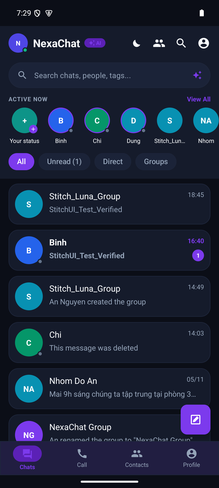</td>
<td>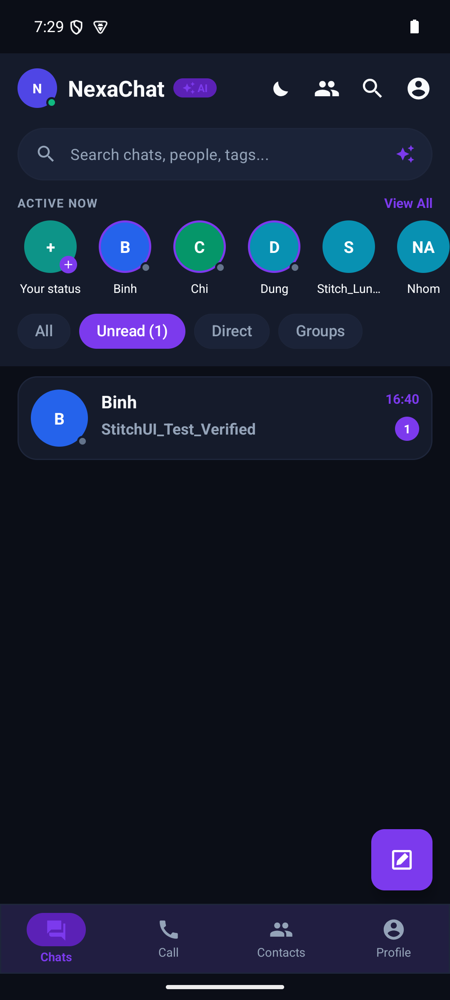</td>
<td>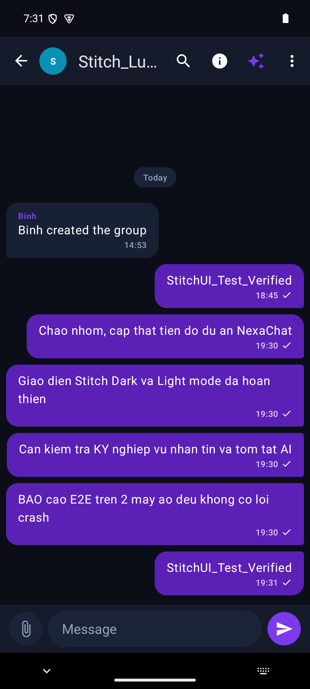</td>
<td>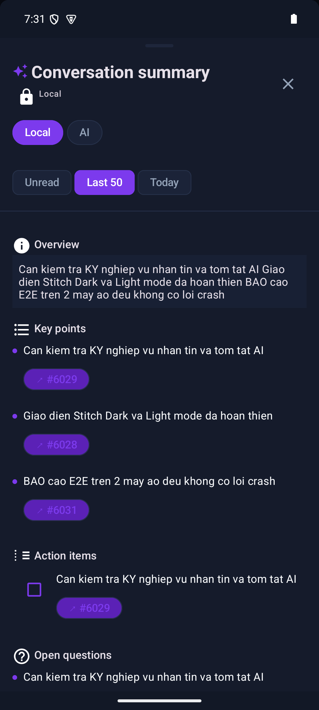</td>
<td>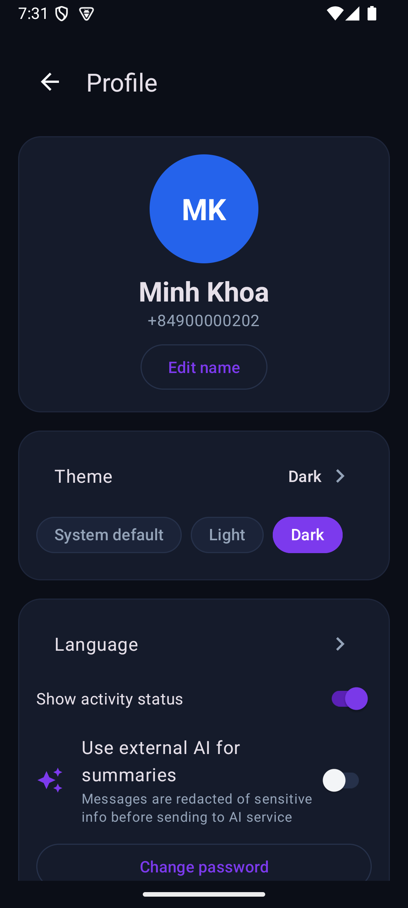</td>
</tr>
</table>

### Light Mode (`#F8FAFC`) & Core Workflows

<table>
<tr>
<td align="center"><b>Inbox (Light Mode)</b></td>
<td align="center"><b>Profile (Light Theme)</b></td>
<td align="center"><b>Contacts Stitch Cards</b></td>
<td align="center"><b>Create Group Flow</b></td>
<td align="center"><b>In-Chat Search</b></td>
</tr>
<tr>
<td>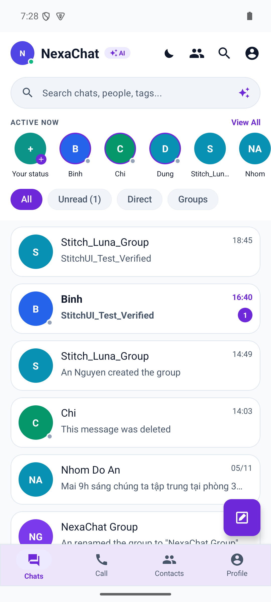</td>
<td>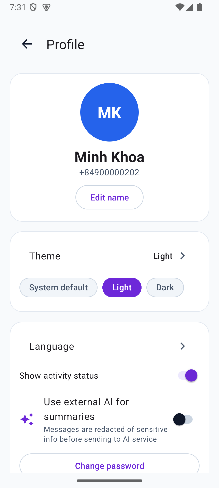</td>
<td>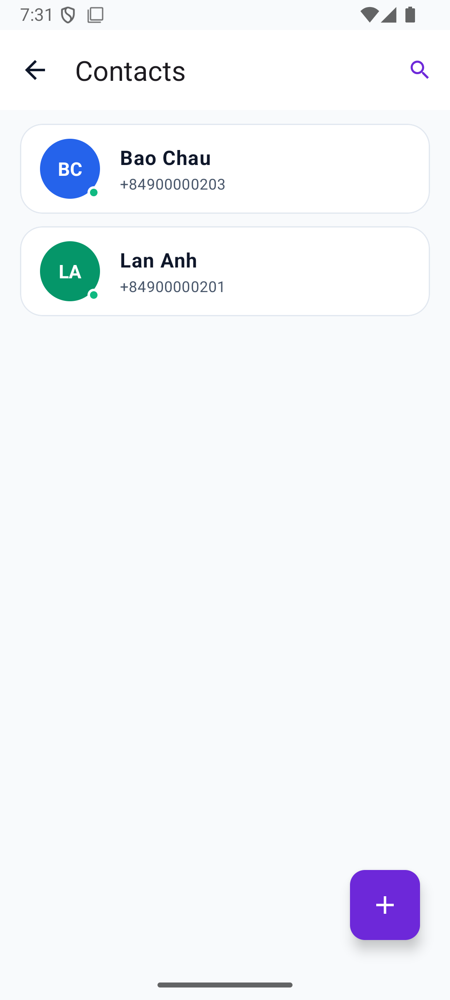</td>
<td>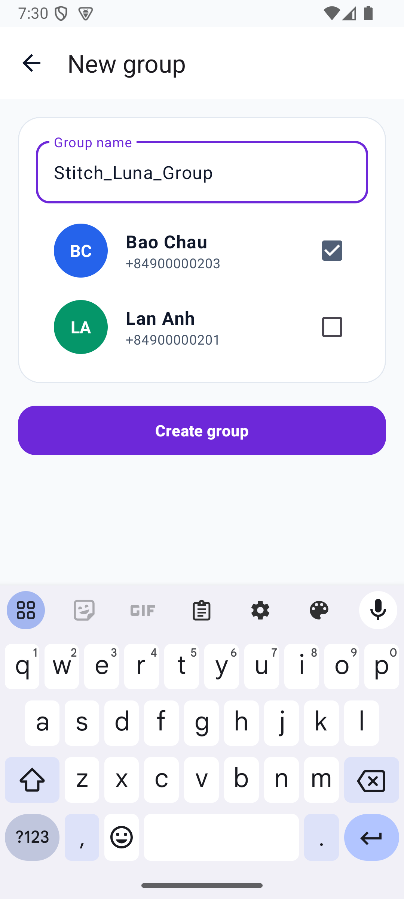</td>
<td>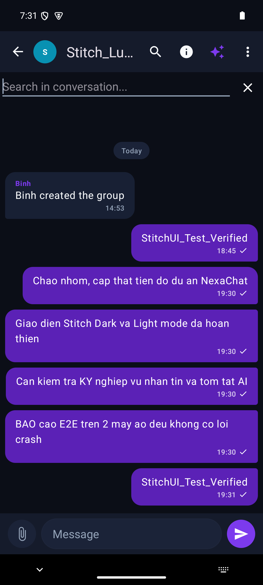</td>
</tr>
</table>

Direct and group chat, phone search, Vietnamese and English UI, light and dark theme, landscape chat, 1-to-1 voice calls, and a consent-gated summary (the local engine is on without consent; an external model is used only after the profile switch is agreed). Stack: pure Java 21 LTS on Android (XML Views, Material 3, Hilt, Room RxJava 3), Spring Boot 3.4, PostgreSQL 16, STOMP, WebRTC signaling.

## Quick start

Before the first start, copy `.env.example` to `.env` and replace the local
database password and JWT secret placeholders; see [docs/operations.md](docs/operations.md).

```bash
docker compose up -d db app                                    # backend + PostgreSQL 16
docker exec -i $(docker compose ps -q db) psql -U nexachat -d nexachat < demo/seed.sql
cd android && ./gradlew assembleDebug && adb install app/build/outputs/apk/debug/app-debug.apk
```

Health check: `curl http://localhost:8080/actuator/health` → `{"status":"UP"}`.
Setup, tests and the LAN demo: [CONTRIBUTING.md](CONTRIBUTING.md) ·
[docs/demo-runbook.md](docs/demo-runbook.md).

## Features

Capability and test-evidence traceability is maintained in
[docs/rtm.md](docs/rtm.md).

| Domain / Capability | Shipped | Where |
|---|---|---|
| Account & Auth | Register / login (E.164 phone, bcrypt 12), JWT + rotating refresh tokens with reuse detection, logout / logout-all, change password | `server/auth`, `app/feature/auth`, `core/storage` |
| Contacts & Discovery | Phone-number search, add/remove contact, alias names | `server/user`, `server/contact`, `app/feature/contacts` |
| Direct Chat & Offline Outbox | 1-1 messaging, optimistic send + outbox retry, read receipts, typing indicator, history paging | `server/message`, `server/ws`, `app/feature/chat` |
| Message Management & Search | Edit own text messages, soft-delete own messages, conversation-scoped text search, presence controls and direct-peer status | `server/message`, `server/presence`, `app/feature/chat`, `app/feature/profile` |
| Group Chat & Admin | Create group, add/remove/leave members, admin roles, rename, system messages | `server/conversation`, `app/feature/group` |
| Theme & Privacy Preferences | Local `SYSTEM` / `LIGHT` / `DARK` theme and server-backed show-presence preference | `core/ui`, `app/feature/profile`, `server/user` |
| Multimedia & File Sharing | Image/video/audio/file upload (magic-byte whitelist, 25MB), owner-or-member download authZ, viewer + ACTION_VIEW | `server/attachment`, `app/feature/media` |
| Bilingual Localization (Vi/En) | Vi/En resource parity: 221 string entries per locale (219 translatable; base, call and summary files), per-app locale (API 33+ native, <33 config-context) | `res/values*`, `core/common/AppLocaleManager` |
| State & Lifecycle Resilience | Room-as-SSOT, `SavedStateHandle` drafts, rotation-safe; chat draft/scroll survive process death (transient forms reset — see known-limitations) | `core/database`, `feature/*/ViewModel` |
| Rich Interactions (Reply, Reactions, Pins, Forward) | Reply/quote + emoji reactions (toggle) + pinned messages (≤3, group-admin), text-only forward | `server/message`, `app/feature/chat/ChatInteractionsViews.java`, `core/ui/ForwardFilter` |
| 1-to-1 Voice Calls (WebRTC) | 1-1 audio calls: STOMP signaling, ICE config, server call history, Android call screens, localized call log | `server/call`, `app/call` |
| AI Conversation Summary | Extractive local engine + optional DeepSeek LLM behind consent, citations, Android summary UI | `server/summary`, `app/summary`, `app/feature/summary` |
| Design System & Quality Gates | Material 3 Stitch Dark/Light themes, ≥48dp touch targets, shared state components, and automated server/client test suites | `core/ui`, `server/src/test`, `app/src/test` |

## Architecture

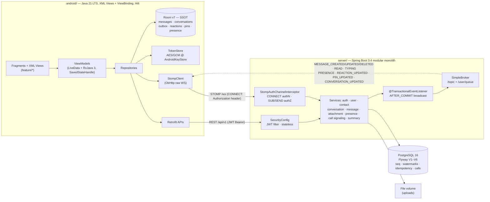

Two transport contracts, one enforcement point: REST `/api/v1` for
request/response (auth, search, attachments, history, resync) and
STOMP-over-WebSocket `/ws` for realtime push — both funnel through the same
services (`MessageService.send` serves the `@MessageMapping` and the REST
POST identically). Persist-before-broadcast: events fan out only
`AFTER_COMMIT`, so a received frame always describes a committed row. Client
side, Room is the only render source — WS frames are written through, never
rendered directly. Rationale and diagrams: [docs/architecture.md](docs/architecture.md) ·
[docs/websocket-protocol.md](docs/websocket-protocol.md) · [docs/api-contract.md](docs/api-contract.md).

## Tech stack

| Layer | Server (`server/`) | Android (`android/`) |
|---|---|---|
| Language | Java 21 LTS | Java 21 LTS |
| Framework | Spring Boot 3.4.1 (Web, WebSocket, Security, Data JPA, Validation, Actuator) | Material 3 + AppCompat, Navigation Component, Fragments, ViewBinding, RecyclerView `ListAdapter` |
| Auth/crypto | jjwt 0.12.6 (HS256), BCrypt cost 12, SHA-256 token hashes | AES/GCM/NoPadding via AndroidKeyStore |
| Realtime | spring-websocket + STOMP, SimpleBroker | OkHttp 4.12 WebSocket + own STOMP codec |
| Persistence | PostgreSQL 16, Flyway V1–V6, `ddl-auto: validate` | Room 2.6.1 (v7, RxJava 3, explicit migrations), RxDataStore, SharedPreferences |
| Files | `StorageService` abstraction, `MagicBytes` sniffing, 25MB cap | Glide 4.16, media3 1.5.1 |
| Other | libphonenumber 8.13.45, bucket4j 8.10.1 rate limiting | Hilt 2.52 (`annotationProcessor`), Retrofit 2.11 + Moshi, RxJava 3.1.9 |
| Build/test | Maven + failsafe (`*IT` @ `verify`), Testcontainers dep | Gradle 8.14.3 + version catalog (`libs.versions.toml`), JUnit 4 + Mockito + RxJava `TestObserver`/`TestSubscriber` |
| Deploy | Multi-stage `server/Dockerfile`, `docker-compose.yml` | `API_BASE_URL` via `local.properties`/`-PapiBaseUrl` |

Design system: tokens, component states and the Stitch→XML layout mapping are in
[docs/design/design-notes.md](docs/design/design-notes.md); live emulator
Stitch Dark & Light Mode showcase frames are indexed in
[docs/media/README.md](docs/media/README.md) ([docs/media/screens/](docs/media/screens/))
and [docs/design/screens/](docs/design/screens/).

## Prerequisites

| Tool | Version | Notes |
|---|---|---|
| JDK | 21 LTS (Temurin) | `java -version` |
| Maven | 3.9+ | system `mvn` (there is no `server/mvnw` wrapper) |
| Android SDK | minSdk 26 · targetSdk 35 | via Android Studio |
| Docker | recent | PostgreSQL + app image via `docker compose` |

## Quickstart — server

Before starting Compose, configure the root `.env` from `.env.example` as
described in [docs/operations.md](docs/operations.md).

**Containerized (everything in Docker):**

```bash
docker compose up -d db app   # builds server image on first run (~minutes)
```

**Dev (compose DB + local Maven, hot reload):**

```bash
docker compose up -d db       # PostgreSQL 16, host port 5433 → 5432
cd server
mvn spring-boot:run           # Flyway migrates on first boot
```

Health check: `curl http://localhost:8080/actuator/health` → `{"status":"UP"}`.
REST base: `http://localhost:8080/api/v1` · WebSocket: `ws://localhost:8080/ws`.
From the repository root, seed data (demo accounts below) is optional:

```sh
docker compose exec -T db psql -U nexachat -d nexachat < demo/seed.sql
```

With host `psql`, run this from the repository root instead:

```sh
psql -h localhost -p 5433 -U nexachat -d nexachat < demo/seed.sql
```

## Quickstart — android

1. Open `android/` in Android Studio (Hedgehog+).
2. Create `android/local.properties` (never committed):

   ```properties
   sdk.dir=<path-to-Android-SDK>
   # emulator → host loopback alias (default): http://10.0.2.2:8080
   # physical device on LAN → your laptop's IP:
   API_BASE_URL=http://192.168.x.x:8080
   ```

   (`API_BASE_URL` can also be passed as `./gradlew -PapiBaseUrl=…`; the value
   lands in `BuildConfig.API_BASE_URL`, `app/build.gradle` (`defaultConfig`).)

3. Build and install:

   ```bash
   cd android
   ./gradlew assembleDebug
   adb install app/build/outputs/apk/debug/app-debug.apk
   ```

   or just press ▶ in Android Studio. USB debugging alternative:
   `adb reverse tcp:8080 tcp:8080` then keep `localhost`/`10.0.2.2` as the host.

## Demo accounts

Seeded by `demo/seed.sql` — **demo only, never use these credentials elsewhere**:

| Phone | Name | Password |
|---|---|---|
| `+84900000001` | An | `password123` |
| `+84900000002` | Binh | `password123` |
| `+84900000003` | Chi | `password123` |
| `+84900000004` | Dung | `password123` |

The seed creates a DIRECT chat (An↔Binh), the GROUP "Nhom Do An", contacts and
unread badges; it is re-runnable (`ON CONFLICT DO NOTHING`). The demo runs
entirely on LAN — no internet needed; the ~8-minute script and preflight
checklist are in [docs/demo-runbook.md](docs/demo-runbook.md). Note the debug
build alone permits LAN cleartext — the release config blocks it
(`app/src/debug/res/xml/network_security_config.xml`).

## Running tests

```bash
# Server — unit tests plus integration tests against real PostgreSQL
cd server && mvn verify
#   unit loop only (faster, skips *IT):
cd server && mvn test

# Android — JVM unit tests
cd android && ./gradlew testDebugUnitTest
```

Integration tests (`*IT`, failsafe) run against real PostgreSQL — locally the
compose DB on `:5433` via `IT_DB_URL/IT_DB_USER/IT_DB_PASSWORD` env vars, in CI
the workflow's postgres service on `:5432` (`.github/workflows/ci.yml`).
Test counts and pass/fail status are revision-specific; use the current CI run
for release evidence. CI is configured to run the server and Android suites,
Android lint, and a committed-secret scan on every PR and push to
`main`/`develop`.

## Repo layout

```text
nexachat/
├─ android/   Pure Java 21 LTS app (XML Views, Fragments, ViewBinding, RxJava 3)
│  ├─ app/src/main/java/com/nexachat/
│  │  ├─ core/       common · database (Room RxJava 3) · network (Retrofit, stomp/) · storage · ui
│  │  ├─ call/       call core/media/service/UI (Java)
│  │  ├─ data/       repositories (Room write-through, outbox, resync; RxJava 3)
│  │  ├─ di/         Hilt modules (`annotationProcessor`)
│  │  ├─ feature/    auth · chat · contacts · group · inbox · interactions · media · profile · splash · summary
│  │  └─ summary/    summary ViewModel + repository wiring
│  ├─ app/src/main/res/layout/   ViewBinding XML layouts
│  ├─ app/schemas/   Room-exported schema JSON (migration-test assets)
│  └─ gradle/libs.versions.toml   # dependency version catalog
├─ server/    Spring Boot modular monolith (REST /api/v1 + STOMP /ws)
│  ├─ src/main/java/com/nexachat/{auth,user,contact,conversation,message,attachment,presence,call,summary,ws,common,config}/
│  ├─ src/main/resources/db/migration/V1–V6   # Flyway migrations
│  └─ Dockerfile + pom.xml
├─ docs/      contracts, security, runbooks, audits, architecture Q&A (index: docs/README.md)
│  ├─ design/       design tokens + Stitch references + live screenshots
│  ├─ media/        Stitch Dark & Light Mode showcase frames (docs/media/README.md)
│  ├─ screenshots/  feature evidence
│  └─ evidence/     local interaction captures (gitignored)
├─ demo/      seed.sql + LAN scripts (lan-up.sh / lan-up.ps1, backup.sh)
├─ tools/     build-report.py · sign-release.sh · package-submission.sh · check-markdown-links.py
├─ .github/   workflows/ci.yml · pull_request_template.md · ISSUE_TEMPLATE/
├─ README.md · CONTRIBUTING.md · CHANGELOG.md
└─ docker-compose.yml
```

## Documentation

The canonical, grouped index is [docs/README.md](docs/README.md). Key entry
points: [docs/architecture.md](docs/architecture.md) ·
[docs/api-contract.md](docs/api-contract.md) ·
[docs/websocket-protocol.md](docs/websocket-protocol.md) ·
[docs/calls.md](docs/calls.md) ·
[docs/ai-summary.md](docs/ai-summary.md) ·
[docs/security.md](docs/security.md) · [docs/rtm.md](docs/rtm.md) ·
[docs/media/README.md](docs/media/README.md) ·
[docs/demo-runbook.md](docs/demo-runbook.md) ·
[docs/viva-questions.md](docs/viva-questions.md) ·
[docs/known-limitations.md](docs/known-limitations.md) ·
[CONTRIBUTING.md](CONTRIBUTING.md) · [CHANGELOG.md](CHANGELOG.md).

## Contributing

Conventional commits (`feat(server/auth): …`, `fix(app/chat): …`), PR per
`feature/<scope>` branch into `develop`, ≥1 cross-review before squash merge.
Never commit secrets, keystores, `.env`, or `local.properties` — `.gitignore`
and the CI secret scan enforce this.

## License & status

NexaChat is designed and operated as a single-node real-time messaging deployment;
architectural trade-offs and non-goals (in-memory SimpleBroker topology, LAN
cleartext debug profile, and deferred E2EE/OTP/FCM integrations) are documented in
[docs/known-limitations.md](docs/known-limitations.md).
