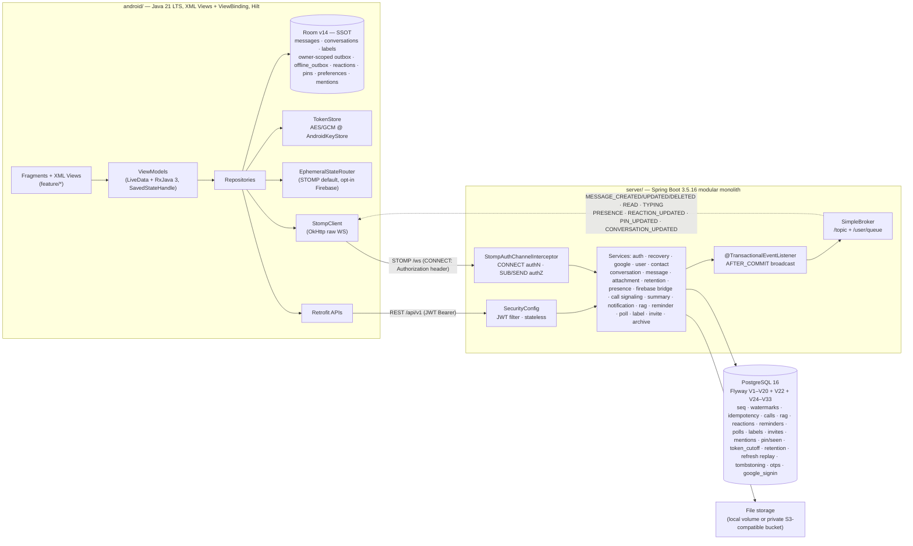

# NexaChat

**NexaChat** is a real-time Android messaging platform: register by phone number,
find and connect with other users, chat 1-1 and in groups over WebSocket/STOMP,
send media/files, edit and delete messages, search conversation history, react,
pin, reply and forward text — in a bilingual (Vi/En) Material 3 UI that keeps
message sending available offline.

> **Architecture at a glance:** 100% **Java 21 LTS** end-to-end — Android client
> (`XML Views`, `Fragments`, `ViewBinding`, `RxJava 3`, `Room v14`, `Hilt`, `Material 3`)
> paired with a **Spring Boot 3.5** modular monolith (`REST /api/v1`, `STOMP over WebSocket /ws`,
> **PostgreSQL 16** with Flyway `V1–V20` + `V22` + `V24–V33` (V21/V23 reserved), **WebRTC** 1-to-1 voice calls,
> Google sign-in (link-first on existing accounts; `POST /auth/google` can register when signup is enabled,
> public JWKS), email OTP recovery/deletion, self-service account deletion,
> consent-gated **AI conversation summaries**, conversation RAG with the Android “Ask this chat” entry,
> and optional Firebase ephemeral state (flags off, STOMP default)).
> Every architectural claim below links directly to its executable source and verification suite.

The Android sync consumer uses Room 14 and negotiates the upcoming sync v2
contract. Until the V32 server is integrated it explicitly uses legacy sync;
[client checkpoints and verification limits](docs/architecture/android-sync.md) describe that boundary.

## Demo & UI Showcase (Dark & Light Mode)

Captured live on `emulator-5554` (`nexachat-audit`) and `emulator-5556` (`campuscore-p07-native`) running the R8-minified release APK against the local Spring Boot 3 + PostgreSQL 16 backend. Full media index: [`docs/media/README.md`](docs/media/README.md).

**Historical UI captures** (pre–v1.2.4 palette): frames below still show the older Midnight Obsidian / Electric Violet look; the shipped app uses the plum Material 3 palette (seed `#733F68` — see [`docs/design/design-notes.md`](docs/design/design-notes.md)).

### Dark Mode — Midnight Obsidian (`#0B0E17`) & Electric Violet (`#7C3AED`) *(historical)*

<table>
<tr>
<td align="center"><b>Inbox & Active Now</b></td>
<td align="center"><b>Unread Filter Chip</b></td>
<td align="center"><b>Chat & Reactions</b></td>
<td align="center"><b>AI Conversation Summary</b></td>
<td align="center"><b>Profile (Dark Theme)</b></td>
</tr>
<tr>
<td></td>
<td></td>
<td></td>
<td></td>
<td></td>
</tr>
</table>

### Light Mode (`#F8FAFC`) & Core Workflows *(historical)*

<table>
<tr>
<td align="center"><b>Inbox (Light Mode)</b></td>
<td align="center"><b>Profile (Light Theme)</b></td>
<td align="center"><b>Contacts Directory</b></td>
<td align="center"><b>Create Group Flow</b></td>
<td align="center"><b>In-Chat Search</b></td>
</tr>
<tr>
<td></td>
<td></td>
<td></td>
<td></td>
<td></td>
</tr>
</table>

Direct and group chat, phone search, Vietnamese and English UI, light and dark theme, landscape chat, 1-to-1 voice calls, and a consent-gated summary (the local engine is on without consent; an external model is used only after the profile switch is agreed). Stack: pure Java 21 LTS on Android (XML Views, Material 3, Hilt, Room RxJava 3), Spring Boot 3.5.16, PostgreSQL 16, STOMP, WebRTC signaling.

## Quick start

Before the first start, copy `.env.example` to `.env` and replace the local
database password and JWT secret placeholders; see [docs/operations/operations.md](docs/operations/operations.md).

```bash
docker compose up -d db app                                    # backend + PostgreSQL 16
docker exec -i $(docker compose ps -q db) psql -U nexachat -d nexachat < demo/seed.sql
# android/local.properties must define sdk.dir before the first Gradle run (see Quickstart — android).
cd android && ./gradlew assembleDebug && adb install app/build/outputs/apk/debug/app-debug.apk
```

Windows (PowerShell): same Compose and seed steps; `.\demo\lan-up.ps1` automates backend + seed + LAN hints. For the app, set `sdk.dir` in `android\local.properties`, then `cd android; .\gradlew.bat assembleDebug; adb install app\build\outputs\apk\debug\app-debug.apk`.

Health check: `curl http://localhost:8080/actuator/health` → `{"status":"UP"}`.
Pre-built APK download: [nexachat.io.vn/download.html](https://nexachat.io.vn/download.html) · [GitHub Releases](https://github.com/JasonTM17/Nexachat_AppJ/releases).
Setup, testing and deployment guides: [CONTRIBUTING.md](CONTRIBUTING.md) ·
[docs/operations/operations.md](docs/operations/operations.md).

## Features

Architecture, protocol contracts, and security boundaries are documented in
[docs/README.md](docs/README.md).

| Domain / Capability | Shipped | Where |
|---|---|---|
| Account & Auth | Register / login (E.164 phone, bcrypt 12), JWT + rotating refresh tokens with reuse detection, logout / logout-all, change password, access-token revocation cutoff (`tokens_valid_after`, V11), keyed refresh replay (V25) | `server/auth`, `app/feature/auth`, `core/storage` |
| Google Sign-In | Link-first OpenID Connect via Google's public JWKS; `POST /auth/google` also registers when `NEXACHAT_GOOGLE_SIGNUP_ENABLED=true` (V28/V33); client IDs from env; single-use nonces; Android Credential Manager | `server/auth/google`, `app/core/auth`, `docs/operations/operations.md`, `docs/quality/known-limitations.md` |
| Account Recovery & Email OTP | Recovery email verification, password reset OTP, account deletion OTP via HMAC-SHA256 digests (V27), cooldown & rate limits, pluggable `MailSender` (SMTP, Resend, local Mailpit for dev) | `server/recovery`, `server/mail`, `app/feature/profile`, `docs/operations/operations.md` |
| Self-Service Account Deletion | Soft-delete / tombstoning (V26), E.164 phone released for re-registration, session invalidation, group auto-leave with admin promotion, PII/avatar scrubbed, historical messages preserved under neutral `Deleted account` label; in-app (`DELETE /api/v1/users/me`) and web flow (`site/delete-account.html`) | `server/user`, `site/delete-account.html`, `app/feature/profile`, `docs/operations/operations.md` |
| Realtime & Ephemeral Routing | STOMP over WebSocket as default for presence, typing, delivery/read receipts; candidate Firebase RTDB bridge and projections (flags off by default, STOMP fallback via `EphemeralStateRouter`) | `server/firebase`, `app/core/realtime/ephemeral`, `docs/architecture/firebase-realtime.md` |
| Static Site & App Links | Bilingual static site on Vercel with Digital Asset Links (`.well-known/assetlinks.json`), self-service web account deletion (`site/delete-account.html`), strict CSP, and repo-owned Vercel build-skip `ignoreCommand` | `site/`, `site/vercel.json`, `docs/operations/domain-and-app-links.md`, `site/README.md` |
| Contacts & Discovery | Phone-number search, add/remove contact, alias names | `server/user`, `server/contact`, `app/feature/contacts` |
| Direct Chat & Offline Outbox | 1-1 messaging, optimistic send, account-scoped durable offline outbox (Room v14) with WorkManager drain, caller-owned inbox labels, 2-tick delivery & read receipts, delta sync with `reaction_events` (V10), typing indicator, history paging | `server/message`, `server/ws`, `app/feature/chat`, `app/data` |
| Message Management & Search | Edit own text messages, soft-delete own messages, conversation-scoped text search accelerated by GIN trigram index (V8), presence controls and direct-peer status | `server/message`, `server/presence`, `app/feature/chat`, `app/feature/profile` |
| Conversation Archive | Member-scoped browser for conversation media, files and links, with filters and keyset paging | `server/archive`, `app/feature/archive` |
| Conversation Preferences | Per-member mute/archive and per-conversation AI opt-out (V12/V13), with Android inbox and chat controls | `server/conversation`, `server/summary`, `app/feature/inbox`, `app/feature/chat` |
| Conversation Pin & Seen Privacy | Per-member conversation pin (≤5) and the reciprocal "hidden seen" switch (V16); inbox pin long-press and profile `showSeen` toggle | `server/conversation`, `server/user`, `app/feature/inbox`, `app/feature/profile` |
| Shared Reminders | Shared recurring reminders with durable FCM delivery (V14) and an Android board | `server/reminder`, `app/feature/reminder` |
| Group Polls | Group polls with voting and a versioned change feed (V15) and an Android board | `server/poll`, `app/feature/poll` |
| Group Mentions & @all | Structured group mentions and admin `mentionAll` (V17); Android composer picker and highlight spans | `server/message`, `app/feature/chat` |
| Conversation Labels | Private per-user labels with per-conversation assignment (V18); Android label dialog | `server/label`, `app/feature/label` |
| Group Invite Links | Hashed invite links, safe preview, join requests and admin approval (V20), with Android manage/join screens | `server/invite`, `app/feature/invite` |
| Message Recall Window | Server-enforced 24 h author recall window with `409 RECALL_WINDOW_EXPIRED`; Android recall action in chat overflow | `server/message`, `app/feature/chat` |
| Muted Push Policy | `NEW_MESSAGE` pushes are muted, with exceptions for mentions/@all, events about the recipient and `CALL_INVITE` | `server/notification`, `docs/operations/operations.md` |
| Group Chat & Admin | Create group, add/remove/leave members, admin roles, rename, system messages | `server/conversation`, `app/feature/group` |
| Theme & Privacy Preferences | Local `SYSTEM` / `LIGHT` / `DARK` theme and server-backed show-presence preference | `core/ui`, `app/feature/profile`, `server/user` |
| Multimedia & File Sharing | Image compression (1920px bound, GPS scrub), BlurHash placeholders (V8), authenticated Glide + 2GB cache, Range downloads (206/416), ISO-BMFF track sniffing (`audio/mp4` voice notes), inline voice player with waveform, 25MB cap | `server/attachment`, `app/feature/media`, `app/feature/chat/voice` |
| Keyset Inbox Paging | 30 conversations per page with keyset cursors, full-walk pruning, retry, and scroll-position anchoring | `server/conversation`, `app/data/ConversationRepository`, `app/feature/inbox` |
| Bilingual Localization (Vi/En) | English/Vietnamese resource parity and per-app locale (API 33+ native, <33 config-context) | `res/values*`, `core/common/AppLocaleManager` |
| State & Lifecycle Resilience | Room-as-SSOT, `SavedStateHandle` drafts, rotation-safe; chat draft/scroll survive process death (transient forms reset — see known-limitations) | `core/database`, `feature/*/ViewModel` |
| Rich Interactions (Reply, Reactions, Pins, Forward) | Reply/quote + emoji reactions with server idempotency (`PUT`/`DELETE`, V10) + pinned messages (≤3, group-admin), text-only forward | `server/message`, `app/feature/chat/ChatInteractionsViews.java`, `core/ui/ForwardFilter` |
| 1-to-1 Voice Calls (WebRTC) | 1-1 audio calls: STOMP signaling, ICE config, server call history, Android call screens with dark gradient and pulse ring, localized call log | `server/call`, `app/call` |
| AI Conversation Summary | Extractive local engine + optional OpenAI-compatible LLM (Gemini primary `gemini-3.1-flash-lite`, DeepSeek `deepseek-flash` fallback) behind consent, citations, Android summary UI | `server/summary`, `app/summary`, `app/feature/summary` |
| Conversation RAG ("Ask this chat") | Server-side QA API (`POST /conversations/{id}/ask`, V9), Android Ask screen, hybrid BM25 + vector search, MMR diversification, citation validation, local lexical fallback, admin-only telemetry `/rag/stats` | `server/rag`, `app/feature/ask`, `docs/architecture/rag.md`, `tools/rag-eval` |
| Push Notifications | FCM HTTP v1 OAuth2 service-account authentication (server), Android device token registration and persisted sync cursor | `server/notification`, `app/notification` |
| Design System & Quality Gates | Material 3 Dark/Light themes, ≥48dp touch targets, shared state components, automated server/client test suites, R8 mapping check (`tools/checks/check-release-r8-mapping.py`), site tests (`site/check.py`, `tools/site-tests`), and markdown link check | `core/ui`, `server/src/test`, `app/src/test`, `docs/quality/testing.md` |

## Architecture



Two transport contracts, one enforcement point: REST `/api/v1` for
request/response (auth, search, attachments, history, resync) and
STOMP-over-WebSocket `/ws` for realtime push — both funnel through the same
services (`MessageService.send` serves the `@MessageMapping` and the REST
POST identically). Persist-before-broadcast: events fan out only
`AFTER_COMMIT`, so a received frame always describes a committed row. Client
side, Room is the only render source — WS frames are written through, never
rendered directly. Rationale and diagrams: [docs/architecture/architecture.md](docs/architecture/architecture.md) ·
[docs/architecture/websocket-protocol.md](docs/architecture/websocket-protocol.md) · [docs/architecture/api-contract.md](docs/architecture/api-contract.md).

## Tech stack

| Layer | Server (`server/`) | Android (`android/`) |
|---|---|---|
| Language | Java 21 LTS | Java 21 LTS |
| Framework | Spring Boot 3.5.16 (Web, WebSocket, Security, Data JPA, Validation, Actuator) | Material 3 + AppCompat, Navigation Component, Fragments, ViewBinding, RecyclerView `ListAdapter` |
| Auth/crypto | jjwt 0.12.6 (HS256), BCrypt cost 12, SHA-256 token hashes, Google OpenID Connect (public JWKS), HMAC-SHA256 OTPs | AES/GCM/NoPadding via AndroidKeyStore, Credential Manager |
| Realtime | spring-websocket + STOMP (default), optional Firebase RTDB bridge | OkHttp 4.12 WebSocket + STOMP, EphemeralStateRouter |
| Persistence | PostgreSQL 16, Flyway V1–V20 + V22 + V24–V33, `ddl-auto: validate` | Room 2.6.1 (v14, exported schemas 6–14, RxJava 3, explicit migrations), RxDataStore, SharedPreferences |
| Files | `StorageService` abstraction, `MagicBytes` sniffing, 25MB cap, Range downloads, BlurHash | Glide 4.16, Media3 1.5.1 |
| Other | libphonenumber 8.13.45, bucket4j 8.10.1 rate limiting | Hilt 2.52 (`annotationProcessor`), Retrofit 2.11 + Moshi, RxJava 3.1.9 |
| Build/test | Maven + failsafe (`*IT` @ `verify`), Testcontainers dep | Gradle 8.14.3 + AGP 8.9.3 + version catalog (`libs.versions.toml`), JUnit 4 + Mockito + RxJava `TestObserver`/`TestSubscriber` |
| Deploy | Multi-stage `server/Dockerfile`, `docker-compose.yml` | `API_BASE_URL` via `local.properties`/`-PapiBaseUrl` |

Design system: tokens, component states and the XML layout mapping are in
[docs/design/design-notes.md](docs/design/design-notes.md); live emulator
Dark & Light Mode showcase frames are indexed in
[docs/media/README.md](docs/media/README.md) ([docs/media/screens/](docs/media/screens)).

## Prerequisites

| Tool | Version | Notes |
|---|---|---|
| JDK | 21 LTS (Temurin) | `java -version`. Server requires JDK 21+ (`sourceCompatibility 21`). Android Gradle requires JDK 21+ (`android/gradle.properties`, `compileOptions VERSION_21`). |
| Maven | 3.9+ | system `mvn` (there is no `server/mvnw` wrapper) |
| Android Studio | current stable | Supports AGP 8.9.3 (`android/gradle/libs.versions.toml`); Hedgehog and older are too old. |
| Android SDK | minSdk 26 · targetSdk 36 (compileSdk 36) | `sdk.dir` in `android/local.properties` |
| Docker | recent | PostgreSQL + app image via `docker compose` |

## Quickstart — server

Before starting Compose, configure the root `.env` from `.env.example` as
described in [docs/operations/operations.md](docs/operations/operations.md).

**Containerized (everything in Docker):**

```bash
docker compose up -d db app   # builds server image on first run (~minutes)
```

**Dev (compose DB + local Maven, hot reload):**

```bash
docker compose up -d db       # PostgreSQL 16, host port 5433 → 5432
cd server
mvn spring-boot:run           # Flyway migrates on first boot
```

For testing email OTP recovery and deletion locally without external SMTP credentials,
run local [Mailpit](https://github.com/axllent/mailpit) (`docker run -d --name mailpit -p 1025:1025 -p 8025:8025 axllent/mailpit`)
and set `NEXACHAT_MAIL_PROVIDER=smtp`, `MAIL_SMTP_HOST=localhost`, `MAIL_SMTP_PORT=1025` in `.env`.
Open `http://localhost:8025` to view incoming OTP codes. Google sign-in is disabled by default
(`NEXACHAT_GOOGLE_SIGNIN_ENABLED=false`); see [docs/operations/operations.md](docs/operations/operations.md) for enabling it with public JWKS validation.

Health check: `curl http://localhost:8080/actuator/health` → `{"status":"UP"}`.
REST base: `http://localhost:8080/api/v1` · WebSocket: `ws://localhost:8080/ws`.
From the repository root, seed data (demo accounts below) is optional:

```sh
docker compose exec -T db psql -U nexachat -d nexachat < demo/seed.sql
```

With host `psql`, run this from the repository root instead:

```sh
psql -h localhost -p 5433 -U nexachat -d nexachat < demo/seed.sql
```

## Quickstart — android

1. Open `android/` in a current Android Studio release that supports AGP 8.9.3 (not Hedgehog or older).
2. Create `android/local.properties` (never committed):

   ```properties
   sdk.dir=<path-to-Android-SDK>
   # emulator → host loopback alias (default): http://10.0.2.2:8080
   # physical device on LAN → your laptop's IP:
   API_BASE_URL=http://192.168.x.x:8080
   # Optional: Google Web OAuth client ID (empty hides Google sign-in buttons):
   GOOGLE_WEB_CLIENT_ID=
   ```

   (`API_BASE_URL` can also be passed as `./gradlew -PapiBaseUrl=…` and Google client ID as
   `-PgoogleWebClientId=…`. Realtime defaults to STOMP over WebSocket; optional Firebase
   ephemeral state is disabled by default via `-PfirebaseRealtimeEnabled=false`.)

3. Build and install:

   ```bash
   cd android
   ./gradlew assembleDebug
   adb install app/build/outputs/apk/debug/app-debug.apk
   ```

   or just press ▶ in Android Studio. USB debugging alternative:
   `adb reverse tcp:8080 tcp:8080` then keep `localhost`/`10.0.2.2` as the host.

   To install pre-built release APKs without building from source, download the signed package from [nexachat.io.vn/download.html](https://nexachat.io.vn/download.html) or [GitHub Releases](https://github.com/JasonTM17/Nexachat_AppJ/releases).

## Demo accounts

Seeded by `demo/seed.sql` — **demo only, never use these credentials elsewhere**:

| Phone | Name | Password |
|---|---|---|
| `+84900000001` | An | `password123` |
| `+84900000002` | Binh | `password123` |
| `+84900000003` | Chi | `password123` |
| `+84900000004` | Dung | `password123` |

The seed creates a DIRECT chat (An↔Binh), a sample group conversation, contacts and
unread badges; it is re-runnable (`ON CONFLICT DO NOTHING`). The local stack runs
entirely on LAN — no internet needed; runtime setup and backup notes are in
[docs/operations/operations.md](docs/operations/operations.md). Note the debug
build and the local-smoke variant permit LAN cleartext — release blocks it
(`app/src/main/res/xml/network_security_config.xml`).

## Running tests

```bash
# Server — unit tests plus PollFlowTest against real PostgreSQL
cd server && mvn test
# Full server suite, including *IT integration tests:
cd server && mvn verify

# Android — JVM unit tests
cd android && ./gradlew testDebugUnitTest

# Android release R8 keep-rule reflection verification
python tools/checks/check-release-r8-mapping.py

# Static site checks and JavaScript unit tests
python site/check.py
cd tools/site-tests && npm test

# Firebase rules offline emulator contract suite
cd tools/firebase-rules && npm test

# Markdown relative link verification
python tools/checks/check-markdown-links.py

# RAG benchmark evaluation (synthetic corpus)
bash tools/rag-eval/run-benchmark.sh
```

Configure a dedicated test database with `IT_DB_URL`, `IT_DB_USER` and
`IT_DB_PASSWORD`; see [docs/quality/testing.md](docs/quality/testing.md) for the setup and
concurrent-run guidance. CI runs the server and Android suites, Android lint,
and a committed-secret scan on every PR and push to `main`/`develop`.

## Repo layout

```text
nexachat/
├─ android/   Pure Java 21 LTS app (XML Views, Fragments, ViewBinding, RxJava 3)
│  ├─ app/src/main/java/com/nexachat/
│  │  ├─ core/       auth (Google sign-in) · common · database (Room RxJava 3) · network · storage · ui · realtime/ephemeral
│  │  ├─ call/       call core/media/service/UI (Java)
│  │  ├─ data/       repositories (Room write-through, outbox, resync; RxJava 3)
│  │  ├─ di/         Hilt modules (`annotationProcessor`)
│  │  ├─ feature/    auth · chat · contacts · group · inbox · archive · ask · invite · label · poll · reminder · groupboard · media · profile · splash · summary
│  │  └─ summary/    summary ViewModel + repository wiring
│  ├─ app/src/main/res/layout/   ViewBinding XML layouts
│  ├─ app/schemas/   Room-exported schema JSON (migration-test assets)
│  └─ gradle/libs.versions.toml   # dependency version catalog
├─ server/    Spring Boot modular monolith (REST /api/v1 + STOMP /ws)
│  ├─ src/main/java/com/nexachat/{auth,user,contact,conversation,message,attachment,retention,presence,call,summary,notification,rag,reminder,poll,label,invite,archive,observability,recovery,firebase,mail,ws,common,config}/
│  ├─ src/main/resources/db/migration/V1–V20, V22, V24–V33 # Flyway migrations
│  └─ Dockerfile + pom.xml
├─ site/      Static site on Vercel (delete-account web flow, assetlinks, check.py, vercel.json)
├─ docs/      audience-grouped documentation (index: docs/README.md)
│  ├─ architecture/   system design, REST/STOMP/RTC/AI contracts
│  ├─ operations/     local Compose, deploy, runbooks, backups, observability
│  ├─ release/         Play Store, Android CI release, release checklist
│  ├─ quality/        security architecture, testing gates, known limitations
│  ├─ archive/        historical survey notes (TECHNICAL_ROADMAP, TEST_*)
│  ├─ release-notes/   per-tag operator notes (release tooling reads this path)
│  ├─ design/         design tokens + design-system references
│  ├─ media/          Dark & Light Mode showcase frames
│  └─ evidence/       local interaction captures (gitignored)
├─ demo/      seed.sql + LAN bootstrap scripts (lan-up.sh / lan-up.ps1, backup.sh)
├─ tools/     checks/ · release/ · ops/ · demo/ · backup/ · domain/ · e2e/ · firebase-rules/ · perf/ · site-tests/ · rag-eval/ · summary-eval/
├─ .github/   workflows/ci.yml · pull_request_template.md · ISSUE_TEMPLATE/
├─ README.md · CONTRIBUTING.md · CHANGELOG.md
└─ docker-compose.yml
```

## Documentation

The canonical, grouped index is [docs/README.md](docs/README.md). Key entry
points: [docs/architecture/architecture.md](docs/architecture/architecture.md) ·
[docs/architecture/api-contract.md](docs/architecture/api-contract.md) ·
[docs/architecture/websocket-protocol.md](docs/architecture/websocket-protocol.md) ·
[docs/architecture/calls.md](docs/architecture/calls.md) ·
[docs/architecture/ai-summary.md](docs/architecture/ai-summary.md) ·
[docs/quality/security.md](docs/quality/security.md) ·
[docs/operations/operations.md](docs/operations/operations.md) ·
[docs/architecture/firebase-realtime.md](docs/architecture/firebase-realtime.md) ·
[docs/operations/domain-and-app-links.md](docs/operations/domain-and-app-links.md) ·
[docs/release/play-store-data-safety.md](docs/release/play-store-data-safety.md) ·
[docs/quality/testing.md](docs/quality/testing.md) ·
[docs/release/release-checklist.md](docs/release/release-checklist.md) ·
[site/README.md](site/README.md) ·
[docs/media/README.md](docs/media/README.md) ·
[docs/quality/known-limitations.md](docs/quality/known-limitations.md) ·
[CONTRIBUTING.md](CONTRIBUTING.md) · [CHANGELOG.md](CHANGELOG.md).

## Contributing

Conventional commits (`feat(server/auth): …`, `fix(app/chat): …`), PR per
`feature/<scope>` branch into `main`, ≥1 cross-review before squash merge.
Never commit secrets, keystores, `.env`, or `local.properties` — `.gitignore`
and the CI secret scan enforce this. For vulnerability reports, follow
[SECURITY.md](SECURITY.md) and report privately through GitHub.

## License & status

Released under the [MIT License](LICENSE).

NexaChat is designed and operated as a single-node real-time messaging deployment;
architectural trade-offs and non-goals (in-memory SimpleBroker topology, LAN
cleartext debug/localSmoke profiles, and external credentials required for live FCM delivery, E2EE, and OTP) are documented in
[docs/quality/known-limitations.md](docs/quality/known-limitations.md).
