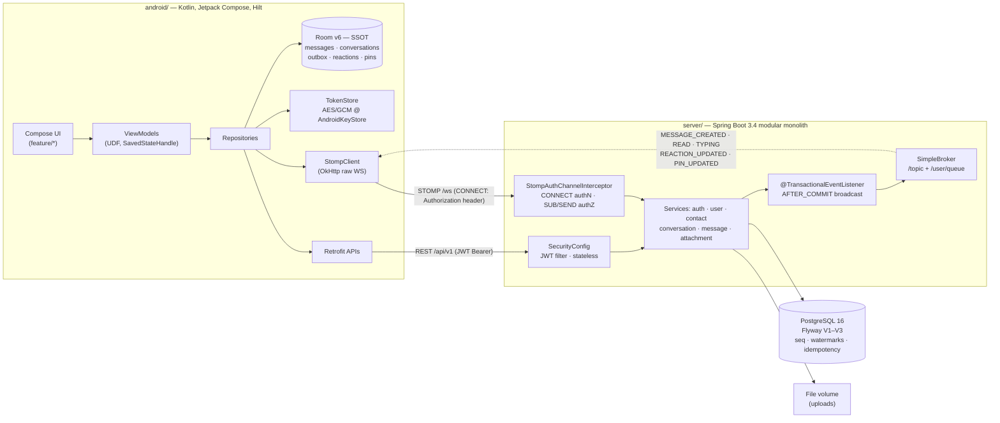

# NexaChat

**NexaChat** is a real-time Android messaging platform: register by phone number,
find and connect with other users, chat 1-1 and in groups over WebSocket/STOMP,
send media/files, react, pin and reply — in a bilingual (Vi/En) Material 3 UI
that keeps working offline.

> Đồ án nhóm (course group project) · Kotlin + Jetpack Compose (client) ·
> Java + Spring Boot (server) · PostgreSQL · STOMP over raw WebSocket.
> Built for a viva defense — every design claim cites shipped code.

## Features

Rubric coverage — the full mapping with test evidence is in
[docs/rtm.md](docs/rtm.md).

| Rubric | Shipped | Where |
|---|---|---|
| R2 — account management | Register / login (E.164 phone, bcrypt 12), JWT + rotating refresh tokens with reuse detection, logout / logout-all, change password | `server/auth`, `app/feature/auth`, `core/storage` |
| R2 — contacts | Phone-number search, add/remove contact, alias names | `server/user`, `server/contact`, `app/feature/contacts` |
| R2 — direct chat | 1-1 messaging, optimistic send + outbox retry, read receipts, typing indicator, history paging | `server/message`, `server/ws`, `app/feature/chat` |
| R2 — group chat | Create group, add/remove/leave members, admin roles, rename, system messages | `server/conversation`, `app/feature/group` |
| R3 — multimedia/files | Image/video/audio/file upload (magic-byte whitelist, 25MB), owner-or-member download authZ, viewer + ACTION_VIEW | `server/attachment`, `app/feature/media` |
| R3 — i18n | Full Vi/En parity (86/86 strings), per-app locale (API 33+ native, <33 config-context) | `res/values*`, `core/common/LocaleManager` |
| R3 — rotation/state | Room-as-SSOT, `SavedStateHandle` drafts, zero state loss on rotation/process death | `core/database`, `feature/*/ViewModel` |
| R4 — creative | Reply/quote + emoji reactions (toggle) + pinned messages (≤3, group-admin) | `server/message` (V3), `app/feature/chat/ChatInteractions` |
| R5 — UI + tests | Material 3, ≥48dp touch targets, shared state components; 287 server + 165 Android tests | `core/ui`, `server/src/test`, `app/src/test` |
| R6 — presentation | This README, `docs/`, viva question bank | `docs/viva-questions.md` |
| R1 — submission | Monorepo + packaging checklist | `docs/packaging-checklist.md` |

## Architecture



Two transport contracts, one enforcement point: REST `/api/v1` for
request/response (auth, search, attachments, history, resync) and
STOMP-over-WebSocket `/ws` for realtime push — both funnel through the same
services (`MessageService.send` serves the `@MessageMapping` and the REST
POST identically). Persist-before-broadcast: events fan out only
`AFTER_COMMIT`, so a received frame always describes a committed row. Client
side, Room is the only render source — WS frames are written through, never
rendered directly. Rationale and diagrams: [docs/architecture.md](docs/architecture.md) ·
[docs/websocket-protocol.md](docs/websocket-protocol.md) · [docs/api-contract.md](docs/api-contract.md).

## Tech stack

| Layer | Server (`server/`) | Android (`android/`) |
|---|---|---|
| Language | Java 17 | Kotlin 2.0.21 |
| Framework | Spring Boot 3.4.1 (Web, WebSocket, Security, Data JPA, Validation, Actuator) | Jetpack Compose (BOM 2024.12.01) + Material 3, Navigation |
| Auth/crypto | jjwt 0.12.6 (HS256), BCrypt cost 12, SHA-256 token hashes | AES/GCM/NoPadding via AndroidKeyStore |
| Realtime | spring-websocket + STOMP, SimpleBroker | OkHttp 4.12 WebSocket + own STOMP codec |
| Persistence | PostgreSQL 16, Flyway V1–V3, `ddl-auto: validate` | Room 2.6.1 (v3, explicit migrations), DataStore Preferences |
| Files | `StorageService` abstraction, `MagicBytes` sniffing, 25MB cap | Coil 2.7, media3 1.5.1 |
| Other | libphonenumber 8.13.45, bucket4j 8.10.1 rate limiting | Hilt 2.52 DI, Retrofit 2.11 + Moshi, coroutines 1.9 |
| Build/test | Maven + failsafe (`*IT` @ `verify`), Testcontainers dep | Gradle + version catalog, JUnit4/MockK/Turbine |
| Deploy | Multi-stage `server/Dockerfile`, `docker-compose.yml` | `API_BASE_URL` via `local.properties`/`-PapiBaseUrl` |

## Prerequisites

| Tool | Version | Notes |
|---|---|---|
| JDK | 17 (Temurin) | `java -version` |
| Maven | 3.9+ | or use `./mvnw` in `server/` |
| Android SDK | minSdk 26 · targetSdk 35 | via Android Studio |
| Docker | recent | PostgreSQL + app image via `docker compose` |

## Quickstart — server

**Containerized (everything in Docker):**

```bash
docker compose up -d db app   # builds server image on first run (~minutes)
```

**Dev (compose DB + local Maven, hot reload):**

```bash
docker compose up -d db       # PostgreSQL 16, host port 5433 → 5432
cd server
./mvnw spring-boot:run        # Flyway migrates on first boot
```

Health check: `curl http://localhost:8080/actuator/health` → `{"status":"UP"}`.
REST base: `http://localhost:8080/api/v1` · WebSocket: `ws://localhost:8080/ws`.
Seed data (demo accounts below) is optional: 
`docker exec -i nexachat-db-1 psql -U nexachat -d nexachat < demo/seed.sql`
(host `psql`: add `-p 5433`).

## Quickstart — android

1. Open `android/` in Android Studio (Hedgehog+).
2. Create `android/local.properties` (never committed):

   ```properties
   sdk.dir=C:\\Users\\<you>\\AppData\\Local\\Android\\Sdk
   # emulator → host loopback alias (default): http://10.0.2.2:8080
   # physical device on LAN → your laptop's IP:
   API_BASE_URL=http://192.168.x.x:8080
   ```

   (`API_BASE_URL` can also be passed as `./gradlew -PapiBaseUrl=…`; the value
   lands in `BuildConfig.API_BASE_URL`, `app/build.gradle.kts:13-35`.)

3. Build and install:

   ```bash
   cd android
   ./gradlew assembleDebug
   adb install app/build/outputs/apk/debug/app-debug.apk
   ```

   or just press ▶ in Android Studio. USB debugging alternative:
   `adb reverse tcp:8080 tcp:8080` then keep `localhost`/`10.0.2.2` as the host.

## Demo accounts

Seeded by `demo/seed.sql` — **demo only, never use these credentials elsewhere**:

| Phone | Name | Password |
|---|---|---|
| `+84900000001` | An | `password123` |
| `+84900000002` | Binh | `password123` |
| `+84900000003` | Chi | `password123` |
| `+84900000004` | Dung | `password123` |

The seed creates a DIRECT chat (An↔Binh), the GROUP "Nhom Do An", contacts and
unread badges; it is re-runnable (`ON CONFLICT DO NOTHING`). The demo runs
entirely on LAN — no internet needed; the ~8-minute script and preflight
checklist are in [docs/demo-runbook.md](docs/demo-runbook.md). Note the debug
build alone permits LAN cleartext — the release config blocks it
(`app/src/debug/res/xml/network_security_config.xml`).

## Running tests

```bash
# Server — full gate: 258 unit tests + 26 integration tests (real Postgres)
cd server && mvn verify
#   unit loop only (faster, skips *IT):
cd server && mvn test

# Android — 165 JVM unit tests
cd android && ./gradlew testDebugUnitTest
```

Integration tests (`*IT`, failsafe) run against real PostgreSQL — locally the
compose DB on `:5433` via `IT_DB_URL/IT_DB_USER/IT_DB_PASSWORD` env vars, in CI
the workflow's postgres service on `:5432` (`.github/workflows/ci.yml`).
Current counts: **287 server tests + 165 Android tests, all green.** CI runs
both suites plus a committed-secret scan on every PR and push to
`main`/`develop` — the suite must stay green to merge.

## Repo layout

```text
nexachat/
├─ android/   Kotlin + Jetpack Compose app
│  ├─ app/src/main/java/com/nexachat/
│  │  ├─ core/       database (Room), network (Retrofit, stomp/), storage, ui
│  │  ├─ data/      repositories (Room write-through, outbox, resync)
│  │  └─ feature/   auth · inbox · contacts · chat · group · media · profile · splash
│  └─ gradle/libs.versions.toml   # dependency versions (catalog)
├─ server/    Spring Boot modular monolith (REST /api/v1 + STOMP /ws)
│  ├─ src/main/java/com/nexachat/{auth,user,contact,conversation,message,
│  │                                attachment,ws,common,config}/
│  ├─ src/main/resources/db/migration/V1–V3   # Flyway schema
│  └─ Dockerfile + pom.xml
├─ docs/      contracts, security, runbooks, audits, viva bank (index below)
├─ demo/      seed.sql + LAN scripts
├─ tools/     build-report.py · sign-release.sh · package-submission.sh
└─ .github/workflows/ci.yml
```

## Documentation index

| Doc | Contents |
|---|---|
| [docs/architecture.md](docs/architecture.md) | Container/component diagrams, module rationale |
| [docs/api-contract.md](docs/api-contract.md) | Every REST endpoint, request/response shapes |
| [docs/websocket-protocol.md](docs/websocket-protocol.md) | STOMP destinations, envelope, delivery guarantees |
| [docs/security.md](docs/security.md) | Security narrative — auth, authZ, storage, rate limits |
| [docs/security-checklist.md](docs/security-checklist.md) | Per-endpoint audit table with file:line proof |
| [docs/rtm.md](docs/rtm.md) | Requirement → module → test → demo traceability |
| [docs/demo-runbook.md](docs/demo-runbook.md) | LAN demo preflight + ~8-minute script |
| [docs/interactions-demo.md](docs/interactions-demo.md) | Reply/reaction/pin demo & viva playbook |
| [docs/viva-questions.md](docs/viva-questions.md) | 45-question defense bank with code citations |
| [docs/known-limitations.md](docs/known-limitations.md) | Honest deferred work — read before the viva |
| [docs/i18n-audit.md](docs/i18n-audit.md) | EN/VI parity + hardcoded-literal sweep |
| [docs/rotation-audit.md](docs/rotation-audit.md) | Per-screen state-survival audit |
| [docs/packaging-checklist.md](docs/packaging-checklist.md) | R1 submission checklist |
| [docs/report.md](docs/report.md) + [docs/report.docx](docs/report.docx) | Full course report (18 sections; regenerate via `tools/build-report.py`) |
| [docs/screenshots-manifest.md](docs/screenshots-manifest.md) | Screenshot capture plan — 22 shots, routes + preconditions |
| `docs/screenshots/` | UI evidence |

## Team & AI declaration / Tuyên bố sử dụng AI

AI tools were used to assist design brainstorming, boilerplate generation, and
test-case suggestions. **Every merged line — AI-assisted or not — has been
reviewed and can be explained by its owner** (the "explain-back" rule: no code
is merged unless the merging member can explain it under defense questioning).

| Member | Role | AI-assisted areas | Owner confirms explain-back |
|---|---|---|---|
| A — _name_ | Backend Lead (auth, realtime) | _fill in_ | ☐ |
| B — _name_ | Backend + DevOps (domain, infra) | _fill in_ | ☐ |
| C — _name_ | Android Lead (chat core) | _fill in_ | ☐ |
| D — _name_ | Android + QA/Docs (UX, quality) | _fill in_ | ☐ |

Each PR also declares AI involvement in the description (see
`.github/pull_request_template.md`).

## Contributing

Conventional commits (`feat(server/auth): …`, `fix(app/chat): …`), PR per
`feature/<scope>` branch into `develop`, ≥1 cross-review before squash merge.
Never commit secrets, keystores, `.env`, or `local.properties` — `.gitignore`
and the CI secret scan enforce this.

## License & status

Course project (đồ án) built for education — no production license is
asserted. It is a single-node demo system by design; the named trade-offs
(single-instance broker, LAN cleartext debug path, no E2EE/OTP/FCM) are
documented in [docs/known-limitations.md](docs/known-limitations.md).
