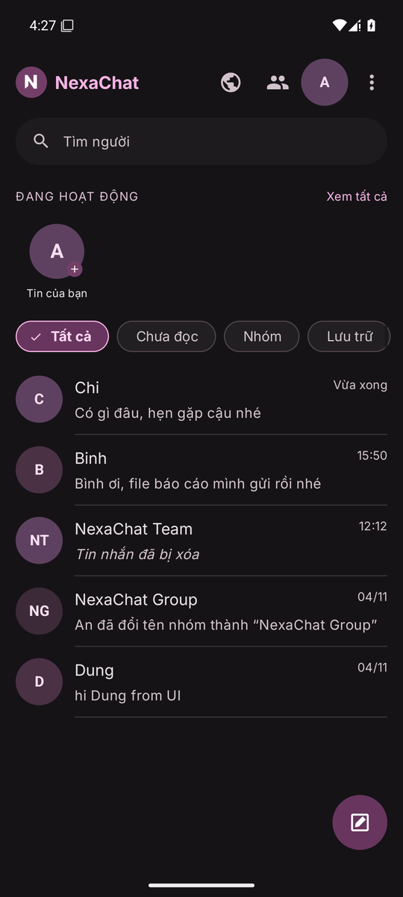
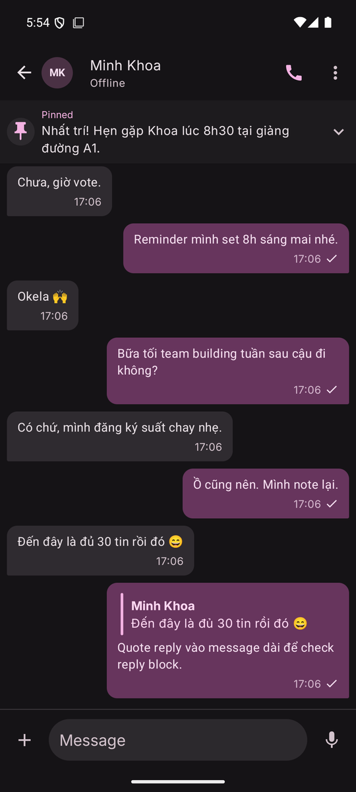
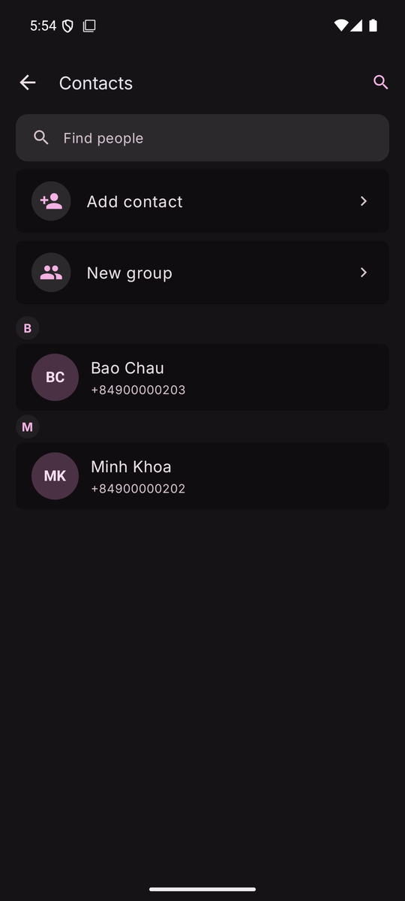
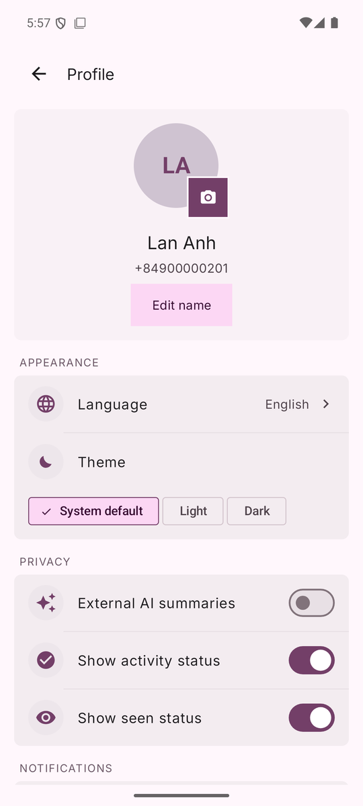
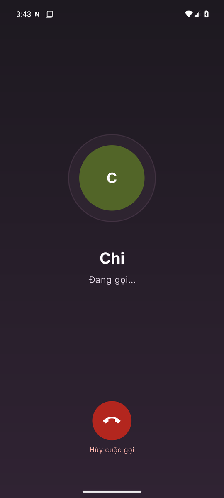
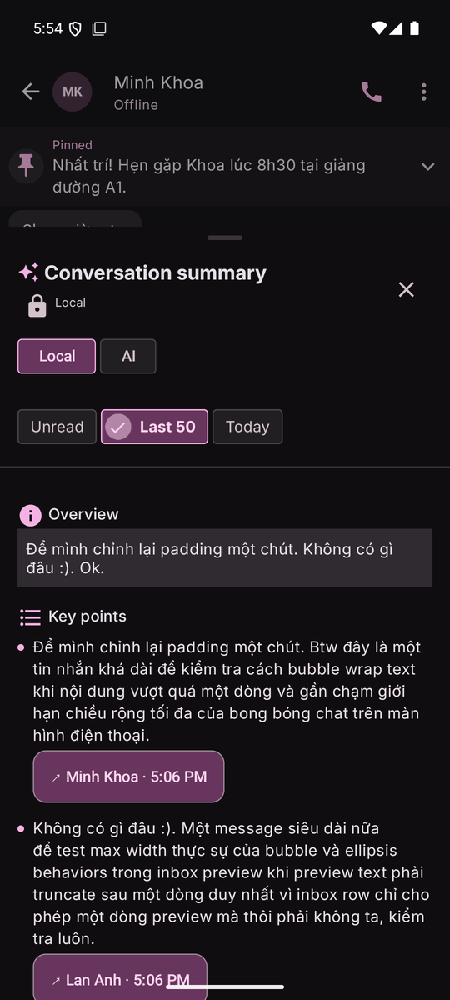
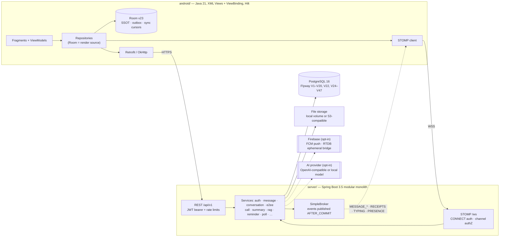

# NexaChat

**English** · [Tiếng Việt](README.vi.md)

NexaChat is a self-hosted, real-time Android messaging platform: a Java 21
Android client (XML Views, Material 3, Room offline-first) backed by a
Spring Boot modular monolith, PostgreSQL and STOMP over WebSocket — with
optional Firebase and AI-provider integrations, both off by default.

[](https://github.com/JasonTM17/Nexachat_AppJ/actions/workflows/ci.yml)

## Screenshots

| Inbox (dark) | Chat (dark) | Contacts (dark) |
| --- | --- | --- |
|  |  |  |

| Profile (light) | Outgoing call | AI summary (dark) |
| --- | --- | --- |
|  |  |  |

## Features

**Messaging**

- Direct and group chats over STOMP/WebSocket with optimistic sends and a durable offline outbox
- Edit, delete and a server-enforced 24 h recall window; reply/quote, forward, emoji reactions, pinned messages
- Delivery and read receipts, typing indicators and presence — each with reciprocal privacy switches
- Conversation-scoped search (PostgreSQL trigram index) and keyset-paged history

**Contacts & groups**

- E.164 phone registration and lookup; contacts with aliases
- Group admin roles, structured mentions and `@all`, hashed invite links with join approvals
- Group polls, shared reminders, private per-user labels, and a member-scoped media/file/link archive

**Media**

- Images, files and voice notes (25 MB cap) with BlurHash placeholders
- Client-side compression and GPS scrub; authenticated downloads with HTTP Range support

**Calls**

- 1-to-1 WebRTC voice calls, STOMP signaling, localized call log, FCM call invites

**Feed & streaks**

- Chat streaks for direct chats plus a daily check-in streak, with opt-in reminder pushes — [docs](docs/architecture/streaks.md)
- A plaintext public feed with posts, images, comments and emoji reactions — [docs](docs/architecture/public-feed.md)

**Security & privacy**

- JWT access tokens + rotating refresh tokens with replay detection; BCrypt (cost 12)
- Email-OTP recovery and self-service account deletion, in-app and on the web
- Optional per-conversation E2EE for direct chats (X25519 + AES-256-GCM; v1 preview, rollout-gated)

**AI (consent-gated)**

- Conversation catch-up summaries: built-in extractive engine plus optional OpenAI-compatible or local-model tiers
- "Ask this chat": conversation RAG with hybrid retrieval, validated citations and an offline lexical fallback

**Offline & sync**

- Room is the only render source; WorkManager drains the outbox; delta sync v2 negotiates per-conversation change cursors
- STOMP is the default realtime transport; an opt-in Firebase RTDB bridge for ephemeral state exists but ships disabled

**Platform**

- Bilingual Vietnamese/English UI with per-app locale; Material 3 light/dark themes
- Java 21 end to end — one language across client and server

## Architecture



Two transports, one enforcement point: REST `/api/v1` for request/response and
STOMP `/ws` for realtime push both funnel through the same services. The server
commits before it broadcasts, so a received frame always describes a committed
row. Detail: [docs/architecture/architecture.md](docs/architecture/architecture.md)
· [api-contract.md](docs/architecture/api-contract.md) ·
[websocket-protocol.md](docs/architecture/websocket-protocol.md).

## Tech stack

Versions below are read from `server/pom.xml`, `android/gradle/libs.versions.toml`,
`android/app/build.gradle` and `server/src/main/resources/db/migration/`.

| Layer | Server (`server/`) | Android (`android/`) |
|---|---|---|
| Language | Java 21 | Java 21 |
| Framework | Spring Boot 3.5.16 (Web, WebSocket, Security, Data JPA, Actuator) | Material 3 1.12.0, AppCompat, Navigation, Fragments, ViewBinding |
| Auth & crypto | jjwt 0.12.6 (HS256), BCrypt cost 12, Google OIDC via public JWKS, HMAC-SHA256 OTPs | AndroidKeyStore AES-GCM token store, Tink 1.24.0 (E2EE), Credential Manager 1.6.0 |
| Realtime | STOMP over WebSocket (SimpleBroker); optional Firebase RTDB bridge | OkHttp 4.12.0 WebSocket + STOMP; stream-webrtc 1.3.10 for calls |
| Persistence | PostgreSQL 16, Flyway 11.13.3 (`V1–V20`, `V22`, `V24–V47`; V21/V23 reserved) | Room 2.6.1 (schema v23), RxDataStore 1.1.1 |
| Media/files | Magic-byte sniffing, 25 MB cap, Range streaming | Glide 4.16.0, Media3 1.5.1, client compression + BlurHash |
| Other | libphonenumber 8.13.45, bucket4j 8.10.1 rate limits | Hilt 2.52, Retrofit 2.11.0 + Moshi 1.15.1, RxJava 3.1.9, WorkManager 2.9.1 |
| Build & test | Maven 3.9+ (no wrapper), JUnit + failsafe `*IT`, Testcontainers 1.21.4 | Gradle 8.14.3 wrapper, AGP 8.9.3, JUnit 4 + Mockito 5.14.2 |
| Deploy | `server/Dockerfile`, `docker-compose.yml` | Signed APK via `android-release` workflow |

## Quick start

### Prerequisites

| Tool | Requirement |
|---|---|
| JDK | 21 (`server/pom.xml`, `android/app/build.gradle`) |
| Maven | 3.9+ (system `mvn`; there is no `server/mvnw`) |
| Docker | recent, for PostgreSQL 16 and the app image |
| Android SDK | compileSdk/targetSdk 36, minSdk 26 |

### Server

```bash
cp .env.example .env          # set DATABASE_PASSWORD and JWT_SECRET
docker compose up -d db app   # builds the server image on first run
curl http://localhost:8080/actuator/health   # -> {"status":"UP"}
```

The Compose file reads every setting from `.env`; required keys are
`DATABASE_URL`, `DATABASE_USER`, `DATABASE_PASSWORD` and `JWT_SECRET`. All
optional variables (mail, FCM, Firebase, storage, AI providers, retention
jobs) are listed by name in [`.env.example`](.env.example) and explained in
[docs/operations/operations.md](docs/operations/operations.md).

Optional demo data (re-runnable; demo accounts use `password123`):

```bash
docker compose exec -T db psql -U nexachat -d nexachat < demo/seed.sql
```

For development, run the database in Compose and the app on the host:

```bash
docker compose up -d db          # PostgreSQL on localhost:5433
cd server && mvn spring-boot:run # Flyway migrates on first boot
```

### Android

1. Create `android/local.properties` (gitignored) with your SDK path and API host:

   ```properties
   sdk.dir=<path-to-Android-SDK>
   API_BASE_URL=http://10.0.2.2:8080   # emulator loopback; use your LAN IP for a device
   # GOOGLE_WEB_CLIENT_ID=             # optional; empty hides Google sign-in
   ```

   `API_BASE_URL` and `GOOGLE_WEB_CLIENT_ID` can also be passed as
   `-PapiBaseUrl=` / `-PgoogleWebClientId=` Gradle properties.

2. Build and install:

   ```bash
   cd android
   ./gradlew assembleDebug
   adb install app/build/outputs/apk/debug/app-debug.apk
   ```

Pre-built signed APKs: [nexachat.io.vn/download.html](https://nexachat.io.vn/download.html)
or [GitHub Releases](https://github.com/JasonTM17/Nexachat_AppJ/releases).

## Tests and quality gates

```bash
cd server && mvn verify                          # unit + PostgreSQL integration tests (*IT)
cd android && ./gradlew testDebugUnitTest lintDebug assembleDebug
python tools/checks/check-markdown-links.py      # relative doc links
python tools/checks/check-api-contract.py        # controller routes vs api-contract.md
python tools/checks/check-android-strings.py     # Vi/En resource parity
python site/check.py                             # static site checks
cd tools/site-tests && npm test                  # site JS unit tests
cd tools/firebase-rules && npm test              # RTDB rules contract (local emulator)
cd admin-web && npm run lint && npm test && npm run build && npm run e2e
```

Integration tests (`*IT`) need a real PostgreSQL — locally the Compose database
on `localhost:5433`, or `IT_DB_URL`/`IT_DB_USER`/`IT_DB_PASSWORD` otherwise; see
[docs/quality/testing.md](docs/quality/testing.md). CI (`.github/workflows/ci.yml`)
runs the server and Android suites, repo-hygiene checkers, site tests, Firebase
rules tests and a secret scan on every PR and push to `main`/`develop`; a green
`main` build also publishes the server image to `ghcr.io`.

## Release

Tags drive releases. Pushing `v*` (or dispatching the workflow with a tag) runs
`Android APK Release` (`.github/workflows/android-release.yml`): it derives
`versionName`/`versionCode` from the tag, builds a signed release APK, verifies
the signer against the first fingerprint in
[`site/.well-known/assetlinks.json`](site/.well-known/assetlinks.json), and
publishes `nexachat-<tag>.apk` plus its `.sha256` to the GitHub Release. Notes
come from `docs/release-notes/<tag>.md` when present. Operator steps:
[docs/release/release-checklist.md](docs/release/release-checklist.md).

## Repository layout

```text
server/    Spring Boot modular monolith (REST /api/v1 + STOMP /ws)
  src/main/java/com/nexachat/{auth,user,contact,conversation,message,attachment,
    retention,presence,call,summary,notification,rag,reminder,poll,label,invite,
    archive,observability,ops,recovery,google,mail,firebase,e2ee,ws,admin,common,config}/
  src/main/resources/db/migration/   Flyway V1–V20, V22, V24–V47 (V21/V23 reserved)
android/   Java 21 app (XML Views, Fragments, ViewBinding, RxJava 3)
  app/src/main/java/com/nexachat/
    core/      auth · common · crypto · database (Room) · media · network · realtime · storage · ui
    data/      repositories (Room write-through, outbox, resync)
    di/        Hilt modules
    call/      call core, media engine, service, UI
    summary/   AI summary repository + ViewModel layer
    feature/   auth · chat · contacts · group · inbox · archive · ask · invite · label · poll
               · reminder · groupboard · media · profile · splash · summary · encryption · ui
  gradle/libs.versions.toml          dependency version catalog
site/      static site (Vercel): landing, download, delete-account, assetlinks
admin-web/ staff admin console (Vite + React + TS): overview, users, alerts,
           rules, audit, system — separate app from site/
docs/      audience-grouped documentation — index: docs/README.md
demo/      seed.sql + LAN bootstrap scripts
tools/     checks/ release/ ops/ backup/ e2e/ firebase-rules/ site-tests/ rag-eval/ …
.github/   workflows/ci.yml, android-release.yml, PR + issue templates
```

## Documentation

[docs/README.md](docs/README.md) indexes everything by audience. Entry points:
[architecture](docs/architecture/architecture.md) ·
[API contract](docs/architecture/api-contract.md) ·
[WebSocket protocol](docs/architecture/websocket-protocol.md) ·
[E2EE](docs/architecture/e2ee.md) ·
[calls](docs/architecture/calls.md) ·
[AI summary](docs/architecture/ai-summary.md) ·
[RAG](docs/architecture/rag.md) ·
[AI translation](docs/architecture/ai-translation.md) ·
[Firebase bridge](docs/architecture/firebase-realtime.md) ·
[operations](docs/operations/operations.md) ·
[security notes](docs/quality/security.md) ·
[known limitations](docs/quality/known-limitations.md) ·
[design notes](docs/design/design-notes.md) ·
[CHANGELOG](CHANGELOG.md).

## Security

Supported versions and private vulnerability reporting: [SECURITY.md](SECURITY.md).

## Contributing

Setup, tests, branching and PR rules: [CONTRIBUTING.md](CONTRIBUTING.md).
Never commit secrets, keystores, `.env*` or `local.properties`.

## License

[MIT](LICENSE).
