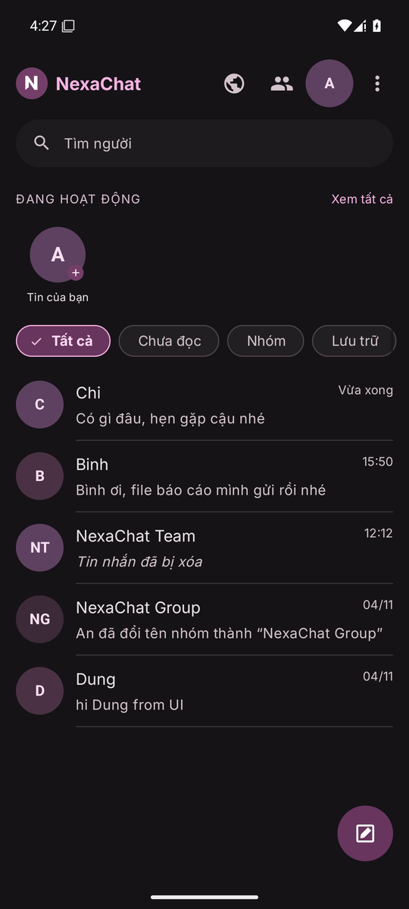
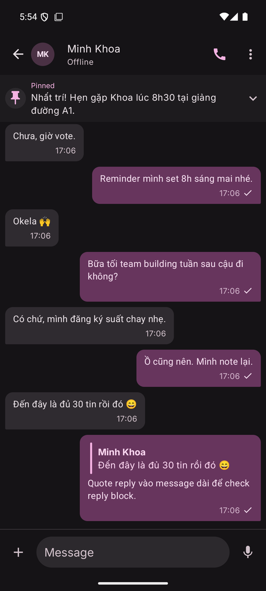
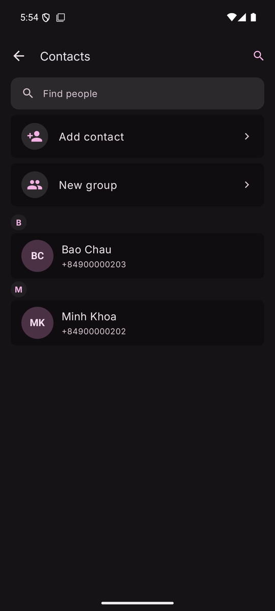
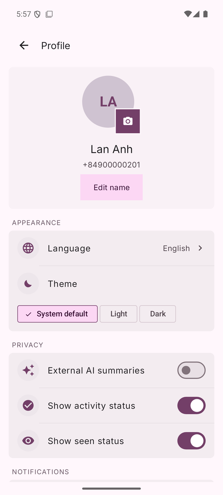
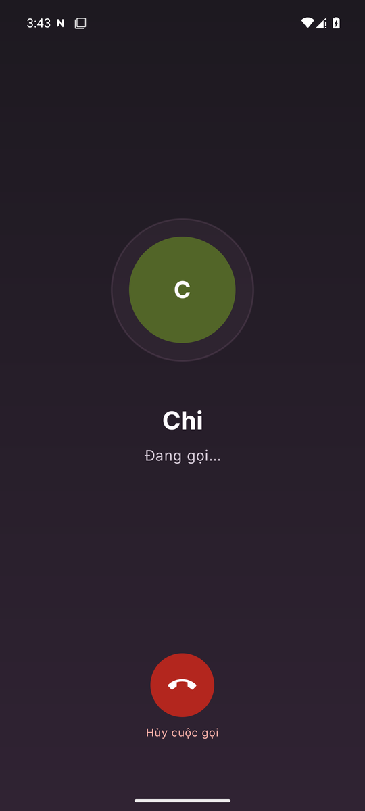
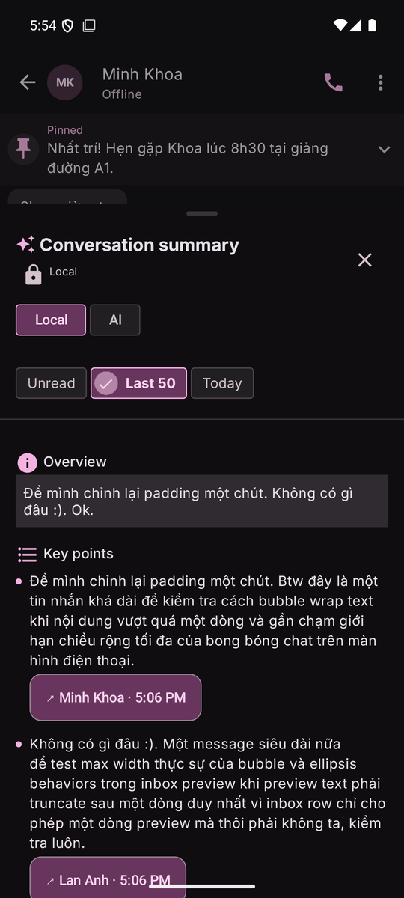
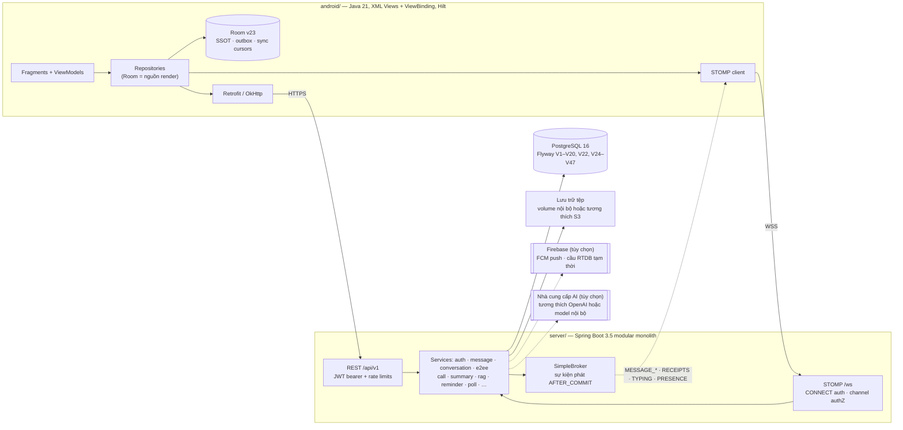

# NexaChat

[Tiếng Anh / English](README.md) · **Tiếng Việt**

NexaChat là nền tảng nhắn tin thời gian thực trên Android, tự triển khai được:
ứng dụng Java 21 (XML Views, Material 3, offline-first bằng Room) đi kèm máy chủ
Spring Boot modular monolith, PostgreSQL và STOMP qua WebSocket — với tích hợp
Firebase và nhà cung cấp AI tùy chọn, mặc định đều tắt.

[](https://github.com/JasonTM17/Nexachat_AppJ/actions/workflows/ci.yml)

## Ảnh chụp màn hình

| Hộp thư (tối) | Trò chuyện (tối) | Danh bạ (tối) |
| --- | --- | --- |
|  |  |  |

| Hồ sơ (sáng) | Cuộc gọi đi | Tóm tắt AI (tối) |
| --- | --- | --- |
|  |  |  |

## Tính năng

**Nhắn tin**

- Trò chuyện 1-1 và nhóm qua STOMP/WebSocket, gửi lạc quan và hộp thư chờ bền khi ngoại tuyến
- Sửa, xóa và thu hồi trong cửa sổ 24 giờ do máy chủ áp đặt; trả lời/trích dẫn, chuyển tiếp, cảm xúc, ghim tin nhắn
- Báo đã nhận và đã xem, chỉ báo đang gõ và trạng thái trực tuyến — mỗi mục có công tắc riêng tư hai chiều
- Tìm kiếm trong phạm vi hội thoại (chỉ mục trigram của PostgreSQL) và phân trang lịch sử bằng keyset

**Danh bạ & nhóm**

- Đăng ký và tra cứu theo số điện thoại E.164; danh bạ có tên gợi nhớ
- Vai trò quản trị nhóm, đề cập có cấu trúc và `@all`, liên kết mời đã băm kèm duyệt yêu cầu tham gia
- Bình chọn nhóm, nhắc hẹn dùng chung, nhãn riêng theo người dùng và kho lưu trữ media/tệp/liên kết theo thành viên

**Media**

- Ảnh, tệp và tin nhắn thoại (giới hạn 25 MB) với ảnh giữ chỗ BlurHash
- Nén phía client và xóa siêu dữ liệu GPS; tải xuống có xác thực qua HTTP Range

**Cuộc gọi**

- Gọi thoại 1-1 bằng WebRTC, báo hiệu qua STOMP, nhật ký cuộc gọi đã bản địa hóa, mời gọi qua FCM

**Bảng tin & chuỗi ngày**

- Chuỗi ngày trò chuyện cho chat 1-1 và chuỗi điểm danh hằng ngày, kèm push nhắc nhở có chọn tham gia — [docs](docs/architecture/streaks.md)
- Bảng tin công khai dạng văn bản thuần với bài viết, ảnh, bình luận và cảm xúc — [docs](docs/architecture/public-feed.md)

**Bảo mật & riêng tư**

- Access token JWT + refresh token xoay vòng có phát hiện dùng lại; BCrypt (cost 12)
- Khôi phục bằng OTP qua email và tự xóa tài khoản, trong ứng dụng lẫn trên web
- E2EE tùy chọn theo hội thoại cho chat 1-1 (X25519 + AES-256-GCM; bản xem trước v1, có cổng rollout)

**AI (cần sự đồng ý)**

- Tóm tắt bắt kịp hội thoại: engine trích xuất sẵn có cùng các tầng model tương thích OpenAI hoặc model nội bộ tùy chọn
- "Hỏi đoạn chat này": RAG trên hội thoại với truy xuất lai, trích dẫn được kiểm chứng và phương án từ vựng ngoại tuyến

**Ngoại tuyến & đồng bộ**

- Room là nguồn render duy nhất; WorkManager xả hộp thư chờ; delta sync v2 đàm phán con trỏ thay đổi theo hội thoại
- STOMP là kênh realtime mặc định; cầu nối Firebase RTDB cho trạng thái tạm thời tồn tại nhưng mặc định tắt

**Nền tảng**

- Giao diện song ngữ Việt/Anh với ngôn ngữ riêng theo ứng dụng; Material 3 sáng/tối
- Java 21 xuyên suốt — một ngôn ngữ cho cả client lẫn server

## Kiến trúc



Hai kênh truyền, một điểm kiểm soát: REST `/api/v1` cho request/response và
STOMP `/ws` cho đẩy realtime đều đi qua cùng các service. Máy chủ commit trước
khi phát sóng, nên một frame nhận được luôn mô tả một bản ghi đã commit. Chi
tiết: [docs/architecture/architecture.md](docs/architecture/architecture.md)
· [api-contract.md](docs/architecture/api-contract.md) ·
[websocket-protocol.md](docs/architecture/websocket-protocol.md).

## Công nghệ

Các phiên bản dưới đây được đọc từ `server/pom.xml`,
`android/gradle/libs.versions.toml`, `android/app/build.gradle` và
`server/src/main/resources/db/migration/`.

| Tầng | Server (`server/`) | Android (`android/`) |
|---|---|---|
| Ngôn ngữ | Java 21 | Java 21 |
| Framework | Spring Boot 3.5.16 (Web, WebSocket, Security, Data JPA, Actuator) | Material 3 1.12.0, AppCompat, Navigation, Fragments, ViewBinding |
| Xác thực & mã hóa | jjwt 0.12.6 (HS256), BCrypt cost 12, Google OIDC qua JWKS công khai, OTP HMAC-SHA256 | Kho token AES-GCM qua AndroidKeyStore, Tink 1.24.0 (E2EE), Credential Manager 1.6.0 |
| Realtime | STOMP qua WebSocket (SimpleBroker); cầu Firebase RTDB tùy chọn | WebSocket OkHttp 4.12.0 + STOMP; stream-webrtc 1.3.10 cho cuộc gọi |
| Lưu trữ | PostgreSQL 16, Flyway 11.13.3 (`V1–V20`, `V22`, `V24–V47`; V21/V23 dự phòng) | Room 2.6.1 (schema v23), RxDataStore 1.1.1 |
| Media/tệp | Kiểm tra magic bytes, giới hạn 25 MB, stream theo Range | Glide 4.16.0, Media3 1.5.1, nén phía client + BlurHash |
| Khác | libphonenumber 8.13.45, giới hạn tần suất bucket4j 8.10.1 | Hilt 2.52, Retrofit 2.11.0 + Moshi 1.15.1, RxJava 3.1.9, WorkManager 2.9.1 |
| Build & kiểm thử | Maven 3.9+ (không có wrapper), JUnit + failsafe `*IT`, Testcontainers 1.21.4 | Gradle wrapper 8.14.3, AGP 8.9.3, JUnit 4 + Mockito 5.14.2 |
| Triển khai | `server/Dockerfile`, `docker-compose.yml` | APK có chữ ký qua workflow `android-release` |

## Bắt đầu nhanh

### Yêu cầu

| Công cụ | Yêu cầu |
|---|---|
| JDK | 21 (`server/pom.xml`, `android/app/build.gradle`) |
| Maven | 3.9+ (`mvn` hệ thống; không có `server/mvnw`) |
| Docker | bản gần đây, cho PostgreSQL 16 và image ứng dụng |
| Android SDK | compileSdk/targetSdk 36, minSdk 26 |

### Server

```bash
cp .env.example .env          # đặt DATABASE_PASSWORD và JWT_SECRET
docker compose up -d db app   # lần đầu sẽ build image server
curl http://localhost:8080/actuator/health   # -> {"status":"UP"}
```

Compose đọc mọi cấu hình từ `.env`; các khóa bắt buộc là `DATABASE_URL`,
`DATABASE_USER`, `DATABASE_PASSWORD` và `JWT_SECRET`. Mọi biến tùy chọn (mail,
FCM, Firebase, storage, nhà cung cấp AI, retention job) được liệt kê theo tên
trong [`.env.example`](.env.example) và giải thích trong
[docs/operations/operations.md](docs/operations/operations.md).

Dữ liệu demo tùy chọn (chạy lại được; tài khoản demo dùng `password123`):

```bash
docker compose exec -T db psql -U nexachat -d nexachat < demo/seed.sql
```

Khi phát triển, chạy database trong Compose và ứng dụng trên máy host:

```bash
docker compose up -d db          # PostgreSQL trên localhost:5433
cd server && mvn spring-boot:run # Flyway migrate ở lần khởi động đầu
```

### Android

1. Tạo `android/local.properties` (đã gitignore) với đường dẫn SDK và host API:

   ```properties
   sdk.dir=<đường-dẫn-Android-SDK>
   API_BASE_URL=http://10.0.2.2:8080   # loopback của emulator; dùng IP LAN cho thiết bị thật
   # GOOGLE_WEB_CLIENT_ID=             # tùy chọn; để trống sẽ ẩn đăng nhập Google
   ```

   `API_BASE_URL` và `GOOGLE_WEB_CLIENT_ID` cũng có thể truyền qua thuộc tính
   Gradle `-PapiBaseUrl=` / `-PgoogleWebClientId=`.

2. Build và cài đặt:

   ```bash
   cd android
   ./gradlew assembleDebug
   adb install app/build/outputs/apk/debug/app-debug.apk
   ```

APK có chữ ký dựng sẵn: [nexachat.io.vn/download.html](https://nexachat.io.vn/download.html)
hoặc [GitHub Releases](https://github.com/JasonTM17/Nexachat_AppJ/releases).

## Kiểm thử và cổng chất lượng

```bash
cd server && mvn verify                          # unit + integration test trên PostgreSQL thật (*IT)
cd android && ./gradlew testDebugUnitTest lintDebug assembleDebug
python tools/checks/check-markdown-links.py      # liên kết tương đối trong tài liệu
python tools/checks/check-api-contract.py        # route controller đối chiếu api-contract.md
python tools/checks/check-android-strings.py     # tương thích tài nguyên Vi/En
python site/check.py                             # kiểm tra site tĩnh
cd tools/site-tests && npm test                  # unit test JS của site
cd tools/firebase-rules && npm test              # hợp đồng rules RTDB (emulator nội bộ)
```

Integration test (`*IT`) cần PostgreSQL thật — cục bộ là database Compose trên
`localhost:5433`, hoặc qua `IT_DB_URL`/`IT_DB_USER`/`IT_DB_PASSWORD`; xem
[docs/quality/testing.md](docs/quality/testing.md). CI (`.github/workflows/ci.yml`)
chạy bộ test server và Android, các checker repo-hygiene, test site, test rules
Firebase và quét secret trên mọi PR và push lên `main`/`develop`; bản `main`
xanh cũng publish image server lên `ghcr.io`.

## Phát hành

Tag điều khiển phát hành. Push tag `v*` (hoặc dispatch workflow với một tag)
chạy `Android APK Release` (`.github/workflows/android-release.yml`): workflow
suy ra `versionName`/`versionCode` từ tag, build APK release có chữ ký, đối
chiếu người ký với fingerprint đầu tiên trong
[`site/.well-known/assetlinks.json`](site/.well-known/assetlinks.json), và
publish `nexachat-<tag>.apk` cùng tệp `.sha256` lên GitHub Release. Ghi chú lấy
từ `docs/release-notes/<tag>.md` nếu có. Các bước cho operator:
[docs/release/release-checklist.md](docs/release/release-checklist.md).

## Cấu trúc kho mã

```text
server/    Spring Boot modular monolith (REST /api/v1 + STOMP /ws)
  src/main/java/com/nexachat/{auth,user,contact,conversation,message,attachment,
    retention,presence,call,summary,notification,rag,reminder,poll,label,invite,
    archive,observability,ops,recovery,google,mail,firebase,e2ee,ws,common,config}/
  src/main/resources/db/migration/   Flyway V1–V20, V22, V24–V47 (V21/V23 dự phòng)
android/   ứng dụng Java 21 (XML Views, Fragments, ViewBinding, RxJava 3)
  app/src/main/java/com/nexachat/
    core/      auth · common · crypto · database (Room) · media · network · realtime · storage · ui
    data/      repositories (ghi xuyên qua Room, outbox, resync)
    di/        các module Hilt
    call/      lõi cuộc gọi, media engine, service, UI
    summary/   repository + ViewModel tóm tắt AI
    feature/   auth · chat · contacts · group · inbox · archive · ask · invite · label · poll
               · reminder · groupboard · media · profile · splash · summary · encryption · ui
  gradle/libs.versions.toml          catalog phiên bản phụ thuộc
site/      site tĩnh (Vercel): landing, download, delete-account, assetlinks
docs/      tài liệu nhóm theo đối tượng đọc — mục lục: docs/README.md
demo/      seed.sql + script khởi động LAN
tools/     checks/ release/ ops/ backup/ e2e/ firebase-rules/ site-tests/ rag-eval/ …
.github/   workflows/ci.yml, android-release.yml, mẫu PR + issue
```

## Tài liệu

[docs/README.md](docs/README.md) lập mục lục theo đối tượng đọc. Các điểm vào:
[kiến trúc](docs/architecture/architecture.md) ·
[hợp đồng API](docs/architecture/api-contract.md) ·
[giao thức WebSocket](docs/architecture/websocket-protocol.md) ·
[E2EE](docs/architecture/e2ee.md) ·
[cuộc gọi](docs/architecture/calls.md) ·
[tóm tắt AI](docs/architecture/ai-summary.md) ·
[RAG](docs/architecture/rag.md) ·
[cầu Firebase](docs/architecture/firebase-realtime.md) ·
[vận hành](docs/operations/operations.md) ·
[ghi chú bảo mật](docs/quality/security.md) ·
[giới hạn đã biết](docs/quality/known-limitations.md) ·
[ghi chú thiết kế](docs/design/design-notes.md) ·
[CHANGELOG](CHANGELOG.md).

## Bảo mật

Phiên bản được hỗ trợ và báo cáo lỗ hổng riêng tư: [SECURITY.md](SECURITY.md).

## Đóng góp

Cài đặt, kiểm thử, quy tắc nhánh và PR: [CONTRIBUTING.md](CONTRIBUTING.md).
Không bao giờ commit secret, keystore, `.env*` hay `local.properties`.

## Giấy phép

[MIT](LICENSE).
