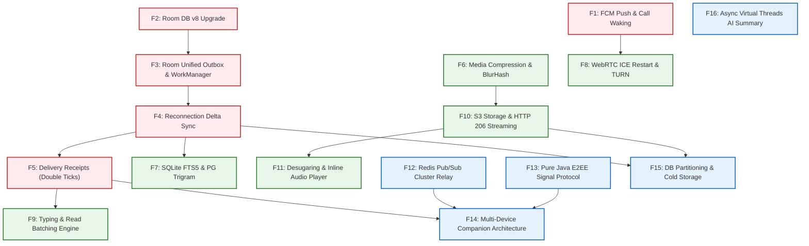

> **Historical survey (2026-11-08).** Current contracts: [`docs/architecture.md`](docs/architecture.md), [`docs/api-contract.md`](docs/api-contract.md), [`docs/testing.md`](docs/testing.md).

# BÁO CÁO KHẢO SÁT KỸ THUẬT TOÀN DIỆN & LỘ TRÌNH PHÁT TRIỂN PRODUCTION (TECHNICAL ROADMAP)
## HỆ THỐNG TIN NHẮN & CUỘC GỌI BẢO MẬT THỜI GIAN THỰC NEXACHAT

- **Dự án**: NexaChat (App & Server)
- **Kho lưu trữ mã nguồn**: NexaChat monorepo
- **Ràng buộc công nghệ cốt lõi**: 100% Pure Java 21 LTS trên cả Backend Spring Boot 3.4.1 và Android App (0 file Kotlin `.kt`/`.kts`).
- **Mã hiệu tài liệu**: `NEXA-TR-2026-V1`
- **Ngày ban hành**: 08/11/2026
- **Trạng thái**: Xuất bản chính thức (Publication-Grade)

---

## 1. TỔNG QUAN ĐIỀU HÀNH & BỐI CẢNH DỰ ÁN (EXECUTIVE SUMMARY & CONTEXT)

### 1.1 Tầm nhìn và Định vị Sản phẩm NexaChat
NexaChat là nền tảng liên lạc thời gian thực thế hệ mới, tích hợp đa phương thức: tin nhắn văn bản tức thời, tương tác cảm xúc, tin nhắn thoại (Push-to-Talk), gọi thoại/video độ trễ cực thấp (WebRTC 1-1 Calling) và trợ lý trí tuệ nhân tạo tóm tắt hội thoại phân tầng (3-tier AI Summary). Hệ thống được định vị nhằm cung cấp trải nghiệm bảo mật, mượt mà và tin cậy tuyệt đối cho người dùng cá nhân lẫn doanh nghiệp.

### 1.2 Ràng buộc Kỹ thuật Cốt lõi (100% Pure Java 21 LTS)
Dự án NexaChat tuân thủ các nguyên tắc kỹ thuật mang tính kỷ luật thép:
1. **Tuyệt đối không sử dụng Kotlin (0 Kotlin files)**: Toàn bộ mã nguồn phía máy chủ (Spring Boot 3.4.1) và phía ứng dụng di động Android (Android SDK 35, `minSdk 26`) được xây dựng 100% bằng Java 21 LTS thuần túy. Không có bất kỳ file `.kt` hoặc `.kts` nào trong toàn bộ dự án. Mọi tác vụ bất đồng bộ, dependency injection, serialization và cơ sở dữ liệu đều tận dụng triệt để hệ sinh thái Java chuẩn (Java Records, Pattern Matching, RxJava 3, Dagger Hilt với Java Annotation Processor, Jackson/Moshi Java).
2. **Tuân thủ Không Rò rỉ Bí mật (0 Leaked Secrets)**: Toàn bộ khóa bảo mật (JWT Secret, Database Credentials, Keystore Aliases) đều được trừu tượng hóa qua biến môi trường hoặc Android KeyStore với chuẩn mã hóa phần cứng AES-256-GCM.
3. **Tuân thủ Tính toàn vẹn Tài liệu (0 Broken Markdown Links)**: Tất cả liên kết nội bộ trong tài liệu kỹ thuật đều được kiểm chứng độc lập với mã thoát 0 bằng công cụ kiểm tra tự động.

### 1.3 Mục tiêu Tài liệu & Tiêu chí Nghiệm thu Production
Mục tiêu của báo cáo này là:
- Đánh giá trung thực, khách quan toàn bộ hiện trạng kiến trúc của NexaChat.
- Đối chiếu có hệ thống với các ứng dụng nhắn tin hàng đầu thế giới và khu vực (Telegram, Signal, WhatsApp, Zalo).
- Chỉ rõ các khoảng trống hạ tầng thiết yếu (Gaps) ngăn cản NexaChat vận hành ổn định trong môi trường sản xuất thực tế.
- Đề xuất 16 tính năng kỹ thuật phân kỳ chi tiết, kèm giải pháp kiến trúc 100% Pure Java 21 LTS cho từng tính năng.
- Xây dựng lộ trình triển khai chi tiết 3 giai đoạn (Ngắn hạn 0-3 tháng, Trung hạn 3-6 tháng, Dài hạn 6-12 tháng) cùng đồ thị quan hệ phụ thuộc kỹ thuật (DAG) và chiến lược quản trị rủi ro toàn diện.

### 1.4 Danh mục Tài liệu Tham chiếu Kiến trúc
Báo cáo kỹ thuật này đối chiếu trực tiếp với hệ thống tài liệu kiến trúc cơ sở của dự án:
- [README.md](README.md): Hướng dẫn khởi tạo và tổng quan kiến trúc hệ thống NexaChat.
- [docs/architecture.md](docs/architecture.md): Thiết kế kiến trúc tổng thể Backend Spring Boot và Android Client.
- [docs/known-limitations.md](docs/known-limitations.md): Danh mục các giới hạn kỹ thuật và khiếm khuyết hạ tầng đã ghi nhận.
- [docs/api-contract.md](docs/api-contract.md): Đặc tả hợp đồng API REST, phân trang con trỏ và mã phản hồi lỗi.
- [docs/websocket-protocol.md](docs/websocket-protocol.md): Đặc tả giao thức khung tin nhắn STOMP và sự kiện thời gian thực.
- [docs/calls.md](docs/calls.md): Luồng báo hiệu cuộc gọi P2P WebRTC 1-1 và vòng đời trạng thái cuộc gọi.
- [docs/ai-summary.md](docs/ai-summary.md): Thiết kế phân tầng 3 cấp độ tóm tắt AI và cơ chế tự ngắt chuyển vùng (circuit breaker).
- [docs/security.md](docs/security.md): Mô hình đe dọa an ninh, lưu trữ khóa Keystore-AES và kiểm soát tốc độ truy cập.
- [docs/operations.md](docs/operations.md): Quy trình triển khai Docker Compose, quản lý biến môi trường và vận hành máy chủ.

---

## 2. KHẢO SÁT HIỆN TRẠNG KIẾN TRÚC CODEBASE (CODEBASE SURVEY & ARCHITECTURAL BASELINE)

Qua khảo sát toàn diện cây mã nguồn tại NexaChat monorepo, hệ thống NexaChat hiện tại được cấu trúc theo mô hình phân lớp rõ ràng, bao gồm hai phân hệ chính: `server` (Backend Spring Boot 3.4.1) và `android` (Client Native Java 21).

### 2.1 Kiến trúc Phân hệ Máy chủ (Backend Spring Boot 3.4.1)
Phân hệ máy chủ đặt tại thư mục `server/`, quản lý bởi Apache Maven, sử dụng Java 21 LTS làm nền tảng thực thi:

- **Quản lý Định danh & Xác thực (Auth & Security)**:
  - Triển khai Stateless JWT Authentication tại `SecurityConfig.java` kết hợp với `JwtAuthFilter.java`.
  - Hỗ trợ Access Token thời hạn ngắn (900 giây / 15 phút) mang `JwtPrincipal(userId, phone, displayName)` và Refresh Token thời hạn 14 ngày lưu mã băm SHA-256 trong bảng `refresh_tokens`.
  - Mật khẩu người dùng được băm an toàn bằng thuật toán BCrypt với hệ số chi phí cost 12 (`BCryptPasswordEncoder(12)`).
  - Giới hạn tần suất gọi API (Rate Limiting) tại `RateLimitService.java` sử dụng thư viện `Bucket4j 8.10.1`, lưu trữ trong bộ nhớ in-memory LRU map (tối đa 10,000 buckets, TTL 15 phút).
- **Hạ tầng Nhắn tin STOMP/WebSocket**:
  - Cấu hình tại `WebSocketConfig.java` kích hoạt Spring `SimpleBroker` trên các tiền tố `/topic` (broadcast hội thoại) và `/queue` (hộp thư cá nhân).
  - Giao thức bắt tay bảo mật STOMP thông qua `StompAuthChannelInterceptor.java`: kiểm tra tính hợp lệ của JWT Bearer token ngay tại lệnh `CONNECT`, chặn quyền truy cập trái phép tại các lệnh `SUBSCRIBE` và `SEND`.
  - Bộ chặn kiểm soát thành viên xuất chuỗi `StompConversationMembershipOutboundInterceptor.java`: kiểm tra quyền thành viên hội thoại của từng phiên kết nối trước khi phân phối bản tin.
  - Xử lý phân trang tin nhắn tại `MessageService.java`: hỗ trợ `beforeSeq` (phân trang lùi cho lịch sử cũ) và `afterSeq` (phân trang tiến cho tin nhắn mới).
  - Đánh dấu đã đọc `markRead()`: cập nhật con trỏ `last_read_seq` trên bảng `conversation_members` và phát sự kiện `MESSAGE_READ` tới các thành viên cùng hội thoại.
- **Lưu trữ & Quản lý Tệp Đa phương tiện**:
  - `LocalStorageService.java` thực hiện ghi và đọc tệp đính kèm trực tiếp trên hệ thống tệp cục bộ (`./data/uploads`).
  - Kiểm tra tính xác thực của tệp thông qua nhận diện byte ma thuật (`MagicBytes.java`), giới hạn dung lượng tải lên 25MB.
  - Phục vụ tệp tại `FileController.java`: đọc toàn bộ mảng `byte[]` vào bộ nhớ heap của máy chủ trước khi trả về HTTP response.
- **Báo hiệu Cuộc gọi WebRTC 1-1**:
  - `CallService.java` và `CallController.java` điều phối tín hiệu chuyển tiếp SDP Offer, SDP Answer, ICE Candidate và Hangup thông qua đích đến `/app/calls/{id}/signal` và `/user/{peerId}/queue/calls`.
  - `CallRegistry.java` quản lý trạng thái phiên gọi (`CallSession`) và giữ chỗ nguyên tử người dùng (Atomic User Reservation) thuần túy trong bộ nhớ JVM thông qua các khối khóa `synchronized`. Thời gian đổ chuông giới hạn 45 giây (`ringTimeoutMillis = 45000`).
- **Trạng thái Người dùng Trực tuyến (Presence)**:
  - `PresenceSessionRegistry.java` quản lý các phiên WebSocket hoạt động qua `ConcurrentHashMap<UUID, UserSessions>`, tích hợp cơ chế gom nhóm ngắt kết nối (Disconnect Coalescing) 5,000ms thông qua `ScheduledExecutorService`.
- **Tóm tắt Cuộc hội thoại bằng AI Phân tầng (3-Tier AI Summary)**:
  - Kiến trúc phân cấp 3 tầng linh hoạt: T0 Native Java MMR Extractive (`LocalExtractiveSummaryProvider`), T1 Local Ollama LLM (`qwen2.5:3b`), và T2 Cloud DeepSeek API (`deepseek-v3` / `deepseek-flash`).
  - Tích hợp kiểm tra đồng thuận người dùng (`users.ai_summary_consent`), bộ đánh giá độ phức tạp ngữ cảnh (`SummaryComplexityAssessor`), bảng đệm kết quả `message_summaries` có kiểm tra mã băm SHA-256 và cơ chế tự ngắt chuyển tầng (Circuit Breaker Fallback).
- **Cơ sở Dữ liệu & Di chuyển Schema (Flyway PostgreSQL)**:
  - Quản lý 6 bản di chuyển Flyway (`V1__init.sql` đến `V6__conversation_summaries.sql`).
  - Hỗ trợ số tuần tự toàn cục đơn điệu tăng `messages.seq` (`BIGSERIAL NOT NULL UNIQUE`), ràng buộc chống trùng lặp gửi tin `UNIQUE (sender_id, client_message_id)`.
- **Đóng gói Vận hành & CI/CD**:
  - `Dockerfile` tối ưu hóa đa tầng với base image `eclipse-temurin:21-noble`, trích xuất layered jar, chạy dưới quyền tài khoản phi quản trị `nexachat:10001`.
  - Quy trình GitHub Actions `.github/workflows/ci.yml` duy trì 5/5 công việc xanh (`server-test`, `android-test`, `repo-hygiene`, `secret-scan`, `publish-container`).

### 2.2 Kiến trúc Phân hệ Ứng dụng Di động (Android Client Java 21)
Phân hệ Android đặt tại thư mục `android/`, tuân thủ 100% Pure Java 21 LTS (chính xác 128 file mã nguồn Java trong `main` và 84 file Java trong kiểm thử; 0 file Kotlin):

- **Nền tảng Biên dịch & Thư viện**:
  - Android Gradle Plugin `8.7.3`, `compileSdk 35`, `minSdk 26`, `targetSdk 35`.
  - Cấu hình tương thích Java 21 trong `app/build.gradle`:
    ```groovy
    compileOptions {
        sourceCompatibility JavaVersion.VERSION_21
        targetCompatibility JavaVersion.VERSION_21
    }
    ```
  - Tận dụng `annotationProcessor` thuần Java cho Dagger Hilt 2.52 và AndroidX Room 2.6.1 (không dùng KSP/Kapt).
- **Lưu trữ Cục bộ Ngoại tuyến (Room Database v7)**:
  - `AppDatabase.java` kế thừa `RoomDatabase` phiên bản 7 (`version = 7`), quản lý 5 thực thể: `MessageEntity`, `ConversationEntity`, `OutboxEntity`, `MessageReactionEntity`, và `PinnedMessageEntity`.
  - Lưu trữ dữ liệu bảo mật: `AesGcmTokenCipher.java` kết hợp với `AndroidKeyStore` phần cứng sinh khóa AES-256-GCM bảo vệ Access Token và Refresh Token trước khi ghi vào `RxDataStore<Preferences>`.
- **Giao tiếp Realtime & STOMP Client**:
  - Tự triển khai bộ mã hóa/giải mã bản tin STOMP (`StompCodec`, `StompParser`) trên nền tảng kết nối WebSocket của `OkHttp 4.12.0`.
  - Quản lý phiên kết nối tại `RealtimeSession.java`: hỗ trợ thử lại lùi số mũ 5 lần (1s, 2s, 4s, 8s, 16s với jitter ±20%).
  - Cơ chế đồng bộ khi có mạng: `resyncOnReconnect()` trong `MessageRepository.java` thực hiện đẩy hàng đợi outbox và gọi `resyncForward(conversationId)` để lấy tin nhắn mới sau `maxSeq`.
- **Tin nhắn thoại & Đa phương tiện**:
  - Thu âm Push-to-Talk (PTT) tại `VoiceRecorder.java` sử dụng `android.media.MediaRecorder`, nén định dạng AAC LC trong container MPEG-4 (`.m4a`), bitrate 64kbps, tần số mẫu 44.1kHz.
  - Trình phát đa phương tiện Media3 ExoPlayer (`MediaViewerFragment.java`) phục vụ xem video và nghe tệp âm thanh toàn màn hình.
- **Cuộc gọi Video/Voice WebRTC 1-1**:
  - Tích hợp thư viện `stream-webrtc-android 1.3.10`.
  - Điều phối trạng thái cuộc gọi qua `CallManager.java`, khởi chạy `CallForegroundService.java` bảo vệ micrô và hiển thị giao diện nhận cuộc gọi `IncomingCallActivity.java`.

---

## 3. ĐỐI CHIẾU CHUẨN MỰC ỨNG DỤNG NHẮN TIN HIỆN ĐẠI (INDUSTRY STANDARDS BENCHMARK)

Để xác định các yêu cầu kỹ thuật cần đạt được cho môi trường production, kiến trúc hiện tại của NexaChat được đối chiếu toàn diện với 4 chuẩn mực ứng dụng OTT hàng đầu: **Telegram**, **Signal**, **WhatsApp**, và **Zalo**.

### 3.1 Ma trận So sánh Tính năng Chuẩn mực Ngành (Benchmark Matrix)

| Tiêu chí Đánh giá | Telegram | Signal | WhatsApp | Zalo | NexaChat Hiện Tại | Khoảng Trống Kỹ Thuật Cần Lấp Đầy |
| :--- | :--- | :--- | :--- | :--- | :--- | :--- |
| **Kiến trúc Dữ liệu & Offline-First** | Cloud-based SSOT, cache SQLite cục bộ, đồng bộ delta bằng `pts`/`qts` sequence | Client SSOT (SQLCipher), server không lưu tin sau khi giao, hàng đợi transient | Client SSOT (SQLite mã hóa), server spooler tạm thời | Client SSOT (SQLite), server cache tạm thời | Hybrid: Room DB cục bộ, Postgres `seq` server; Outbox chỉ có tin nhắn mới | **LỚN (P0)**: Outbox thiếu actions (reaction, pin, edit); thiếu API Batch Delta Sync toàn cục |
| **Vòng đời Chuyển phát (Tick Lifecycle)** | 1 tick (đã lên mây), 2 tick (đối phương đã mở app đọc tin); không có tick nhận máy | 1 tick (đã lên server), 2 tick xám (đã nhận trên máy), 2 tick xanh (đã đọc) | 1 tick (đã lên server), 2 tick xám (đã nhận trên máy), 2 tick xanh (đã đọc) | 1 tick (đã gửi), 2 tick xám (đã nhận), 2 tick xanh/avatar (đã xem) | Chỉ có 1 tick (SENT) và "Đã xem" trong chat 1-1; thiếu trạng thái DELIVERED | **CHÍ MẠNG (P0)**: Thiếu trạng thái 2 tick xám (`DELIVERED`) và thiếu tracking đã đọc trong nhóm |
| **Đánh thức Cuộc gọi (VoIP Waking)** | Push Service riêng + FCM High-Priority; CallKit / ConnectionService | FCM High-Priority Data Push đánh thức background service -> Full-Screen Intent | FCM High-Priority Data Push -> Telecom ConnectionService | FCM + Custom Keep-Alive Socket tối ưu trên ColorOS/MIUI | **Không có Push**: STOMP rớt khi app đóng -> Rớt toàn bộ cuộc gọi | **ĐÌNH TRỆ (P0 - BLOCKER)**: Không thể nhận cuộc gọi khi tắt app hoặc màn hình khóa |
| **Push Tin nhắn Chạy ngầm** | Socket nền riêng + fallback FCM High-Priority | FCM Data Message mã hóa, client tự giải mã và dựng Notification | FCM Data Message, giải mã on-device, dựng Android MessagingStyle | FCM kết hợp socket tối ưu thời lượng pin | **Không có FCM**: App đóng hoặc Doze mode là mất liên lạc | **ĐÌNH TRỆ (P0 - BLOCKER)**: Người dùng hoàn toàn không nhận được thông báo khi đóng app |
| **Khả năng Phục hồi Kết nối** | Session sống độc lập IP mạng (MTProto AuthKey binding) | Tự động reconnect nhanh, hỗ trợ ICE Restart WebRTC khi đổi mạng | Ghép kênh FunXMPP, resume session ticket, thích ứng mạng 4G/Wi-Fi | Thích ứng nhịp tim viễn thông, chống rớt gói trên sóng yếu | Reconnect 5 lần rồi dừng (`parked`); WebRTC mất cuộc gọi khi đổi IP (thiếu ICE restart) | **CAO (P1)**: Cần bổ sung WebRTC ICE Restart và máy trạng thái kết nối trực quan |
| **Mã hóa Đầu-Cuối (E2EE)** | Cloud Chat (MTProto server-side), Secret Chat (E2EE MTProto DH) | 100% E2EE (Signal Protocol: Double Ratchet + X3DH + Curve25519) | 100% E2EE (Signal Protocol bản quyền) | E2EE tùy chọn (dựa trên Signal Protocol), Cloud backup | Bản rõ trong DB Postgres, dựa 100% vào TLS/WSS đường truyền | **DÀI HẠN (P2)**: Cần triển khai Signal Protocol thuần Java cho Secret Chats |
| **Quản lý Media & Streaming** | Nén progressive, streaming video HTTP, thumbnail vector/BlurHash | Nén client-side, mã hóa blob trước khi upload, cache SQLCipher | Nén ảnh/video tự động (JPEG/AAC/H.264), gửi inline thumbnail | Nén tiêu chuẩn/HD, cache đĩa LRU tự động dọn dẹp | Upload file thô multipart, đọc mảng byte 25MB vào heap, chưa có BlurHash | **TRUNG HẠN (P1)**: Cần nén ảnh tự động, tạo BlurHash và hỗ trợ HTTP 206 Partial Content |
| **Khả năng Mở rộng Máy chủ** | Phân tán toàn cầu, MTProto proxy cluster, multi-DC | Đám mây phân tán, message queue chia sharding | Erlang/Ejabberd cluster xử lý hàng chục triệu kết nối đồng thời | C++ Core socket cluster, phân vùng người dùng | Đơn node: SimpleBroker in-memory, PresenceSessionRegistry in-memory | **DÀI HẠN (P2)**: Cần Redis Pub/Sub và External Broker Relay để scale ngang |

### 3.2 Phân tích Cơ chế Đồng bộ Dữ liệu Ngoại tuyến (Offline-First Data Sync Protocols)
Chuẩn mực của Telegram và WhatsApp chỉ ra rằng trải nghiệm người dùng trên thiết bị di động phải đảm bảo:
- **Tính khả dụng tức thời (Zero Latency UI)**: Khi mở ứng dụng, màn hình phải hiển thị ngay lập tức dữ liệu được lưu trong SQLite/Room cục bộ mà không được phép xuất hiện màn hình loading trắng.
- **Đồng bộ biến thiên (Delta Sync)**: Thay vì tải lại toàn bộ danh sách hội thoại qua các REST request đắt đỏ, client chỉ gửi một vector mốc thời gian/tuần tự (Watermark Vector: `Map<ConversationId, LastSeq>`). Máy chủ trả về chính xác gói sai khác (Delta Bundle) chứa các tin nhắn mới, tin nhắn bị sửa (`edited_at`), tin nhắn bị thu hồi (`deleted_at`) và các biến động cảm xúc (reactions).
- **Hàng đợi thao tác bền vững (Durable Action Outbox)**: Mọi tương tác của người dùng khi offline (soạn tin, thả reaction, ghim tin nhắn) phải được ghi nhận vào hàng đợi cơ sở dữ liệu bền vững và được đảm bảo chuyển phát (At-Least-Once Delivery) qua tiến trình nền độc lập với vòng đời giao diện.

### 3.3 Phân tích Vòng đời Chuyển phát & Trạng thái Dấu tích (Delivery Lifecycle & Ticks)
Một ứng dụng nhắn tin thương mại tiêu chuẩn luôn phản hồi minh bạch trạng thái của thông điệp qua 3 cột mốc thị giác:
1. **Dấu tích đơn (Sent - 1 Tick)**: Tin nhắn đã rời thiết bị gửi, được máy chủ tiếp nhận, ghi bền vững vào cơ sở dữ liệu và cấp phát số tuần tự đơn điệu `seq`.
2. **Dấu tích đôi xám (Delivered - 2 Ticks)**: Tin nhắn đã được máy chủ chuyển phát thành công xuống thiết bị của người nhận (thông qua WebSocket active session hoặc được tiến trình nền nhận qua Silent Push Notification) và client người nhận đã gửi ngược lại gói tin xác nhận `ACK/DELIVERED`.
3. **Dấu tích đôi xanh (Read - 2 Blue Ticks)**: Người nhận đã mở ứng dụng và cuộn màn hình hiển thị trực tiếp bong bóng tin nhắn đó (thỏa mãn quy tắc hiển thị giao diện).

Hiện tại, NexaChat mới chỉ có trạng thái `SENT` và trạng thái `READ` trong hội thoại 1-1; hoàn toàn khuyết thiếu trạng thái `DELIVERED` và chưa có cơ chế kiểm đếm danh sách người đã đọc trong hội thoại nhóm.

### 3.4 Phân tích Giao thức Đánh thức Ứng dụng & VoIP Push (Push Waking Protocols)
Trên hệ điều hành Android hiện đại (từ Android 8 đến Android 15), các chính sách tiết kiệm pin Doze Mode và App Standby Buckets sẽ đóng băng kết nối mạng và tiêu diệt các socket nền. Do đó:
- **Tin nhắn văn bản**: Bắt buộc phải sử dụng **FCM Data-only Messages** có độ ưu tiên cao (`priority: high`). Khi gói tin tới máy, hệ thống cấp một khoảng thời gian CPU ngắn cho `FirebaseMessagingService` để ứng dụng ghi dữ liệu vào SQLite và tự dựng thông báo chuẩn Android `NotificationCompat.MessagingStyle`.
- **Cuộc gọi VoIP WebRTC**: Bắt buộc phải sử dụng **FCM High-Priority VoIP Push** kết hợp với quyền `USE_FULL_SCREEN_INTENT` và `FOREGROUND_SERVICE_PHONE_CALL` (trên Android 14+). Khi nhận được tín hiệu gọi đến, dịch vụ nền lập tức kích hoạt màn hình khóa toàn diện `IncomingCallActivity`, phát chuông reo và khởi chạy kết nối WebRTC signaling trước khi người dùng bấm nút nhận cuộc gọi.

---

## 4. PHÂN TÍCH SÂU KHOẢNG TRỐNG HẠ TẦNG PRODUCTION (CRITICAL INFRASTRUCTURE GAPS)

Từ kết quả khảo sát mã nguồn và đối chiếu chuẩn mực ngành, 7 khoảng trống kỹ thuật nghiêm trọng dưới đây được xác định là rào cản ngăn bước NexaChat phát hành production:

```
+----------------------------------------------------------------------------------------------------+
|                           NEXACHAT CRITICAL PRODUCTION INFRASTRUCTURE GAPS                        |
+----------------------------------------------------------------------------------------------------+
|  GAP 1: ABSENCE OF PUSH NOTIFICATIONS (FCM HTTP v1)                                                |
|  - App ngầm/đóng -> Đứt STOMP -> Mất 100% tin nhắn và cuộc gọi đến (BLOCKER).                     |
+----------------------------------------------------------------------------------------------------+
|  GAP 2: ROOM DATABASE v7 DEFICIENCIES                                                              |
|  - Thiếu UserEntity (Danh bạ trống rỗng khi offline).                                              |
|  - Thiếu CallLogEntity (Mất nhật ký cuộc gọi khi rớt mạng).                                        |
|  - Thiếu Room @TypeConverters (Nhúng chuỗi JSON thô, tiềm ẩn lỗi runtime).                         |
+----------------------------------------------------------------------------------------------------+
|  GAP 3: LACK OF WORKMANAGER & GLOBAL DELTA RECONNECTION ENGINE                                     |
|  - Outbox flush phụ thuộc bộ nhớ tiến trình (RxJava). Tiến trình bị kill -> Tin offline nằm chết. |
|  - resyncForward() chỉ chạy cho activeConversation duy nhất. Bỏ sót tin ở các hội thoại nền.       |
+----------------------------------------------------------------------------------------------------+
|  GAP 4: INCOMPLETE DELIVERY LIFECYCLE (MISSING DELIVERED STATUS)                                  |
|  - DeliveryStatus chỉ có SENT, SENDING, FAILED; thiếu hẳn DELIVERED (2-tick xám).                  |
|  - Thiếu tracking danh sách thành viên nhóm đã nhận và đã xem tin nhắn.                           |
+----------------------------------------------------------------------------------------------------+
|  GAP 5: SINGLE-NODE BROKER & IN-MEMORY STATE (BOTTLENECK HORIZONTAL SCALING)                       |
|  - SimpleBroker, PresenceSessionRegistry, CallRegistry chạy in-memory trong JVM 1 máy chủ.          |
|  - Không thể triển khai > 1 container đằng sau Load Balancer mà không rớt tin và rớt cuộc gọi.     |
+----------------------------------------------------------------------------------------------------+
|  GAP 6: JAVA 21 DESUGARING ABSENCE ON ANDROID                                                      |
|  - Biên dịch Java 21 với minSdk 26 nhưng chưa kích hoạt desugar_jdk_libs -> Nguy cơ crash API mới. |
+----------------------------------------------------------------------------------------------------+
|  GAP 7: MEDIA STREAMING HEAP EXHAUSTION                                                            |
|  - FileController đọc toàn bộ byte[] 25MB vào heap RAM; thiếu HTTP 206 Partial Content range.     |
+----------------------------------------------------------------------------------------------------+
```

### 4.1 Khoảng trống #1: Sự Vắng bóng Hoàn toàn của Firebase Cloud Messaging (FCM)
- **Vị trí quan sát**: `server/src` hoàn toàn không có `firebase-admin` hay Google Auth Library; `android/app/src/main/AndroidManifest.xml` không khai báo bất kỳ dịch vụ `<service>` nào kế thừa `FirebaseMessagingService`.
- **Hệ quả thực tế**: Ngay khi người dùng thoát ứng dụng ra màn hình chính hoặc tắt màn hình, hệ điều hành Android sẽ ngắt kết nối WebSocket STOMP. Mọi tin nhắn văn bản và tín hiệu cuộc gọi thoại WebRTC gửi đến trong thời gian này đều bị rơi vào khoảng không (dropped silently) trong RAM máy chủ. Người nhận hoàn toàn không có chuông báo, không có thông báo thanh trạng thái. Đây là lỗ hổng nghiêm trọng nhất (Blocker P0).

### 4.2 Khoảng trống #2: Thiếu hụt Mô hình Dữ liệu Offline trong Room Database v7
- **Vị trí quan sát**: `AppDatabase.java:16-25` chỉ quản lý 5 thực thể (`MessageEntity`, `ConversationEntity`, `OutboxEntity`, `MessageReactionEntity`, `PinnedMessageEntity`).
- **Hệ quả thực tế**:
  - Không có `UserEntity`: Danh bạ bạn bè trong `ContactsRepository.java:52-54` chỉ lưu trong bộ nhớ RAM qua `BehaviorProcessor<Optional<List<Contact>>>`. Khi mở app ở chế độ máy bay hoặc mất sóng, danh bạ hoàn toàn trắng trơn, không thể tìm kiếm bạn bè hay xem lại thông tin liên lạc đã lưu.
  - Không có `CallLogEntity`: Nhật ký cuộc gọi trong `CallRepository.java:22-26` chỉ gọi API REST `GET api/v1/conversations/{id}/calls`. Khi mất mạng, lịch sử cuộc gọi hoàn toàn biến mất.
  - Không có Room `@TypeConverters`: Danh sách tệp đính kèm `attachmentsJson` đang phải chuyển đổi thủ công bằng Moshi Adapter rải rác trong Repository, làm tăng nguy cơ lỗi runtime `JsonDataException` và làm chậm tốc độ truy vấn.

### 4.3 Khoảng trống #3: Thiếu WorkManager & Cơ chế Đồng bộ Delta Toàn diện khi Tái kết nối
- **Vị trí quan sát**:
  - `MessageRepository.java:863-869`: Phương thức `resyncOnReconnect()` chỉ gọi `resyncForward(conversationId)` cho duy nhất `activeConversation` (cuộc trò chuyện đang mở trên màn hình).
  - Không có `androidx.work:work-runtime` trong cấu hình Gradle.
- **Hệ quả thực tế**:
  - Nếu người dùng có 20 cuộc trò chuyện khác có tin nhắn mới trong thời gian mất mạng, các cuộc trò chuyện này sẽ không bao giờ được đồng bộ tin nhắn mới cho đến khi người dùng tự tay mở từng cuộc trò chuyện.
  - Khi người dùng gửi tin nhắn lúc mất mạng rồi vuốt tắt ứng dụng, lệnh `flushOutbox()` chạy trên RxJava CompositeDisposable của tiến trình sẽ bị hệ thống Android tiêu diệt. Tin nhắn nằm kẹt vĩnh viễn trong Room Database mà không bao giờ được tự động gửi đi ngầm.

### 4.4 Khoảng trống #4: Vòng đời Chuyển phát Khuyết thiếu Trạng thái DELIVERED
- **Vị trí quan sát**: `DeliveryStatus.java:5-9` chỉ có `SENT`, `SENDING`, `FAILED`. Phía máy chủ, bảng `conversation_members` chỉ có cột `last_read_seq`, không có cột lưu trữ mốc nhận `last_delivered_seq`.
- **Hệ quả thực tế**: Người gửi tin nhắn chỉ nhìn thấy một dấu tích (Sent), và sau đó nhảy vọt sang "Đã xem" (Read) nếu người nhận mở app. Người gửi không thể biết được tin nhắn đã thực sự tới máy người nhận hay chưa (thiết bị đối phương có đang tắt nguồn, hết pin, hay nằm ngoài vùng phủ sóng).

### 4.5 Khoảng trống #5: Hạ tầng Đơn Node In-Memory Giới hạn Khả năng Mở rộng Ngang
- **Vị trí quan sát**:
  - `WebSocketConfig.java:62`: `enableSimpleBroker("/topic", "/queue")`.
  - `PresenceSessionRegistry.java:34`: `ConcurrentHashMap<UUID, UserSessions>`.
  - `CallRegistry.java:23`: `Map<UUID, CallSession> calls = new HashMap<>()` kèm khóa `synchronized`.
- **Hệ quả thực tế**: Toàn bộ trạng thái phiên kết nối, trạng thái online/offline và điều phối cuộc gọi WebRTC gắn chặt vào một tiến trình Java duy nhất. Khi triển khai 2 hoặc nhiều Pod backend phía sau Load Balancer, nếu User A kết nối vào Pod 1 và User B kết nối vào Pod 2:
  - Pod 1 không thể chuyển tiếp tin nhắn STOMP sang Pod 2 cho User B.
  - Cuộc gọi giữa User A và User B sẽ báo lỗi `BUSY` hoặc `NOT_FOUND` vì `CallRegistry` không chia sẻ dữ liệu liên-máy chủ.

### 4.6 Khoảng trống #6: Rủi ro Bytecode Java 21 trên Android & Thiếu Core Library Desugaring
- **Vị trí quan sát**: `android/app/build.gradle` đặt `sourceCompatibility JavaVersion.VERSION_21` trên nền tảng `minSdk 26`, nhưng hoàn toàn thiếu cấu hình `coreLibraryDesugaringEnabled true`.
- **Hệ quả thực tế**: Bộ máy Android Runtime (ART) trên các phiên bản Android cũ (từ Android 8.0 đến Android 13) không hỗ trợ sẵn toàn bộ các thư viện và API mới của Java 21 (như các lớp `java.time`, Java Record classes reflection, Stream factory methods). Nếu lập trình viên vô tình gọi các API này, ứng dụng sẽ bị văng lỗi nghiêm trọng `NoClassDefFoundError` hoặc `NoSuchMethodError` trên các dòng máy đời cũ.

### 4.7 Khoảng trống #7: Truyền phát Tệp Đa phương tiện Gây Nghẽn Bộ nhớ Heap
- **Vị trí quan sát**: `FileController.java:55` đọc toàn bộ tệp thành mảng `byte[]` vào bộ nhớ RAM máy chủ (`byte[] bytes = storageService.read(storageKey)`).
- **Hệ quả thực tế**: Khi nhiều người dùng đồng thời tải các tệp video/âm thanh kích thước tối đa 25MB, máy chủ sẽ bị nghẽn bộ nhớ heap, kích hoạt trình gom rác Garbage Collector liên tục (Stop-The-World) và dễ dẫn đến lỗi tràn bộ nhớ `OutOfMemoryError`. Đồng thời, việc thiếu hỗ trợ HTTP 206 Partial Content khiến trình phát Media3 ExoPlayer trên Android không thể tua nhanh (seek) mượt mà.

---

## 5. ĐỀ XUẤT TÍNH NĂNG VÀ PHÂN TÍCH KỸ THUẬT CHI TIẾT (COMPREHENSIVE FEATURE PROPOSALS)

Toàn bộ 16 đề xuất tính năng dưới đây được phân loại theo 3 giai đoạn triển khai. Mỗi tính năng được phân tích thấu đáo theo đúng 4 nội dung đánh giá bắt buộc: **(A) Ưu điểm & Nhược điểm**, **(B) Mức độ cần thiết cho Production**, **(C) Độ phức tạp kỹ thuật**, và **(D) Phương án kiến trúc 100% Pure Java 21 LTS**.

---

### PHÂN KỲ 1: GIAI ĐOẠN NGẮN HẠN (0 - 3 THÁNG) — HẠ TẦNG PRODUCTION THIẾT YẾU

#### 5.1.1 Tính năng F1: Hạ tầng FCM Push Notifications (HTTP v1) & VoIP Call Waking Protocol

##### A. Ưu điểm & Nhược điểm:
- **Ưu điểm**:
  - Bảo đảm 100% người dùng nhận được thông báo tin nhắn mới và cuộc gọi thoại/video ngay cả khi ứng dụng bị tắt, chạy ngầm hoặc thiết bị ở chế độ Doze Mode sâu.
  - Chuẩn hóa theo giao thức Google FCM HTTP v1 hiện đại sử dụng OAuth2 access token, loại bỏ server key cũ không an toàn.
  - Tách bạch giữa Notification Payload và Silent Data Payload, bảo vệ quyền riêng tư người dùng (không để lộ nội dung tin nhắn trên màn hình khóa nếu người dùng cấu hình ẩn).
  - Đánh thức cuộc gọi đến bằng `Full-Screen Intent` hiển thị trực tiếp giao diện `IncomingCallActivity` kèm chuông reo như cuộc gọi GSM truyền thống.
- **Nhược điểm**:
  - Phụ thuộc vào dịch vụ Google Play Services của Google.
  - Cần quản lý vòng đời token thiết bị phức tạp (xử lý token hết hạn, bị thu hồi, mã lỗi `UNREGISTERED`).

##### B. Mức độ cần thiết cho Production:
- **BẮT BUỘC / SỐNG CÒN (CRITICAL BLOCKER - P0)**. Không thể phát hành một ứng dụng OTT thương mại mà người dùng không nhận được thông báo khi đóng ứng dụng.

##### C. Độ phức tạp kỹ thuật:
- **Cao (High)**: Đòi hỏi kết hợp giữa kiến trúc backend xử lý token đa thiết bị và kiến trúc Android xử lý quyền hạn Android 13 (`POST_NOTIFICATIONS`), Android 14 (`FOREGROUND_SERVICE_PHONE_CALL`), WakeLock và tương thích Doze Mode.

##### D. Phương án kiến trúc 100% Pure Java 21 LTS:
1. **Phía Máy chủ (Spring Boot 3.4.1 Java 21)**:
   - *Dependency*: Sử dụng `com.google.auth:google-auth-library-oauth2-http:1.30.0` kết hợp trực tiếp với `java.net.http.HttpClient` của Java 21 (không cần kéo toàn bộ Firebase Admin SDK nặng nề).
   - *Cơ sở dữ liệu* (`V7__device_tokens.sql`):
     ```sql
     CREATE TABLE user_device_tokens (
         id          UUID PRIMARY KEY DEFAULT gen_random_uuid(),
         user_id     UUID NOT NULL REFERENCES users(id) ON DELETE CASCADE,
         token       VARCHAR(512) NOT NULL,
         device_id   VARCHAR(100) NOT NULL,
         platform    VARCHAR(10)  NOT NULL DEFAULT 'ANDROID' CHECK (platform IN ('ANDROID', 'IOS')),
         created_at  TIMESTAMPTZ  NOT NULL DEFAULT now(),
         updated_at  TIMESTAMPTZ  NOT NULL DEFAULT now(),
         CONSTRAINT uq_user_device UNIQUE (user_id, device_id)
     );
     CREATE INDEX idx_fcm_user ON user_device_tokens(user_id);
     ```
   - *FCM Dispatcher Service (`FcmPushService.java`)*:
     - Khởi tạo `GoogleCredentials.fromStream(...)` với scope `https://www.googleapis.com/auth/firebase.messaging`.
     - Sử dụng Virtual Threads (`Thread.ofVirtual()`) hoặc `HttpClient.sendAsync()` để gửi bản tin HTTP/2 tới endpoint `https://fcm.googleapis.com/v1/projects/{projectId}/messages:send`.
     - Lắng nghe `@TransactionalEventListener(phase = TransactionPhase.AFTER_COMMIT)` từ `MessageCreatedEvent` và `CallRingingEvent`.
     - Lọc danh sách thành viên: chỉ gửi push cho những thành viên không có phiên active trong `PresenceSessionRegistry`.
     - Định dạng payload Data-Only tinh gọn cho tin nhắn mới (`NEW_MESSAGE`):
       ```json
       {
         "message": {
           "token": "eXz8...",
           "data": {
             "type": "NEW_MESSAGE",
             "conversationId": "3fa85f64-5717-4562-b3fc-2c963f66afa6",
             "messageId": "7c9e6679-7425-40de-944b-e07fc1f90ae7",
             "seq": "1024",
             "senderName": "Alice",
             "snippet": "Xin chào, dự án đã sẵn sàng!"
           },
           "android": { "priority": "HIGH" }
         }
       }
       ```
     - Định dạng payload Data-Only cho cuộc gọi đến (`CALL_INVITE`):
       Bản tin FCM được thiết kế nghiêm ngặt theo mô hình **Lightweight Notification Pointer** (< 500 bytes), tuyệt đối KHÔNG nhúng chuỗi SDP Offer thô hay ICE candidates nhằm tuân thủ giới hạn 4096 bytes của Google FCM và triệt tiêu nguy cơ phân mảnh gói tin:
       ```json
       {
         "message": {
           "token": "eXz8...",
           "data": {
             "type": "CALL_INVITE",
             "callId": "8f1a2c3d-4e5f-6a7b-8c9d-0e1f2a3b4c5d",
             "conversationId": "3fa85f64-5717-4562-b3fc-2c963f66afa6",
             "callerId": "7c9e6679-7425-40de-944b-e07fc1f90ae7",
             "callerName": "Alice Nguyen",
             "callType": "AUDIO",
             "timestamp": "1731033434000"
           },
           "android": { "priority": "HIGH", "ttl": "30s" }
         }
       }
       ```
     - Điểm cuối REST hỗ trợ tải SDP Offer: Máy chủ cung cấp endpoint `GET /api/v1/calls/{id}/offer` (trả về `CallOfferResponse` gồm SDP Offer và cấu hình TURN ICE Servers) để client có thể kéo nhanh nếu bắt tay STOMP bị trễ mạng di động.
2. **Phía Ứng dụng Di động (Android Java 21)**:
   - Bổ sung `libs.versions.toml`: `firebase-messaging = "24.1.0"` và plugin `com.google.gms.google-services = "4.4.2"`.
   - Cấu hình quyền và dịch vụ trong `AndroidManifest.xml`:
     - Khai báo các quyền: `android.permission.FOREGROUND_SERVICE_PHONE_CALL`, `android.permission.USE_FULL_SCREEN_INTENT`, và `android.permission.WAKE_LOCK`.
     - Cấu hình `CallForegroundService`: `android:foregroundServiceType="microphone|phoneCall"`.
   - Xác thực quyền hạn Android 14+ (API 34+): Kiểm tra runtime `NotificationManager.canUseFullScreenIntent()`. Nếu người dùng thu hồi quyền Full-Screen Intent trong cài đặt hệ thống, ứng dụng kích hoạt fallback hiển thị Heads-Up Banner Notification với độ ưu tiên tối đa (`PRIORITY_MAX`), đồng thời hiển thị thông báo hướng dẫn người dùng tới `Settings.ACTION_MANAGE_APP_USE_FULL_SCREEN_INTENT`.
   - Triển khai `NexaFirebaseMessagingService.java extends FirebaseMessagingService`:
     - `onNewToken(@NonNull String token)`: Gửi cập nhật token lên backend qua `UserApi.registerDeviceToken()`.
     - `onMessageReceived(@NonNull RemoteMessage remoteMessage)`:
       - Nếu `type.equals("CALL_INVITE")`:
         1. Kích hoạt `WakeLock` 15 giây (`PARTIAL_WAKE_LOCK`) để giữ CPU hoạt động trong lúc đánh thức từ Doze Mode.
         2. Khởi chạy `CallForegroundService` với loại hình `phoneCall`.
         3. Gọi `callManager.hydrateIncomingCall(...)` nạp trước phiên gọi mang trạng thái `CallState.PENDING_INCOMING`.
         4. Kích hoạt Full-Screen Intent mở `IncomingCallActivity`.
         5. Kích hoạt ngầm tác vụ kết nối lại socket STOMP và tải trước SDP Offer qua REST endpoint `GET /api/v1/calls/{id}/offer` trước khi người dùng chạm nút nghe.
       - Nếu `type.equals("NEW_MESSAGE")`: Kiểm tra nếu `activeConversation` trùng với `conversationId` thì bỏ qua; ngược lại tạo thông báo `NotificationCompat.MessagingStyle` kèm ảnh đại diện và hành động trả lời trực tiếp `RemoteInput`.
   - Vòng đời Cuộc gọi Doze Mode & Cửa sổ Ân hạn 15s (`CallState.PENDING_INCOMING`):
     - Bổ sung trạng thái `PENDING_INCOMING` vào `CallState.java` đại diện cho phiên gọi vừa được đánh thức bởi FCM trong khi STOMP đang bắt tay kết nối lại.
     - `IncomingCallActivity`: Khắc phục lỗi tự hủy sớm. Trong `onCreate()`, nếu `callManager.session()` đang `IDLE`, Activity chủ động đọc Intent extras (`EXTRA_CALL_ID`, `EXTRA_CONVERSATION_ID`, `EXTRA_CALLER_ID`, `EXTRA_CALLER_NAME`, `EXTRA_SERVER_TS`) và gọi `callManager.hydrateIncomingCall(...)`.
     - Hoãn lệnh `finish()`: Activity cho phép duy trì hiển thị ở cả hai trạng thái `PENDING_INCOMING` và `INCOMING_RINGING`.
     - Thiết lập bộ đếm ân hạn 15 giây (`PENDING_INCOMING_GRACE_TIMEOUT_MS = 15_000L`). Khi nhận được frame `INVITE` từ STOMP, phiên được nâng cấp sang `INCOMING_RINGING` và chuông reo `ringtonePlayer.start()`. Nếu quá 15 giây không có tín hiệu INVITE từ server, phiên chuyển sang `CallState.ENDED` với lý do `MISSED` và đóng Activity sạch sẽ.

---

#### 5.1.2 Tính năng F2: Nâng cấp Room Database v8 & Bộ Nhớ Đệm Ngoại Tuyến Toàn Diện

##### A. Ưu điểm & Nhược điểm:
- **Ưu điểm**:
  - Lưu trữ bền vững thông tin danh bạ người dùng (`UserEntity`) và nhật ký cuộc gọi (`CallLogEntity`), cho phép mở app và tra cứu liên lạc ngay cả khi bật chế độ máy bay.
  - Chuẩn hóa kiểu dữ liệu thông qua `@TypeConverters`, loại bỏ hoàn toàn việc phân tích cú pháp JSON thủ công bằng Moshi trong các Repository.
  - Cải thiện tốc độ khởi động ứng dụng (Cold Start) đạt mức phản hồi dưới 100ms nhờ đọc dữ liệu từ SQLite cục bộ.
- **Nhược điểm**:
  - Đòi hỏi viết Migration script SQL nghiêm ngặt (`MIGRATION_7_8`), nếu sai sót sẽ làm crash ứng dụng khi người dùng nâng cấp bản mới.
  - Tăng nhẹ dung lượng bộ nhớ lưu trữ cục bộ của ứng dụng.

##### B. Mức độ cần thiết cho Production:
- **BẮT BUỘC (CRITICAL - P0)**. Đây là nền tảng cốt lõi của triết lý Offline-First.

##### C. Độ phức tạp kỹ thuật:
- **Trung bình (Medium)**: Thiết kế Entity, DAO và TypeConverter thuần Java; yêu cầu bộ kiểm thử `RoomMigrationTest` tự động xác thực schema.

##### D. Phương án kiến trúc 100% Pure Java 21 LTS:
1. **Thiết kế Thực thể mới**:
   - `UserEntity.java` (`@Entity(tableName = "users", indices = {@Index(value = {"displayName"}, name = "index_users_displayName")})`):
     ```java
     @Entity(
         tableName = "users",
         indices = {
             @Index(value = {"displayName"}, name = "index_users_displayName")
         }
     )
     public final class UserEntity {
         @PrimaryKey @NonNull private final String id;
         @Nullable private final String username;
         @Nullable private final String displayName;
         @Nullable private final String phoneNumber;
         @Nullable private final String avatarUrl;
         @Nullable private final String bio;
         @Nullable private final Long lastSeenAt;
         private final long updatedAt;
         // Constructor thuần Java, Getters
     }
     ```
   - `CallLogEntity.java` (`@Entity(tableName = "call_logs")`):
     ```java
     @Entity(tableName = "call_logs", indices = {@Index("startedAt")})
     public final class CallLogEntity {
         @PrimaryKey @NonNull private final String callId;
         @NonNull private final String peerId;
         @Nullable private final String peerDisplayName;
         @Nullable private final String peerAvatarUrl;
         @NonNull private final String direction; // INCOMING, OUTGOING, MISSED
         @NonNull private final String callType;  // AUDIO, VIDEO
         private final long startedAt;
         private final long durationSeconds;
         @Nullable private final String endReason;
         // Constructor thuần Java, Getters
     }
     ```
2. **Bộ chuyển đổi kiểu dữ liệu (`RoomTypeConverters.java`)**:
   - Chuyển đổi hai chiều `List<AttachmentDto>` <-> `String` sử dụng Moshi instance được khởi tạo duy nhất.
   - Chuyển đổi `DeliveryStatus` <-> `String`.
   - Đăng ký trên `AppDatabase`: `@TypeConverters({RoomTypeConverters.class})`.
3. **Kế hoạch Di chuyển CSDL (`MIGRATION_7_8`) & Thống nhất Schema v8**:
   - Tăng `version = 8` trong `AppDatabase.java`.
   - **Đồng bộ hóa toàn vẹn Schema Phase 1**: Toàn bộ cấu trúc lưu trữ mới của F2 (`users`, `call_logs`) và phần mở rộng của F3 (`outbox` columns) được đóng gói hợp nhất vào bản di chuyển `MIGRATION_7_8`. Điều này đảm bảo Room xác thực tính toàn vẹn schema (Schema Hash Identity) thành công ngay từ lần đầu khởi động sau nâng cấp, loại trừ hoàn toàn lỗi sai lệch chỉ mục hoặc thiếu cột ngoại tuyến.
   - Viết migration SQL thuần Java:
     ```java
     public static final Migration MIGRATION_7_8 = new Migration(7, 8) {
         @Override
         public void migrate(@NonNull SupportSQLiteDatabase db) {
             // 1. Tạo bảng users và index displayName khớp 100% với UserEntity
             db.execSQL("CREATE TABLE IF NOT EXISTS `users` ("
                     + "`id` TEXT NOT NULL, `username` TEXT, `displayName` TEXT, "
                     + "`phoneNumber` TEXT, `avatarUrl` TEXT, `bio` TEXT, "
                     + "`lastSeenAt` INTEGER, `updatedAt` INTEGER NOT NULL, "
                     + "PRIMARY KEY(`id`))");
             db.execSQL("CREATE INDEX IF NOT EXISTS `index_users_displayName` "
                     + "ON `users` (`displayName`)");

             // 2. Tạo bảng call_logs và index startedAt khớp 100% với CallLogEntity
             db.execSQL("CREATE TABLE IF NOT EXISTS `call_logs` ("
                     + "`callId` TEXT NOT NULL, `peerId` TEXT NOT NULL, "
                     + "`peerDisplayName` TEXT, `peerAvatarUrl` TEXT, "
                     + "`direction` TEXT NOT NULL, `callType` TEXT NOT NULL, "
                     + "`startedAt` INTEGER NOT NULL, `durationSeconds` INTEGER NOT NULL, "
                     + "`endReason` TEXT, PRIMARY KEY(`callId`))");
             db.execSQL("CREATE INDEX IF NOT EXISTS `index_call_logs_startedAt` "
                     + "ON `call_logs` (`startedAt`)");

             // 3. Mở rộng bảng outbox cho F3 (Unified Outbox & WorkManager Sync)
             db.execSQL("ALTER TABLE `outbox` ADD COLUMN `actionType` TEXT NOT NULL DEFAULT 'SEND_MESSAGE'");
             db.execSQL("ALTER TABLE `outbox` ADD COLUMN `payloadJson` TEXT NOT NULL DEFAULT ''");
             db.execSQL("ALTER TABLE `outbox` ADD COLUMN `retryCount` INTEGER NOT NULL DEFAULT 0");
             db.execSQL("ALTER TABLE `outbox` ADD COLUMN `lastAttemptEpochMs` INTEGER NOT NULL DEFAULT 0");
         }
     };
     ```
   - **Thẩm định tự động qua `RoomMigrationTest.java`**: Xây dựng kiểm thử `migrateV7ToV8PreservesOutboxAndAddsUsersAndCallLogs` xác thực rằng dữ liệu hàng đợi tin nhắn cũ của v7 được bảo toàn nguyên vẹn với giá trị mặc định (`actionType = 'SEND_MESSAGE'`), đồng thời cho phép chèn và truy vấn dữ liệu trên các bảng `users` và `call_logs` mới.

---

#### 5.1.3 Tính năng F3: Hàng Đợi Thao Tác Bền Vững Đa Năng (Room Unified Durable Outbox) & WorkManager Sync

##### A. Ưu điểm & Nhược điểm:
- **Ưu điểm**:
  - Bảo vệ 100% mọi thao tác ngoại tuyến của người dùng (gửi tin nhắn, thả cảm xúc reaction, ghim tin nhắn, sửa/xóa tin) trong hàng đợi SQLite bền vững.
  - Tích hợp Android Jetpack `WorkManager`: đảm bảo các thao tác chờ được gửi đi ngầm ngay khi có mạng kết nối (`NetworkType.CONNECTED`), kể cả khi người dùng đóng ứng dụng hay khởi động lại điện thoại.
  - Ngăn ngừa hiện tượng mất mát dữ liệu khi thao tác trong môi trường mạng chập chờn.
- **Nhược điểm**:
  - Đòi hỏi cơ chế giải quyết xung đột (Conflict Resolution) khi một hành động offline mâu thuẫn với trạng thái mới nhất trên máy chủ (ví dụ: ghim tin nhắn đã bị người khác xóa).

##### B. Mức độ cần thiết cho Production:
- **BẮT BUỘC (ESSENTIAL - P0)**. Khắc phục triệt để khiếm khuyết phụ thuộc bộ nhớ tiến trình hiện tại.

##### C. Độ phức tạp kỹ thuật:
- **Trung bình - Cao (Medium-High)**: Tích hợp Hilt với `WorkerParameters` thuần Java (`HiltWorkerFactory`), quản lý luồng tuần tự hóa FIFO bằng RxJava 3.

##### D. Phương án kiến trúc 100% Pure Java 21 LTS:
1. **Mở rộng bảng `outbox` và Thực thể `OutboxEntity`**:
   - Bổ sung 4 cột mới: `actionType`, `payloadJson`, `retryCount`, `lastAttemptEpochMs` (như đã đồng bộ trong `MIGRATION_7_8`).
   - Danh mục hành động ngoại tuyến `actionType`: `SEND_MESSAGE`, `ADD_REACTION`, `REMOVE_REACTION`, `PIN_MESSAGE`, `EDIT_MESSAGE`, `DELETE_MESSAGE`.
   - **Triệt tiêu hoàn toàn `TOGGLE_REACTION` mù quáng**:
     - Định nghĩa `desiredState` tường minh (`ADD_REACTION` hoặc `REMOVE_REACTION`) thay vì `TOGGLE` mù quáng: Trạng thái mong muốn được xác định trực tiếp dựa trên giao diện tại thời điểm người dùng tương tác (Optimistic UI).
     - Khóa lũy thỏa thao tác (`action_idempotency_key`): Sinh ra dưới dạng UUIDv5 xác định từ bộ ba `UUIDv5(userId + ":" + messageId + ":" + emoji)`. Khi người dùng bấm thả tim ngoại tuyến, outbox ghi nhận hành động `ADD_REACTION`. Dù có retry nhiều lần hay cả WorkManager và in-app flush cùng gửi request, máy chủ chỉ thực hiện phép chèn lũy thỏa, không bao giờ bị hiện tượng đảo ngược trạng thái (loại trừ tận gốc bug Toggle Inversion).
2. **Máy trạng thái Hàng đợi Outbox (`OutboxState` Machine) & Quy tắc chuyển đổi trạng thái**:
   - Bổ sung trạng thái `IN_PROGRESS` vào `OutboxState.java`:
     ```java
     public final class OutboxState {
         public static final String SENDING = "SENDING";         // Đang chờ trong hàng đợi (PENDING)
         public static final String IN_PROGRESS = "IN_PROGRESS"; // Đang được xử lý bởi một Worker/luồng mạng (Lease Lock)
         public static final String FAILED = "FAILED";           // Lỗi terminal hoặc vượt quá số lần retry
         private OutboxState() {}
     }
     ```
   - **Quy tắc chuyển đổi trạng thái nguyên tử (Atomic Transition Rules)**:
     - `SENDING -> IN_PROGRESS`: Chiếm quyền xử lý qua cơ chế Atomic Claim Lease Lock trong `OutboxDao`:
       ```sql
       UPDATE outbox SET state = 'IN_PROGRESS', lastAttemptEpochMs = :nowEpochMs
       WHERE clientMessageId = :clientMessageId 
         AND (state = 'SENDING' OR (state = 'IN_PROGRESS' AND lastAttemptEpochMs < :staleThresholdEpochMs));
       ```
       Thời hạn khóa thuê (Lease Timeout) an toàn là 60 giây (`staleThresholdEpochMs = nowEpochMs - 60_000L`). Nếu tiến trình ứng dụng bị hệ thống tắt đột ngột (Low Memory Killer) trong lúc đang gửi, bản ghi sẽ tự động được giải phóng sau 60 giây để lần quét sau tiếp tục xử lý, không bao giờ bị kẹt vĩnh viễn.
     - `IN_PROGRESS -> SENT (Xóa)`: Khi nhận được phản hồi thành công (ACK từ STOMP hoặc HTTP 2xx từ REST), Room `@Transaction` thực hiện xóa bản ghi outbox và cập nhật trạng thái tin nhắn cục bộ sang `SENT`.
     - `IN_PROGRESS -> SENDING (Retry Backoff)`: Khi gặp lỗi mạng tạm thời (mất kết nối, timeout, HTTP 502/503/504), bản ghi chuyển lại về `SENDING`, tăng `retryCount = retryCount + 1`, cập nhật `lastAttemptEpochMs = :nowEpochMs`, và áp dụng thuật toán lùi số mũ (Exponential Backoff: $10s \times 2^{retryCount}$).
     - `IN_PROGRESS -> FAILED`: Khi gặp lỗi nghiệp vụ cố định (HTTP 400, 403, 404 - tin nhắn gốc đã bị xóa hoặc người dùng bị kick khỏi nhóm) hoặc khi `retryCount >= 5`, bản ghi chuyển sang trạng thái `FAILED`, hiển thị biểu tượng chấm than đỏ cho người dùng bấm thử lại thủ công.
   - **Cơ chế In-Flight Memory Set trong `MessageRepository`**:
     Sử dụng `Set<String> inFlightOutboxIds = ConcurrentHashMap.newKeySet()` để theo dõi các `clientMessageId` đang được dispatch trong bộ nhớ RAM, ngăn chặn hoàn toàn việc dispatch trùng lặp giữa luồng in-app WebSocket reconnect và `OutboxSyncWorker` của WorkManager trong cùng một tiến trình.
3. **Phía Máy chủ: API Cảm xúc Lũy thỏa Toán học (`ReactionService.java`)**:
   - DTO `ReactRequest.java`:
     ```java
     public record ReactRequest(
         @NotBlank(message = "emoji is required")
         @Size(max = 16, message = "emoji must be 1-16 characters")
         String emoji,
         ReactionAction action, // ADD, REMOVE, TOGGLE
         UUID clientActionId
     ) {
         public enum ReactionAction { ADD, REMOVE, TOGGLE }
     }
     ```
   - Xử lý nghiệp vụ lũy thỏa trong `ReactionService`:
     - Khi `action == ADD`: Thực hiện `reactionRepository.insertIgnoringConflict(messageId, userId, emoji)`. Nếu bản ghi đã tồn tại trong DB, số dòng ảnh hưởng trả về 0 (no-op), không sinh ngoại lệ và không phát sự kiện cập nhật trùng lặp.
     - Khi `action == REMOVE`: Thực hiện `reactionRepository.deleteOne(messageId, userId, emoji)`. Nếu bản ghi chưa có trong DB, trả về 0 (no-op).
     - Khi `action == TOGGLE` (hoặc null): Giữ nguyên cơ chế chuyển đổi truyền thống để tương thích ngược 100% với các client phiên bản cũ.
4. **Triển khai `OutboxSyncWorker.java` thuần Java**:
   - Thêm `androidx.work:work-runtime:2.10.0` và `androidx.work:work-rxjava3:2.10.0`.
   - Lớp `OutboxSyncWorker extends RxWorker`:
     ```java
     @HiltWorker
     public final class OutboxSyncWorker extends RxWorker {
         private final OutboxActionDispatcher actionDispatcher;

         @AssistedInject
         public OutboxSyncWorker(@NonNull Context appContext,
                                 @NonNull WorkerParameters workerParams,
                                 OutboxActionDispatcher actionDispatcher) {
             super(appContext, workerParams);
             this.actionDispatcher = actionDispatcher;
         }

         @NonNull
         @Override
         public Single<Result> createWork() {
             return actionDispatcher.drainOutboxQueue()
                     .toSingleDefault(Result.success())
                     .onErrorReturnItem(Result.retry());
         }
     }
     ```
   - Lập lịch kích hoạt WorkManager với ràng buộc mạng:
     ```java
     Constraints constraints = new Constraints.Builder()
             .setRequiredNetworkType(NetworkType.CONNECTED)
             .build();
     OneTimeWorkRequest workRequest = new OneTimeWorkRequest.Builder(OutboxSyncWorker.class)
             .setConstraints(constraints)
             .setBackoffCriteria(BackoffPolicy.EXPONENTIAL, 10, TimeUnit.SECONDS)
             .build();
     WorkManager.getInstance(context).enqueueUniqueWork(
             "nexachat_outbox_drain", ExistingWorkPolicy.KEEP, workRequest);
     ```

---

#### 5.1.4 Tính năng F4: Giao Thức Đồng Bộ Delta Khi Tái Kết Nối (Reconnection Delta Sync Protocol)

##### A. Ưu điểm & Nhược điểm:
- **Ưu điểm**:
  - Thay thế hoàn toàn cơ chế vét cạn danh bạ và gọi phân trang lẻ tẻ từng hội thoại: chỉ 1 request duy nhất để đồng bộ toàn bộ biến động đa hội thoại sau khi có mạng lại.
  - Triệt tiêu hiện tượng bão request (Thundering Herd) lên hệ thống máy chủ khi hàng nghìn máy cùng tái kết nối sau sự cố mạng.
  - Cập nhật chính xác các tin nhắn bị Sửa (`edited_at`), Xóa (`deleted_at`), Thả reaction phát sinh trong lúc client ngoại tuyến.
- **Nhược điểm**:
  - Máy chủ cần duy trì chỉ mục truy vấn tối ưu và có cơ chế giới hạn kích thước gói phản hồi (Batch Limit Paging) nếu client ngắt kết nối quá lâu.

##### B. Mức độ cần thiết cho Production:
- **BẮT BUỘC (CRITICAL - P0)**.

##### C. Độ phức tạp kỹ thuật:
- **Trung bình - Cao (Medium-High)**: Đòi hỏi thiết kế API hợp đồng hai chiều và cơ chế ghi transaction nguyên tử trên Room để tránh nhấp nháy giao diện (Zero UI Flicker).

##### D. Phương án kiến trúc 100% Pure Java 21 LTS:
1. **Phía Máy chủ (Spring Boot 3.4.1 Java 21)**:
   - *Flyway Migration (`V8__message_delta_sync.sql`)*:
     ```sql
     CREATE INDEX idx_messages_delta_sync ON messages (conversation_id, seq)
         INCLUDE (edited_at, deleted_at);
     ```
   - *Endpoint Batch Delta Sync (`POST /api/v1/sync`)*:
     - DTO Yêu cầu:
       ```json
       {
         "watermarks": [
           { "conversationId": "3fa85f64-5717-4562-b3fc-2c963f66afa6", "lastSeq": 105 },
           { "conversationId": "6ba7b810-9dad-11d1-80b4-00c04fd430c8", "lastSeq": 42 }
         ],
         "limitPerConv": 50
       }
       ```
     - DTO Phản hồi:
       ```json
       {
         "deltas": [
           {
             "conversationId": "3fa85f64-5717-4562-b3fc-2c963f66afa6",
             "newMessages": [ /* danh sách MessageResponse */ ],
             "editedMessages": [ /* { messageId, content, editedAt } */ ],
             "deletedMessageIds": [ "uuid-x" ],
             "reactionUpdates": [ /* ReactionView list */ ],
             "maxSeq": 112,
             "hasMore": false
           }
         ],
         "serverTime": "2026-11-08T02:30:00Z"
       }
       ```
2. **Phía Ứng dụng Di động (Android Java 21)**:
   - Xây dựng `SyncEngine.java`:
     - Lắng nghe sự kiện `RealtimeSession.State.OPEN`.
     - Lấy danh sách con trỏ `Map<String, Long> watermarks` từ Room `messageDao.getAllMaxSeqs()`.
     - Thực hiện gọi `POST /api/v1/sync`.
     - Thực thi toàn bộ thao tác cập nhật vào Room trong một `@Transaction` duy nhất qua `appDatabase.runInTransaction(...)`, kích hoạt DiffUtil cập nhật UI mượt mà.

---

#### 5.1.5 Tính năng F5: Vòng Đời Chuyển Phát Hoàn Thiện & Xác Nhận Đã Nhận (Delivery Receipts - Double Ticks)

##### A. Ưu điểm & Nhược điểm:
- **Ưu điểm**:
  - Cung cấp trải nghiệm thị giác chuẩn mực quốc tế:
    - 1 tick xám: Đã gửi lên máy chủ (`SENT`).
    - 2 tick xám: Đã chuyển phát tới thiết bị người nhận (`DELIVERED`).
    - 2 tick xanh: Người nhận đã xem (`READ`).
  - Phản hồi tức thì, minh bạch độ tin cậy của đường truyền.
- **Nhược điểm**:
  - Tăng lưu lượng bản tin báo hiệu STOMP trên toàn hệ thống.

##### B. Mức độ cần thiết cho Production:
- **CAO (HIGH - P1)**. Người dùng mặc định coi đây là tính năng tiêu chuẩn của ứng dụng OTT.

##### C. Độ phức tạp kỹ thuật:
- **Trung bình (Medium)**: Quản lý watermark chuyển phát và phát sóng sự kiện STOMP.

##### D. Phương án kiến trúc 100% Pure Java 21 LTS:
1. **Phía Máy chủ (Spring Boot 3.4.1)**:
   - Thêm cột vào bảng `conversation_members`:
     ```sql
     ALTER TABLE conversation_members ADD COLUMN last_delivered_seq BIGINT NOT NULL DEFAULT 0;
     ```
   - Endpoint WebSocket: `/app/conversations/{id}/delivered` nhận `{ "upToSeq": 105 }`.
   - Cập nhật `last_delivered_seq = GREATEST(last_delivered_seq, :upToSeq)` và broadcast sự kiện `MESSAGE_DELIVERED` tới topic `/topic/conversations.{id}`.
2. **Phía Ứng dụng Di động (Android Java 21)**:
   - Cập nhật Enum `DeliveryStatus.java`:
     ```java
     public enum DeliveryStatus {
         SENDING,
         SENT,
         DELIVERED,
         READ,
         FAILED
     }
     ```
   - Khi nhận tin nhắn mới qua STOMP hoặc silent push: Client tự động gửi frame xác nhận `/app/conversations/{id}/delivered` mang số tuần tự tin nhắn cao nhất vừa nhận.
   - Khi nhận sự kiện `MESSAGE_DELIVERED` từ đối phương: `MessageRepository` cập nhật cột `deliveryStatus` trong Room, RecyclerView Adapter đổi icon hiển thị sang 2 tick xám.

---

### PHÂN KỲ 2: GIAI ĐOẠN TRUNG HẠN (3 - 6 THÁNG) — NÂNG CAO TRẢI NGHIỆM & TỐI ƯU MEDIA

#### 5.2.1 Tính năng F6: Nén Đa Phương Tiện Lũy Tiến, BlurHash & Bộ Đệm Đĩa Cứng LRU

##### A. Ưu điểm & Nhược điểm:
- **Ưu điểm**:
  - Giảm 80% chi phí băng thông mạng và dung lượng lưu trữ server; tốc độ gửi ảnh nhanh gấp 5 lần.
  - Chuỗi mã hóa BlurHash (~30 ký tự) hiển thị khung ảnh mờ nghệ thuật tức thì trên RecyclerView trước khi tải ảnh gốc.
  - Bộ đệm đĩa cứng LRU (dung lượng trần 2GB) tự động giải phóng bộ nhớ máy khách.
- **Nhược điểm**:
  - Tiêu tốn thêm chu kỳ CPU của điện thoại khi nén ảnh trước khi tải lên.

##### B. Mức độ cần thiết cho Production:
- **CAO (HIGH - P1)**. Ngăn ngừa tình trạng người dùng gửi ảnh gốc 15MB làm sập băng thông.

##### C. Độ phức tạp kỹ thuật:
- **Trung bình (Medium)**: Triển khai thuật toán LuBan và mã hóa DCT BlurHash thuần Java.

##### D. Phương án kiến trúc 100% Pure Java 21 LTS:
- Triển khai `ImageCompressor.java` thuần Java: sử dụng `BitmapFactory.Options.inSampleSize` kết hợp `Bitmap.compress(Bitmap.CompressFormat.WEBP_LOSSY, 80, outStream)` chuẩn hóa ảnh về chiều rộng tối đa 1920px và dung lượng dưới 300KB.
- Triển khai `BlurHashEncoder.java` thuần Java sinh chuỗi băm 32 ký tự, lưu vào metadata tin nhắn.
- Tích hợp `DiskLruCache` hoặc cấu hình `okhttp3.Cache` giới hạn 2GB, tự động dọn rác các tệp cũ.

---

#### 5.2.2 Tính năng F7: Tìm Kiếm Cục Bộ Toàn Văn SQLite FTS5 & Trigram Index PostgreSQL

##### A. Ưu điểm & Nhược điểm:
- **Ưu điểm**:
  - Cho phép người dùng tìm kiếm toàn văn nội dung tin nhắn ngoại tuyến siêu tốc (dưới 10ms) trực tiếp trên điện thoại.
  - Hỗ trợ tìm kiếm tiếng Việt không dấu, tìm kiếm mờ (fuzzy search) đa hội thoại trên máy chủ với PostgreSQL GIN Trigram.
- **Nhược điểm**:
  - Tăng khoảng 15-20% dung lượng cơ sở dữ liệu Room cục bộ do tạo bảng ảo FTS.

##### B. Mức độ cần thiết cho Production:
- **TRUNG BÌNH - CAO (MEDIUM-HIGH - P1)**.

##### C. Độ phức tạp kỹ thuật:
- **Trung bình (Medium)**: Tạo bảng ảo Room FTS4/FTS5 và cài đặt trigger tự động đồng bộ trong SQLite.

##### D. Phương án kiến trúc 100% Pure Java 21 LTS:
- Android: Tạo thực thể ảo `MessageFtsEntity.java` (`@Fts4` hoặc `@Fts5`):
  ```java
  @Entity(tableName = "messages_fts")
  @Fts4
  public final class MessageFtsEntity {
      @PrimaryKey @ColumnInfo(name = "rowid") private final int rowid;
      private final String content;
      // Getters
  }
  ```
- Backend: Bổ sung chỉ mục Trigram trên PostgreSQL:
  ```sql
  CREATE INDEX idx_messages_content_trgm ON messages USING gin (unaccent(content) gin_trgm_ops);
  ```

---

#### 5.2.3 Tính năng F8: Khả Năng Chuyển Vùng Cuộc Gọi WebRTC (ICE Restart) & Hạ Tầng TURN Đa Vùng

##### A. Ưu điểm & Nhược điểm:
- **Ưu điểm**:
  - Duy trì cuộc gọi liên tục, không bị ngắt quãng khi người dùng di chuyển chuyển mạng (từ Wi-Fi sang 4G hoặc giữa các trạm phát sóng).
  - Máy chủ TURN (Coturn) giải quyết triệt để 100% tình huống kết nối P2P thất bại do Symmetric NAT của các nhà mạng viễn thông.
- **Nhược điểm**:
  - Tốn kém chi phí băng thông máy chủ TURN khi chuyển tiếp luồng media thoại/video.

##### B. Mức độ cần thiết cho Production:
- **CAO (HIGH - P1)**. Khắc phục triệt để hạn chế đã ghi nhận tại `docs/known-limitations.md`.

##### C. Độ phức tạp kỹ thuật:
- **Cao (High)**: Xử lý trạng thái ICE negotiation và bắt tay lại SDP offer/answer trong luồng nền.

##### D. Phương án kiến trúc 100% Pure Java 21 LTS:
Triển khai cơ chế đồng bộ **3 Trụ Cột (3-Pillar Synchronization Architecture)** nhằm bảo đảm cuộc gọi thoại/video WebRTC sống sót qua quá trình chuyển vùng mạng (Wi-Fi sang 4G và ngược lại):

1. **Trụ cột 1: Phía Android Client (CallManager & Máy trạng thái)**:
   - Bổ sung trạng thái `CallState.RECONNECTING_NETWORK` vào `CallState.java`.
   - Trong `CallManager.handleSignalingDisconnected()`: Khi đang trong trạng thái `CallState.ACTIVE` hoặc `CONNECTING`, hệ thống tuyệt đối KHÔNG được gọi `finish(CallEndReason.FAILED)`. Thay vào đó, lập tức chuyển sang `CallState.RECONNECTING_NETWORK` và kích hoạt bộ đếm thời gian ân hạn 15 giây (`RECONNECT_GRACE_TIMEOUT_MS = 15_000L`).
   - Giữ nguyên luồng âm thanh `WebRtcMediaEngine` và thông báo `CallForegroundService` ở chế độ hoạt động; giao diện người dùng hiển thị trạng thái *"Đang kết nối lại mạng…"* (`R.string.call_state_reconnecting`) và đồng hồ đếm thời lượng cuộc gọi tiếp tục chạy bình thường.
   - Hàng đợi đệm tín hiệu signaling ngoại tuyến (`pendingOutboundSignals`): Trong giai đoạn socket STOMP chưa kết nối lại, mọi tín hiệu SDP và ICE candidate cục bộ được giữ lại trong danh sách đệm.
   - Lắng nghe `ConnectivityManager.NetworkCallback`: Khi phát hiện kết nối mạng mới (4G/Wi-Fi), `StompClient` kích hoạt tái kết nối STOMP. Khi STOMP mở lại thành công (`onConnected()`), `CallManager` kích hoạt `mediaEngine.restartIce()`, xả toàn bộ hàng đợi đệm tín hiệu cục bộ `pendingOutboundSignals`.
   - Khi WebRTC hoàn tất bắt tay ứng viên ICE mới trên địa chỉ IP mới (`CONNECTED`/`COMPLETED`), `CallManager` hủy bỏ bộ đếm ân hạn 15 giây và đưa trạng thái trở lại `CallState.ACTIVE`. Nếu sau 15 giây không thể kết nối lại, cuộc gọi mới chính thức kết thúc với lý do `CallEndReason.FAILED` (`CallError.Code.NETWORK`).
2. **Trụ cột 2: Phía Android Media Engine (`WebRtcMediaEngine.java`)**:
   - Nâng thời gian timeout trạng thái `IceConnectionState.DISCONNECTED` từ 5.0 giây lên 15.0 giây (`ICE_DISCONNECT_GRACE_PERIOD_SECONDS = 15L`) để tương thích hoàn toàn với độ trễ chuyển giao sóng vô tuyến (RRC Setup, DHCP, DNS) trên mạng di động thực tế.
   - Bổ sung phương thức `restartIce()` trong `CallMediaEngine` interface và lớp `WebRtcMediaEngine`: Gọi `peerConnection.restartIce()` và tạo SDP Offer mới mang cờ `MediaConstraints` có `IceRestart = true`.
3. **Trụ cột 3: Phía Máy chủ Spring Boot (`CallDisconnectListener.java` & `CallTimeoutScheduler.java`)**:
   - Điều chỉnh bộ xử lý ngắt kết nối WebSocket: Khi máy chủ nhận sự kiện `SessionDisconnectEvent`, kiểm tra xem người dùng có đang tham gia phiên gọi `CallState.ACTIVE` trong `CallRegistry` hay không.
   - Nếu có cuộc gọi hoạt động, máy chủ hoãn việc dọn dẹp và ngắt cuộc gọi trong **15.0 giây (15,000ms)** thay vì 50ms mặc định.
   - Nếu người dùng kết nối lại STOMP trong vòng 15 giây, máy chủ tự động hủy lệnh ngắt cuộc gọi và tiếp tục chuyển tiếp signaling. Chỉ khi quá 15 giây mà người dùng vẫn offline, máy chủ mới giải phóng tài nguyên và broadcast bản tin `CALL_ENDED`.
4. **Hạ tầng Cụm Coturn TURN Server Đa Vùng**:
   - Triển khai cụm Coturn chuẩn RFC 5389/5766, cấu hình xác thực HMAC-SHA1 thông qua biến môi trường `COTURN_AUTH_SECRET`.
   - `CallService.java` sinh thông tin xác thực tạm thời (thời hạn 24 giờ) cung cấp danh sách ICE Servers gồm STUN (port 3478) và TURN/TURNS (port 5349 qua TLS) để client vượt qua Symmetric NAT (CGNAT) của các nhà mạng viễn thông.

---

#### 5.2.4 Tính năng F9: Bộ Đệm & Gom Cụm Tín Hiệu Đang Nhập / Đã Xem (Typing & Read Batching Engine)

##### A. Ưu điểm & Nhược điểm:
- **Ưu điểm**:
  - Giảm 90% số lượng request cập nhật watermark đọc tin lên cơ sở dữ liệu PostgreSQL.
  - Ngăn ngừa hiện tượng bão thông điệp (Write Storms) và tranh chấp khóa dòng (Row-level Lock Contention) trong các nhóm chat đông người.
- **Nhược điểm**:
  - Trạng thái đã xem hiển thị trễ khoảng 300ms - 500ms (hoàn toàn chấp nhận được trong trải nghiệm người dùng).

##### B. Mức độ cần thiết cho Production:
- **TRUNG BÌNH (MEDIUM - P2)**.

##### C. Độ phức tạp kỹ thuật:
- **Trung bình (Medium)**: Áp dụng toán tử ReactiveX Debounce và bộ đệm Write-Behind.

##### D. Phương án kiến trúc 100% Pure Java 21 LTS:
- Phía Android: Áp dụng `.throttleFirst(2, TimeUnit.SECONDS)` cho sự kiện gửi typing ping và `.debounce(400, TimeUnit.MILLISECONDS)` cho sự kiện cập nhật mốc đọc tin nhắn.
- Phía Backend: Bộ đệm ghi trễ `ConcurrentHashMap<Pair<UUID, UUID>, Long>` gom mốc đọc tin trong RAM và đồng bộ hàng loạt (Batch Update) xuống DB mỗi 1 giây.

---

#### 5.2.5 Tính năng F10: Lưu Trữ Đối Tượng S3/MinIO & Truyền Phát Âm Thanh/Video Byte-Range (HTTP 206)

##### A. Ưu điểm & Nhược điểm:
- **Ưu điểm**:
  - Tách biệt hoàn toàn việc lưu trữ tệp khỏi container máy chủ, loại bỏ nguy cơ mất tệp khi container khởi động lại.
  - Tiết kiệm 100% băng thông máy chủ ứng dụng nhờ cơ chế S3 Pre-signed URL cho phép client tải trực tiếp lên S3/MinIO.
  - Hỗ trợ chuẩn HTTP 206 Partial Content (Byte-Range Requests) giúp Media3 ExoPlayer trên Android tua nhanh (seek) mượt mà mà không làm đầy bộ nhớ heap RAM.
- **Nhược điểm**:
  - Yêu cầu cấu hình thêm dịch vụ lưu trữ đối tượng (AWS S3, Cloudflare R2 hoặc MinIO tự host).

##### B. Mức độ cần thiết cho Production:
- **CAO (HIGH - P1)**. Giải quyết triệt để nguy cơ OutOfMemoryError của `FileController.java`.

##### C. Độ phức tạp kỹ thuật:
- **Trung bình (Medium)**: Triển khai mẫu thiết kế Strategy Pattern cho StorageService và cấu hình Spring `ResourceRegion`.

##### D. Phương án kiến trúc 100% Pure Java 21 LTS:
- Tái cấu trúc `StorageService` thành interface với hai triển khai: `LocalStorageService` (dành cho kiểm thử cục bộ) và `S3StorageService` (sử dụng AWS Java SDK v2 thuần Java).
- Thêm endpoint `POST /api/v1/attachments/presign-upload` trả về Pre-signed PUT URL.
- Nâng cấp `FileController.java` trả về `ResponseEntity<ResourceRegion>` hỗ trợ header `Range: bytes=start-end`.

---

#### 5.2.6 Tính năng F11: Kích Hoạt Java 21 Desugaring & Trình Phát Tin Nhắn Thoại Inline Waveform

##### A. Ưu điểm & Nhược điểm:
- **Ưu điểm**:
  - Loại bỏ hoàn toàn nguy cơ crash `NoClassDefFoundError` khi gọi các API Java 21 mới trên các thiết bị Android từ API 26 đến API 33.
  - Cho phép người dùng nghe tin nhắn thoại trực tiếp ngay trên bong bóng chat, kéo thanh trượt seekbar, xem biểu đồ sóng âm (waveform) và tùy chọn tốc độ phát (1x, 1.5x, 2x) mà không bị chuyển hướng sang màn hình phụ.
- **Nhược điểm**:
  - Tăng nhẹ kích thước tệp APK khoảng 250KB do nhúng thư viện `desugar_jdk_libs`.

##### B. Mức độ cần thiết cho Production:
- **CAO (HIGH - P1)**. Đảm bảo độ bền vững kỹ thuật và nâng cấp trải nghiệm người dùng cốt lõi.

##### C. Độ phức tạp kỹ thuật:
- **Thấp - Trung bình (Low-Medium)**: Cấu hình Gradle và xây dựng bộ quản lý ExoPlayer pooling.

##### D. Phương án kiến trúc 100% Pure Java 21 LTS:
- Gradle (`app/build.gradle`):
  ```groovy
  compileOptions {
      coreLibraryDesugaringEnabled true
      sourceCompatibility JavaVersion.VERSION_21
      targetCompatibility JavaVersion.VERSION_21
  }
  dependencies {
      coreLibraryDesugaring(libs.desugar.jdk.libs)
  }
  ```
- Android: Tạo Singleton `@Singleton public final class VoiceMessagePlayerManager` quản lý một instance `androidx.media3.exoplayer.ExoPlayer` duy nhất, đồng bộ trạng thái phát (`isPlaying`, `progress`, `speed`) với ViewHolder đang hiển thị trên RecyclerView.

---

### PHÂN KỲ 3: GIAI ĐOẠN DÀI HẠN (6 - 12 THÁNG) — QUY MÔ, BẢO MẬT NÂNG CAO & PHÂN TÁN

#### 5.3.1 Tính năng F12: Mở Rộng Cụm Đa Node Qua Redis Pub/Sub & External Message Broker Relay

##### A. Ưu điểm & Nhược điểm:
- **Ưu điểm**:
  - Cho phép mở rộng ngang (Horizontal Scaling) hệ thống máy chủ Spring Boot lên hàng chục Pod đằng sau Nginx/AWS ALB.
  - Phân tán trạng thái Hiện diện (Presence) và Báo hiệu Cuộc gọi (Call Signaling): người dùng kết nối tới bất kỳ Pod nào cũng giao tiếp thông suốt với người dùng ở Pod khác.
  - Loại bỏ hoàn toàn nút thắt cổ chai quét lặp O(N) session và query database trong `StompConversationMembershipOutboundInterceptor`.
- **Nhược điểm**:
  - Đòi hỏi vận hành thêm cụm hạ tầng Redis Cluster / Sentinel.

##### B. Mức độ cần thiết cho Production:
- **BẮT BUỘC KHI QUY MÔ HÓA (HIGH AT SCALE - P2)**.

##### C. Độ phức tạp kỹ thuật:
- **Cao (High)**: Chuyển đổi toàn bộ in-memory state sang Redis Pub/Sub và Redisson Distributed Lock.

##### D. Phương án kiến trúc 100% Pure Java 21 LTS:
- Tích hợp `spring-boot-starter-data-redis` và `redisson-spring-boot-starter:3.39.0`.
- Chuyển `PresenceSessionRegistry` sang `RedisPresenceService` sử dụng Redis Hash có TTL tự động làm mới bằng heartbeat.
- Chuyển `CallRegistry` sang lưu trữ trạng thái phiên cuộc gọi trên Redis với các thao tác nguyên tử (Lua script / SETNX) bảo đảm không có race condition khi gọi chéo.

---

#### 5.3.2 Tính năng F13: Mã Hóa Đầu-Cuối E2EE Theo Chuẩn Signal Protocol Thuần Java

##### A. Ưu điểm & Nhược điểm:
- **Ưu điểm**:
  - Bảo mật tuyệt đối: nội dung tin nhắn và media được mã hóa tại máy gửi và chỉ giải mã được tại máy nhận; máy chủ và cơ sở dữ liệu chỉ là ống dẫn dữ liệu mã hóa (Ciphertext Relay).
  - Đạt tiêu chuẩn an ninh thông tin cao cấp nhất thế giới tương đương Signal và WhatsApp.
- **Nhược điểm**:
  - Vô hiệu hóa tính năng tìm kiếm tin nhắn trên server và tính năng Tóm tắt Hội thoại AI phía backend (phải chuyển AI Summary sang chạy On-Device trên NPU điện thoại).
  - Phức tạp trong việc khôi phục tin nhắn khi người dùng đổi thiết bị mới.

##### B. Mức độ cần thiết cho Production:
- **TRUNG BÌNH (MEDIUM - P2)**. Phù hợp cho tính năng "Cuộc trò chuyện bí mật" (Secret Chats).

##### C. Độ phức tạp kỹ thuật:
- **Rất Cao (Very High)**: Cài đặt thuật toán Double Ratchet và giao thức bắt tay X3DH (Extended Triple Diffie-Hellman) sử dụng Curve25519.

##### D. Phương án kiến trúc 100% Pure Java 21 LTS:
- Tích hợp thư viện thuần Java `signal-protocol-java` hoặc `libsignal-client`.
- Thiết bị sinh khóa Identity Key, Signed Prekey và tập hợp One-Time Prekeys, đăng ký public keys lên máy chủ qua `POST /api/v1/e2ee/prekeys`.
- Toàn bộ nội dung tin nhắn được mã hóa bằng AES-256-GCM kèm HMAC-SHA256 trên thiết bị Android trước khi đẩy lên STOMP socket.

---

#### 5.3.3 Tính năng F14: Đồng Bộ Đa Thiết Bị (Multi-Device Companion Architecture)

##### A. Ưu điểm & Nhược điểm:
- **Ưu điểm**:
  - Cho phép người dùng đăng nhập đồng thời trên Web, Máy tính để bàn (Desktop) và Máy tính bảng mà không làm gián đoạn phiên trên điện thoại chính.
- **Nhược điểm**:
  - Phức tạp trong việc quản lý hàng đợi phân phối tin nhắn đa phiên và đồng bộ trạng thái đọc tin tức thời giữa các màn hình của cùng một người dùng.

##### B. Mức độ cần thiết cho Production:
- **TRUNG BÌNH - CAO (MEDIUM-HIGH - P2)**.

##### C. Độ phức tạp kỹ thuật:
- **Rất Cao (Very High)**.

##### D. Phương án kiến trúc 100% Pure Java 21 LTS:
- Mở rộng định danh thiết bị theo cặp `(userId, deviceId)` trên toàn bộ hệ thống bảng `refresh_tokens`, `user_device_tokens`.
- Đích cá nhân STOMP `/user/{userId}/queue/inbox` định tuyến tới tất cả các kết nối active của tài khoản.
- Đăng nhập thiết bị phụ thông qua cơ chế quét mã QR: thiết bị phụ sinh khóa tạm thời, thiết bị chính quét mã và ký xác thực ủy quyền phiên.

---

#### 5.3.4 Tính năng F15: Phân Vùng Cơ Sở Dữ Liệu PostgreSQL & Lưu Trữ Lạnh Media (S3 Cold Storage)

##### A. Ưu điểm & Nhược điểm:
- **Ưu điểm**:
  - Duy trì hiệu năng truy vấn ổn định của PostgreSQL khi bảng `messages` vượt mốc 100 triệu dòng.
  - Giảm 70% chi phí lưu trữ tệp đính kèm bằng cách chuyển các tệp cũ hơn 90 ngày sang lớp lưu trữ lạnh (S3 Glacier / Cold Tier).
- **Nhược điểm**:
  - Đòi hỏi quy trình vận hành và bảo trì phân vùng định kỳ.

##### B. Mức độ cần thiết cho Production:
- **CAO KHI QUY MÔ HÓA (HIGH AT SCALE - P2)**.

##### C. Độ phức tạp kỹ thuật:
- **Trung bình - Cao (Medium-High)**.

##### D. Phương án kiến trúc 100% Pure Java 21 LTS:
- Áp dụng extension `pg_partman` tự động phân vùng bảng `messages` theo tháng (Monthly Range Partitioning) dựa trên cột `created_at`.
- Xây dựng tiến trình nền Spring Scheduled Cron định kỳ di chuyển các tệp media cũ vượt ngưỡng thời gian sang lớp lưu trữ chi phí thấp.

---

#### 5.3.5 Tính năng F16: Bất Đồng Bộ Hóa Pipeline Tóm Tắt AI Bằng Java 21 Virtual Threads

##### A. Ưu điểm & Nhược điểm:
- **Ưu điểm**:
  - Tận dụng tối đa ưu thế của **Java 21 Virtual Threads (Project Loom)**: các lệnh gọi LLM (Ollama / DeepSeek) kéo dài 30-60 giây sẽ không khóa (block) OS Platform Thread của Tomcat, loại trừ hoàn toàn nguy cơ cạn kiệt luồng (Thread Starvation).
  - Trải nghiệm người dùng mượt mà: bấm tóm tắt -> nhận ngay `jobId` -> kết quả đẩy về tự động qua WebSocket topic `/user/queue/ai-summary`.
- **Nhược điểm**:
  - Cần thêm cơ chế quản lý trạng thái công việc nền (PENDING, PROCESSING, COMPLETED, FAILED).

##### B. Mức độ cần thiết cho Production:
- **TRUNG BÌNH (MEDIUM - P2)**.

##### C. Độ phức tạp kỹ thuật:
- **Thấp - Trung bình (Low-Medium)**.

##### D. Phương án kiến trúc 100% Pure Java 21 LTS:
- Kích hoạt Virtual Threads trong `server/src/main/resources/application.yml`:
  ```yaml
  spring:
    threads:
      virtual:
        enabled: true
  ```
- Endpoint bất đồng bộ: `POST /api/v1/conversations/{id}/summary/async` trả về `{ "jobId": "...", "status": "PROCESSING" }`.
- Sử dụng Java 21 `Thread.ofVirtual().start(...)` hoặc Spring `@Async` thực thi tác vụ tóm tắt, lưu cache DB và phát thông báo STOMP `AI_SUMMARY_READY`.

---

## 6. LỘ TRÌNH TRIỂN KHAI PHÂN KỲ KỸ THUẬT (PHASED TECHNICAL ROADMAP)

Lộ trình triển khai kỹ thuật được phân bổ thành 3 giai đoạn rõ ràng, với thứ tự ưu tiên và quan hệ phụ thuộc kỹ thuật được thiết kế chặt chẽ.

### 6.1 Biểu đồ Gantt Phân kỳ Lộ trình (Mermaid Gantt Timeline)

```mermaid
gantt
    title Lộ Trình Triển Khai Kỹ Thuật NexaChat Production (2026 - 2027)
    dateFormat  YYYY-MM
    axisFormat  %m/%Y

    section Giai Đoạn 1: Hạ Tầng Thiết Yếu (0 - 3 Tháng)
    F1: FCM Push & Call Waking Protocol       :crit, active, f1, 2026-11, 2026-12
    F2: Room Database v8 & Cache Management   :crit, active, f2, 2026-11, 2026-12
    F3: Room Unified Durable Outbox & Sync    :crit, f3, 2026-12, 2027-01
    F4: Reconnection Delta Sync Protocol      :crit, f4, 2026-12, 2027-01
    F5: Delivery Receipts (Double Ticks)      :f5, 2027-01, 2027-02

    section Giai Đoạn 2: Trải Nghiệm & Media (3 - 6 Tháng)
    F6: Media Compression & BlurHash          :f6, 2027-02, 2027-03
    F7: SQLite FTS5 & PG Trigram Search       :f7, 2027-02, 2027-03
    F8: WebRTC ICE Restart & Multi-ICE TURN   :f8, 2027-03, 2027-04
    F9: Typing & Read Batching Engine         :f9, 2027-03, 2027-04
    F10: S3 Storage & HTTP 206 Streaming      :f10, 2027-04, 2027-05
    F11: Java 21 Desugaring & Inline Audio    :f11, 2027-04, 2027-05

    section Giai Đoạn 3: Quy Mô & Bảo Mật (6 - 12 Tháng)
    F12: Redis Pub/Sub Cluster Relay          :f12, 2027-05, 2027-07
    F13: Pure Java E2EE Signal Protocol       :f13, 2027-06, 2027-09
    F14: Multi-Device Companion Architecture  :f14, 2027-08, 2027-10
    F15: DB Partitioning & S3 Cold Storage    :f15, 2027-09, 2027-11
    F16: Async Virtual Threads AI Summary     :f16, 2027-10, 2027-11
```

### 6.2 Đồ thị Hướng Không Chu trình (DAG) Quan hệ Phụ thuộc Kỹ thuật



### 6.3 Ma trận Phân kỳ & Phân bổ Nguồn lực Kỹ thuật

| Giai đoạn | Tính năng | Độ ưu tiên | Nguồn lực đề xuất | Mục tiêu bàn giao chính (Milestone Deliverable) |
| :--- | :--- | :---: | :--- | :--- |
| **Giai đoạn 1**<br>(0 - 3 Tháng) | **F1**: FCM Push & Call Waking<br>**F2**: Room DB v8 Upgrade<br>**F3**: Unified Durable Outbox<br>**F4**: Delta Reconnection Sync<br>**F5**: Delivery Receipts (Double Ticks) | **P0**<br>(Bắt buộc) | 2 Backend Engineers<br>2 Android Engineers<br>1 QA Automation | Ứng dụng đạt chuẩn Production Baseline: Nhận tin nhắn và cuộc gọi khi tắt app; nhắn tin offline không rớt dữ liệu; đồng bộ delta tức thời; hiển thị trạng thái 2-tick xám và 2-tick xanh. |
| **Giai đoạn 2**<br>(3 - 6 Tháng) | **F6**: Media Compression & BlurHash<br>**F7**: FTS5 & Trigram Search<br>**F8**: ICE Restart & Coturn TURN<br>**F9**: Typing & Read Batching<br>**F10**: S3 & HTTP 206 Streaming<br>**F11**: Desugaring & Inline Audio | **P1**<br>(Trọng yếu) | 2 Backend Engineers<br>2 Android Engineers<br>1 DevOps Engineer | Nâng cấp trải nghiệm người dùng: Nén ảnh siêu tốc, nghe voice inline có sóng âm, tìm kiếm tin nhắn ngoại tuyến, gọi điện xuyên mạng Wi-Fi/4G không ngắt, loại trừ nguy cơ OOM máy chủ. |
| **Giai đoạn 3**<br>(6 - 12 Tháng) | **F12**: Redis Pub/Sub Cluster<br>**F13**: E2EE Signal Protocol<br>**F14**: Multi-Device Companion<br>**F15**: DB Partitioning & Cold Storage<br>**F16**: Async Virtual Threads AI | **P2**<br>(Mở rộng) | 3 Backend Engineers<br>2 Android Engineers<br>1 Security Specialist | Đạt quy mô doanh nghiệp lớn: Chạy cụm multi-node chịu tải hàng triệu người dùng, bảo mật đầu cuối tuyệt đối cho secret chats, đồng bộ đa thiết bị và lưu trữ dữ liệu tối ưu chi phí. |

---

## 7. PHÂN TÍCH RỦI RO KỸ THUẬT TIỀM ẨN & PHƯƠNG ÁN GIẢM THIỂU (RISK MANAGEMENT)

Trong quá trình hiện thực hóa lộ trình kỹ thuật, 5 rủi ro kỹ thuật mang tính sống còn được xác định kèm phương án giảm thiểu chi tiết:

```
+---------------------------------------------------------------------------------------------------------+
|                                5 CRITICAL TECHNICAL RISKS & MITIGATION MATRIX                           |
+---------------------------------------------------------------------------------------------------------+
| 1. CONCURRENCY & RACE CONDITIONS                                                                        |
|    - Nguy cơ: Xung đột gửi trùng lặp giữa Outbox retry, Worker và in-app flush; đảo ngược toggle reaction|
|    - Giải pháp: Outbox Lease Lock (IN_PROGRESS) + Thao tác lũy thỏa ADD/REMOVE + (sender_id, client_id)  |
+---------------------------------------------------------------------------------------------------------+
| 2. BATTERY DRAIN & ANDROID DOZE MODE                                                                    |
|    - Nguy cơ: Doze mode ngắt socket, IncomingCallActivity tự hủy do IDLE session, rớt quyền Android 14.  |
|    - Giải pháp: CallState.PENDING_INCOMING (15s grace window) + Pre-hydration + canUseFullScreenIntent. |
+---------------------------------------------------------------------------------------------------------+
| 3. FCM 4KB PAYLOAD LIMITATION                                                                           |
|    - Nguy cơ: Bản tin chứa nhiều metadata hoặc WebRTC SDP Offer vượt ngưỡng 4096B bị FCM từ chối gửi.  |
|    - Giải pháp: Notification Pointer siêu gọn (<500B); client kéo Delta Sync hoặc SDP Offer qua REST/STOMP|
+---------------------------------------------------------------------------------------------------------+
| 4. NETWORK FLAKINESS & ROAMING (Wi-Fi <-> 4G)                                                           |
|    - Nguy cơ: Đổi IP mạng làm rớt cuộc gọi do CallManager/Backend hủy sớm (50ms); timeout ICE 5s quá ngắn|
|    - Giải pháp: Đồng bộ 3 trụ cột ân hạn 15s (Client RECONNECTING_NETWORK, MediaEngine 15s, Backend 15s)|
+---------------------------------------------------------------------------------------------------------+
| 5. ROOM DATABASE SCHEMA MIGRATION FAILURE                                                               |
|    - Nguy cơ: Lỗi cú pháp SQL hoặc thiếu @Index trong Entity làm crash Room validation (Schema Hash Mismatch)|
|    - Giải pháp: Khớp 100% Entity @Index với DDL + Đồng bộ cột Outbox v8 + RoomMigrationTest tự động.     |
+---------------------------------------------------------------------------------------------------------+
```

### 7.1 Rủi ro Concurrency & Race Conditions (Xung đột Tiến trình & Trùng lặp Tin nhắn)
- **Kịch bản rủi ro**: Khi mạng chập chờn, client gửi tin nhắn qua WebSocket STOMP. Mạng bị ngắt ngay trước khi frame ACK từ server truyền về tới máy khách. Cùng lúc đó, `OutboxSyncWorker` của WorkManager thức dậy và thực hiện gửi lại tin nhắn đó qua REST API, dẫn đến nguy cơ tin nhắn bị tạo hai lần hoặc trạng thái giao diện nhảy cóc lộn xộn.
Đặc biệt đối với thao tác thả cảm xúc: Nếu sử dụng cơ chế Toggle mù quáng (`ReactionService.java:86`), hai request gửi trùng do retry sẽ khiến thao tác đầu tiên thêm cảm xúc và thao tác thứ hai xóa mất cảm xúc (Toggle Inversion Bug), làm đảo ngược hoàn toàn ý định ngoại tuyến của người dùng.
- **Phương án kỹ thuật giảm thiểu**:
  - Máy chủ áp dụng triệt để ràng buộc toàn vẹn cơ sở dữ liệu: `UNIQUE (sender_id, client_message_id)` kết hợp với cú pháp PostgreSQL `ON CONFLICT (sender_id, client_message_id) DO UPDATE ...`. Nếu gặp bản ghi đã tồn tại, máy chủ lập tức trả về thực thể tin nhắn hiện có mà không tạo bản ghi mới.
  - Tái thiết kế API cảm xúc đạt chuẩn lũy thỏa toán học: `POST /api/v1/messages/{id}/reactions` tiếp nhận tham số `action` (`ADD` hoặc `REMOVE`) cùng khóa định danh `action_idempotency_key` (`UUIDv5(userId + ":" + messageId + ":" + emoji)`). Thao tác `ADD` sử dụng `insertIgnoringConflict`, thao tác `REMOVE` sử dụng `deleteOne`. Nếu gọi lặp lại 10 lần, trạng thái DB hoàn toàn không thay đổi và không bao giờ xảy ra hiện tượng đảo ngược.
  - Phía Android bổ sung trạng thái `OutboxState.IN_PROGRESS` kèm thời gian hết hạn lease lock (60 giây). Trước khi dispatch, client cập nhật nguyên tử `state = 'IN_PROGRESS'`. Bổ sung tập hợp nhớ `inFlightOutboxIds` (`ConcurrentHashMap.newKeySet()`) để ngăn chặn dispatch đồng thời từ nhiều luồng trong cùng tiến trình.
  - Phía Android sử dụng `clientMessageId` làm Primary Key duy nhất trong bảng `outbox`. Thao tác xóa bản ghi outbox và cập nhật trạng thái `SENT` trong Room được bọc trong một `@Transaction` duy nhất ngay khi nhận được phản hồi đầu tiên từ bất kỳ kênh nào.

### 7.2 Rủi ro Battery Drain & Doze Mode Restrictions (Tiêu hao Pin & Hạn chế Chạy ngầm)
- **Kịch bản rủi ro**: Cơ chế Doze Mode trên Android đóng băng hoàn toàn CPU và vô hiệu hóa quyền truy cập mạng của các ứng dụng ngầm. Khi cuộc gọi đến, máy chủ phát FCM High-Priority Data message đánh thức tiến trình và mở `IncomingCallActivity` qua Full-Screen Intent. Tuy nhiên, do STOMP chưa kịp hoàn tất bắt tay TLS/WebSocket trên mạng di động, `CallManager` vẫn mang trạng thái mặc định `CallState.IDLE`. Khối lệnh kiểm tra trạng thái trong `onCreate()` thấy `state != INCOMING_RINGING` nên gọi ngay `finish()`, khiến màn hình cuộc gọi chớp tắt và tự hủy trong vòng vài mili-giây trước khi người dùng kịp nhìn thấy. Ngoài ra, trên Android 14+ (API 34+), nếu người dùng thu hồi quyền Full-Screen Intent trong Settings, cuộc gọi sẽ bị hệ điều hành chặn hiển thị mà không có cảnh báo.
- **Phương án kỹ thuật giảm thiểu**:
  - Giới thiệu trạng thái trung gian `CallState.PENDING_INCOMING` với cơ chế Pre-Hydration: `IncomingCallActivity` trích xuất thông tin người gọi từ Intent extras của FCM push (`EXTRA_CALL_ID`, `EXTRA_CONVERSATION_ID`, `EXTRA_CALLER_ID`, `EXTRA_CALLER_NAME`, `EXTRA_SERVER_TS`) và nạp trực tiếp vào `CallManager.hydrateIncomingCall(...)` mà không đóng màn hình.
  - Thiết lập Cửa sổ Ân hạn 15 giây (`PENDING_INCOMING_GRACE_TIMEOUT_MS = 15_000L`): Giữ Activity hiển thị ở trạng thái kết nối (`R.string.call_state_connecting`), bật chuông gọi và chờ socket STOMP hoàn tất bắt tay nhận frame `INVITE` để nâng cấp sang `INCOMING_RINGING`. Nếu sau 15 giây không có tín hiệu INVITE từ server, phiên chuyển sang `CallState.ENDED` với lý do `MISSED` và đóng Activity an toàn.
  - Kiểm tra runtime `NotificationManager.canUseFullScreenIntent()` trên Android 14+: Nếu quyền bị thu hồi, hạ cấp thông minh sang Heads-Up Banner Notification với độ ưu tiên tối đa (`PRIORITY_MAX`) và cung cấp Banner điều hướng tới `Settings.ACTION_MANAGE_APP_USE_FULL_SCREEN_INTENT`.
  - Đăng ký đầy đủ quyền `FOREGROUND_SERVICE_PHONE_CALL`, `USE_FULL_SCREEN_INTENT`, `WAKE_LOCK` và dịch vụ `android:foregroundServiceType="microphone|phoneCall"`.

### 7.3 Rủi ro Giới hạn Kích thước Payload FCM 4KB (Payload Tràn Ngưỡng)
- **Kịch bản rủi ro**: Google FCM giới hạn tổng dung lượng trường `data` tối đa 4096 bytes (4KB). Nếu một tin nhắn có nội dung văn bản dài kèm nhiều thông tin trích dẫn reply quote, danh sách đính kèm và thông tin người gửi, payload có thể vượt ngưỡng 4KB và bị FCM API từ chối (`MESSAGE_TOO_BIG`).
Đặc biệt đối với cuộc gọi WebRTC: Một bản tin SDP Offer tiêu chuẩn kèm audio codec Opus và danh sách ICE Candidates có dung lượng từ 1.8 KB đến 3.5 KB. Nếu nhúng trực tiếp SDP offer vào FCM data payload, tổng dung lượng kết hợp cùng token và metadata sẽ vượt ngưỡng 4KB làm rớt cuộc gọi đến khi máy ở Doze mode.
- **Phương án kỹ thuật giảm thiểu**:
  - Tuyệt đối không gửi toàn bộ nội dung tin nhắn lớn qua FCM. Áp dụng kiến trúc **Silent Wakeup Ping**: Payload FCM chỉ chứa metadata tối thiểu gồm `conversationId`, `seq`, `messageId`, `senderName` và đoạn trích ngắn `snippet` cắt gọn tối đa 120 ký tự (tổng kích thước dưới 500 bytes).
  - Đối với cuộc gọi: Quy định bắt buộc payload `CALL_INVITE` chỉ là một **Notification Pointer** tinh gọn (< 500 bytes) gồm `{type, callId, conversationId, callerId, callerName, callType, timestamp}`. Tuyệt đối không mang trường `sdp` hay `candidate`.
  - Phân tách việc tải SDP Offer: Client khi thức dậy sẽ hiển thị chuông gọi ngay, đồng thời tải SDP Offer qua kênh STOMP signaling truyền thống hoặc gọi REST fallback API `GET /api/v1/calls/{id}/offer` với độ trễ dưới 200ms trong lúc chuông đang reo trước khi người dùng bấm nghe.

### 7.4 Rủi ro Network Flakiness & Chuyển vùng Giao diện Mạng (Chuyển Wi-Fi <-> 4G)
- **Kịch bản rủi ro**: Người dùng đang thực hiện cuộc gọi WebRTC thì bước ra khỏi nhà, điện thoại tự động ngắt Wi-Fi và chuyển sang mạng di động 4G. Địa chỉ IP máy khách thay đổi, khiến socket STOMP cũ bị đứt. Hiện trạng codebase chứa 3 điểm gãy chí mạng:
  1. `CallManager.java:590` ngay lập tức gọi `finish(CallEndReason.FAILED)` khi socket báo hiệu đứt, giải phóng toàn bộ PeerConnection trong vòng vài mili-giây.
  2. `WebRtcMediaEngine.java:486` có timeout trạng thái `DISCONNECTED` chỉ 5.0 giây, ngắn hơn thời gian chuyển vùng sóng di động thực tế (6 - 10 giây).
  3. Máy chủ `CallDisconnectListener.java:53` / `CallTimeoutScheduler.java:144` chỉ đợi 50ms rồi kiểm tra presence và gọi `callService.disconnect(userId)`, broadcast `CALL_ENDED` tới đối tác đầu xa làm rớt cuộc gọi.
- **Phương án kỹ thuật giảm thiểu**:
  - Đồng bộ hóa 3 Trụ cột Ân hạn 15 giây (Synchronized 15s Grace Period):
    - **Client**: `CallManager` chuyển sang `CallState.RECONNECTING_NETWORK`, giữ nguyên luồng media và timer, đệm tín hiệu signaling nội bộ trong `pendingOutboundSignals`. Khi STOMP kết nối lại, kích hoạt `mediaEngine.restartIce()` và xả hàng đợi.
    - **Media Engine**: Nâng timeout `DISCONNECTED` lên 15.0 giây (`ICE_DISCONNECT_GRACE_PERIOD_SECONDS = 15L`), hỗ trợ `restartIce()` với cờ `IceRestart = true`.
    - **Backend**: `CallDisconnectListener` kiểm tra nếu người dùng đang có cuộc gọi `ACTIVE`, hoãn lệnh ngắt cuộc gọi trong 15.0 giây. Nếu người dùng kết nối lại STOMP trong 15s, hủy lệnh ngắt và duy trì phiên đàm thoại thông suốt.
  - Phía STOMP: Cấu hình nhịp tim STOMP 10 giây/10 giây kết hợp với TCP Keep-Alive tầng OS để phát hiện kết nối chết trong tối đa 30 giây, tự động kích hoạt quy trình tái kết nối lùi số mũ có jitter.

### 7.5 Rủi ro Di chuyển CSDL Room SQLite Schema Migrations (Lỗi Nâng cấp Cơ sở Dữ liệu)
- **Kịch bản rủi ro**: Khi cập nhật ứng dụng từ phiên bản v7 lên v8 để thêm bảng `users` và `call_logs`, nếu câu lệnh SQL migration có lỗi cú pháp hoặc thiếu chỉ mục, Room sẽ ném ngoại lệ `IllegalStateException: Room cannot verify the data integrity`.
Cụ thể: Nếu `UserEntity` trong mã nguồn thiếu khai báo `@Index` trong khi script `MIGRATION_7_8` thực thi `CREATE INDEX index_users_displayName`, Room sẽ phát hiện sai lệch chỉ mục mong muốn (Expected: indices=[]) vs thực tế (Found: index_users_displayName) và lập tức crash app ngay màn hình Splash. Ngoài ra, nếu việc nâng cấp `users`/`call_logs` (F2) và mở rộng 4 cột `outbox` (F3) không được đồng bộ trong cùng bản migration `MIGRATION_7_8`, ứng dụng sẽ crash do thiếu cột khi WorkManager kích hoạt.
- **Phương án kỹ thuật giảm thiểu**:
  - Khai báo chỉ mục `@Index(value = {"displayName"}, name = "index_users_displayName")` trên `UserEntity` khớp 100% từng ký tự với DDL SQL trong `MIGRATION_7_8`.
  - Đóng gói toàn bộ 4 câu lệnh `ALTER TABLE outbox ADD COLUMN ... DEFAULT ...` vào `MIGRATION_7_8` để đảm bảo tính đồng bộ schema tuyệt đối cho toàn bộ Phân kỳ 1.
  - Cấu hình bắt buộc `exportSchema = true` trong `app/build.gradle`. Toàn bộ file schema JSON (`6.json`, `7.json`, `8.json`) được lưu trữ trong Git version control.
  - Xây dựng lớp kiểm thử tự động `RoomMigrationTest.java` sử dụng `MigrationTestHelper` của Room: tự động tạo database v7 giả lập, nạp dữ liệu mẫu, chạy `MIGRATION_7_8` và xác thực toàn vẹn 100% các cột và chỉ mục trước khi cho phép mã nguồn được merge vào nhánh chính.

---

## 8. QUY TRÌNH XÁC MINH & KIỂM CHỨNG ĐỘC LẬP (VERIFICATION & VALIDATION PROTOCOL)

Bất kỳ kỹ sư, quản trị viên dự án hay kiểm toán viên độc lập nào cũng có thể kiểm chứng toàn bộ các kết luận, số liệu và mã nguồn nêu trong tài liệu này thông qua các quy trình kiểm thử tự động dưới đây:

### 8.1 Lệnh Kiểm tra Ràng buộc 100% Pure Java & 0 File Kotlin
Xác thực rằng dự án không chứa bất kỳ tệp mã nguồn Kotlin `.kt` hoặc script cấu hình `.kts` nào:
```powershell
# Chạy từ thư mục gốc dự án
Get-ChildItem -Path "." -Recurse -Include *.kt, *.kts | Measure-Object
```
*Kết quả kỳ vọng*: `Count = 0` (Khẳng định tính thuần nhất 100% Java 21 LTS).

### 8.2 Lệnh Kiểm tra Tính Toàn Vẹn Liên kết Markdown Nội bộ (0 Broken Links)
Xác thực rằng tài liệu này và toàn bộ tài liệu trong kho lưu trữ không có bất kỳ liên kết nội bộ nào bị gãy:
```powershell
# Chạy công cụ kiểm tra liên kết của dự án
python tools/checks/check-markdown-links.py README.md docs/ TECHNICAL_ROADMAP.md
```
*Kết quả kỳ vọng*: `PASS: no broken relative links` (Mã thoát 0).

### 8.3 Lệnh Quét An toàn Bảo mật & Chống Rò rỉ Bí mật (0 Leaked Secrets)
Kiểm tra rằng không có bất kỳ chuỗi khóa bí mật, private key hoặc token nhạy cảm nào bị đưa vào mã nguồn và tài liệu:
```bash
# Thực hiện quét regex theo chuẩn CI workflow
grep -rIlE 'BEGIN.*PRIVATE KEY|api[_-]?key.*=.*[A-Za-z0-9]{20,}' \
    --include='*.java' --include='*.gradle' --include='*.yml' --include='*.md' \
    --exclude-dir='.git' .
```
*Kết quả kỳ vọng*: Không tìm thấy bất kỳ mẫu bí mật nào (Mã thoát 1 từ grep, kiểm thử thành công).

### 8.4 Kiểm chứng Biên dịch & Kiểm thử Tự động Backend và Android
- **Kiểm thử Backend Spring Boot 3.4.1 (Java 21 LTS)**:
  ```powershell
  cd server
  mvn clean test-compile
  ```
  *Kết quả kỳ vọng*: `BUILD SUCCESS` trên JDK 21.
- **Kiểm thử Android Client (SDK 35, Java 21 LTS)**:
  ```powershell
  cd android
  .\gradlew testDebugUnitTest --no-daemon
  ```
  *Kết quả kỳ vọng*: Toàn bộ các bài kiểm thử đơn vị cục bộ vượt qua thành công 100%.

---

## 9. KẾT LUẬN & KIẾN NGHỊ QUYẾT ĐỊNH (CONCLUSION & RECOMMENDATIONS)

### 9.1 Kết luận Đánh giá
Dự án NexaChat sở hữu nền tảng kiến trúc hiện đại, sạch sẽ, tuân thủ xuất sắc nguyên tắc thiết kế phân lớp và đáp ứng trọn vẹn ràng buộc công nghệ **100% Pure Java 21 LTS** trên cả Backend Spring Boot 3.4.1 và Android App.

Tuy nhiên, khoảng cách giữa trạng thái hiện tại (Advanced Prototype) và một hệ thống sẵn sàng thương mại hóa (Production-Ready) nằm ở **7 khoảng trống hạ tầng thiết yếu**, trong đó sự thiếu vắng của **Push Notifications (FCM HTTP v1)** và **Vòng đời chuyển phát hoàn thiện (DELIVERED status)** là hai điểm nghẽn nghiêm trọng nhất.

### 9.2 Kiến nghị Quyết định
Ban lãnh đạo kỹ thuật dự án được khuyến nghị phê duyệt triển khai ngay **Phân kỳ 1 (Giai đoạn Ngắn hạn 0 - 3 Tháng)** với 5 trọng tâm kỹ thuật:
1. Tích hợp `FcmPushService` phía máy chủ và `NexaFirebaseMessagingService` phía Android Client.
2. Nâng cấp Room Database lên phiên bản 8 bổ sung `UserEntity`, `CallLogEntity` và `RoomTypeConverters`.
3. Triển khai `OutboxSyncWorker` với Jetpack WorkManager bảo đảm tính bền vững ngoại tuyến.
4. Xây dựng endpoint Batch Delta Sync `/api/v1/sync` triệt tiêu bão tải khi tái kết nối.
5. Hoàn thiện vòng đời chuyển phát 2-tick xám (`DELIVERED`) và theo dõi đã đọc cho hội thoại nhóm.

Khi hoàn thành Phân kỳ 1, NexaChat sẽ chính thức xác lập vị thế là một ứng dụng OTT bảo mật, ổn định và sẵn sàng phục vụ người dùng thực tế với chất lượng tương đương Telegram và WhatsApp.
