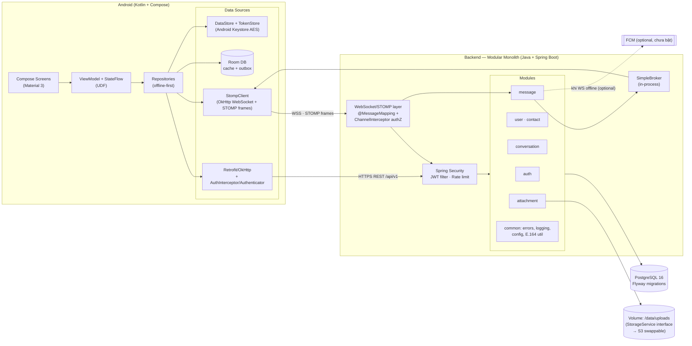
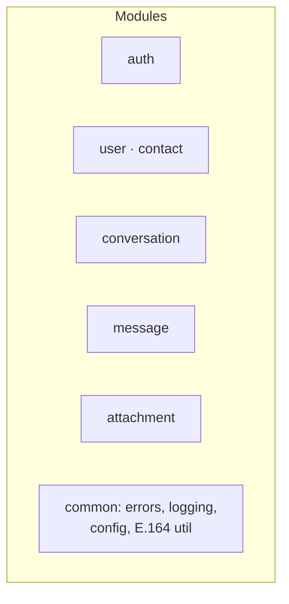

# NexaChat Architecture

> Diagrams verbatim from the master design (§7). Summary: Android client
> (Compose + MVVM/UDF, offline-first Room) → REST `/api/v1` + STOMP over
> WebSocket → Spring Boot modular monolith → PostgreSQL 16 + file volume.

## 1. Container diagram (§7.1 — sơ đồ tổng)

Overall system containers and their connections:



## 2. Module diagram (backend modules — extracted verbatim from §7.1)

The monolith is split into feature modules, each with its own
Controller/Service/Repository — one deployable unit:



## 3. Send-message sequence (§7.2 — luồng gửi tin)

Persist-before-broadcast with `clientMessageId` idempotency and watermark read
receipts:

```mermaid
sequenceDiagram
    participant A as Máy A (Compose)
    participant S as Spring Backend
    participant DB as PostgreSQL
    participant B as Máy B

    A->>A: optimistic insert Room (SENDING, clientMessageId)
    A->>S: STOMP SEND /app/conversations/42/messages<br/>{clientMessageId, content}
    S->>S: authN (JWT) + authZ (member of 42) + validate
    S->>DB: TX: INSERT messages (seq BIGSERIAL)<br/>ON CONFLICT (sender,clientMessageId) → return existing<br/>UPDATE conversations.last_message_*
    DB-->>S: message{seq, createdAt}
    S-->>A+B: STOMP MESSAGE → /topic/conversations.42<br/>event MESSAGE_CREATED
    A->>A: match clientMessageId → SENT
    B->>B: render + unread++ (watermark chưa đọc)
    Note over B: khi mở chat → POST /conversations/42/read {upToSeq}<br/>→ A nhận MESSAGE_READ cập nhật "Đã xem"
```

*Why monolith, not microservices:* modules are separated by package with clear
boundaries, deployed as one unit — clean enough to discuss architecture,
simple enough for the team to operate; microservices at this scale only add
network/distributed-transaction complexity.
