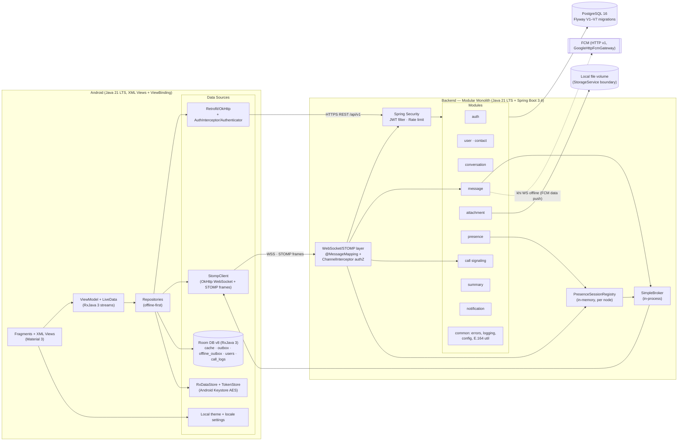
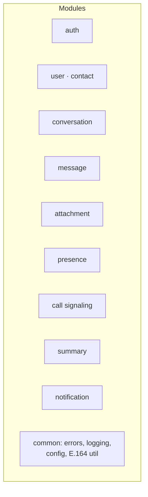

# NexaChat Architecture

> Current implementation view: Android app (Java 21 LTS, XML Views + Fragments +
> ViewBinding, ViewModel + LiveData, RxJava 3, offline-first Room v8) → REST
> `/api/v1` + STOMP over WebSocket → Spring Boot 3.4 modular monolith → PostgreSQL 16
> (Flyway V1–V7) + file volume. Call signaling shares STOMP (`server/call`,
> `app/call/core/StompCallSignalingClient.java`), paired with Android call screens
> (`CallActivity`, `IncomingCallActivity`) and WebRTC audio (`WebRtcMediaEngine`);
> see [docs/calls.md](calls.md).

## 1. Container diagram (§7.1 — sơ đồ tổng)

Overall system containers and their connections:



## 2. Backend module diagram

The monolith separates feature code by package and deploys as one backend
unit. Individual modules use the controller/service/repository layers they
need; the diagram is a package overview, not a claim that every package has
all three layers.



## 3. Send-message sequence

Persist-before-broadcast with `clientMessageId` idempotency and watermark read
receipts:

```mermaid
sequenceDiagram
    participant A as Máy A (Fragment UI)
    participant S as Spring Backend
    participant DB as PostgreSQL
    participant B as Máy B

    A->>A: optimistic insert Room (SENDING, clientMessageId)
    A->>S: STOMP SEND /app/conversations/42/messages<br/>{clientMessageId, content}
    S->>S: authN (JWT) + authZ (member of 42) + validate
    S->>DB: TX: INSERT messages (seq BIGSERIAL)<br/>ON CONFLICT (sender,clientMessageId) → return existing<br/>UPDATE conversations.last_message_*
    DB-->>S: message{seq, createdAt}
    S-->>A+B: STOMP MESSAGE → /topic/conversations.42<br/>event MESSAGE_CREATED
    A->>A: match clientMessageId → SENT (1 tick)
    B->>B: render + unread++ (watermark chưa đọc)
    B->>S: STOMP SEND /app/conversations/42/delivered {upToSeq}
    S-->>A: STOMP MESSAGE_DELIVERED {userId, upToSeq}<br/>(A renders 2 gray ticks)
    Note over B: khi mở chat → POST /conversations/42/read {upToSeq}<br/>→ A nhận MESSAGE_READ cập nhật 2 vạch xanh ("Đã xem")
```

## 4. Edit, delete, sync and offline outbox

- **Edit:** an authenticated conversation member may edit their own `TEXT`
  message. The server trims and validates content, updates `editedAt`, commits,
  then broadcasts `MESSAGE_UPDATED`. Repeating the same normalized content is
  a no-op. The REST search endpoint searches live `TEXT` rows in one
  conversation using escaped, accent-insensitive `unaccent` + `ILIKE` matching.
- **Delete:** the author soft-deletes their message. The row and sequence stay
  in history as a tombstone (`content: null`); reactions and pins are removed.
  Attachment metadata and stored bytes are retained, but the deleted message's
  attachments cannot be downloaded through the message binding.
- **Delta Sync:** client `SyncEngine` aggregates all conversation watermark sequences
  from Room v8, requests `POST /api/v1/sync`, and atomically applies new messages,
  edits, tombstones, and reaction updates in a single Room transaction, backed by
  server covering index `idx_messages_delta_sync` on `(conversation_id, seq)`.
- **Offline Outbox & WorkManager:** pending optimistic messages (`outbox`) and
  the `offline_outbox` action table (RFC 4122 UUIDv5 idempotency keys) are drained by
  `OutboxSyncWorker` via WorkManager with `NetworkType.CONNECTED` constraints and atomic
  lease locking. Reaction and pin toggles write the optimistic state and enqueue a durable
  action in one Room transaction; the dispatcher replays the stored idempotency key,
  retries transient failures with exponential backoff, and rolls back on a permanent 4xx.
- **Presence:** each authenticated STOMP session contributes to an
  in-memory per-user count. After commit, presence goes only to DIRECT peers
  when the subject allows presence. Hiding one's presence is one-way; it does
  not hide the peers from that user. Last-disconnect offline notification is
  coalesced for five seconds.

Theme mode (`SYSTEM`, `LIGHT`, `DARK`) and locale are local Android settings;
they are applied by the app and are not persisted as server account settings.

*Why monolith, not microservices:* modules are separated by package with clear
boundaries, deployed as one unit — clean enough to discuss architecture,
simple enough for the team to operate; microservices at this scale only add
network/distributed-transaction complexity.
