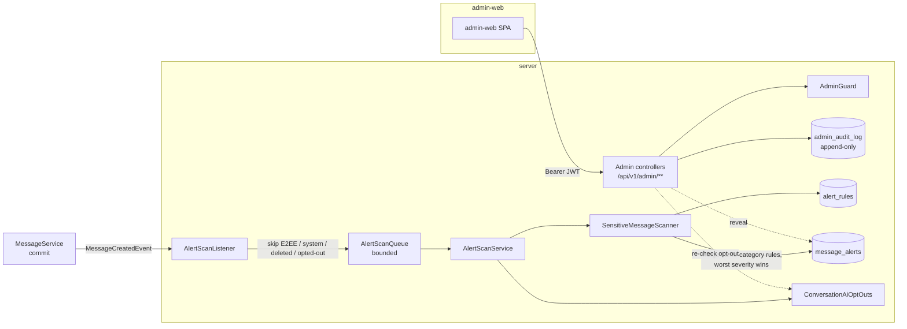

# Admin console

Status: server APIs + `admin-web` frontend shipped (Flyway V36). Headline feature: sensitive-message alerts.

## What it does

A separate staff console for system and account management:

- **Accounts** — list/search/filter users, detail counters, suspend/unsuspend (suspension revokes access and refresh tokens and locks REST + WebSocket use), revoke sessions, role changes, staff warnings delivered as in-app notices.
- **Alerts** — asynchronous sensitive-message detection on committed messages, a triage queue with acknowledge/assign/resolve/dismiss/escalate/warn-sender workflow, bulk dismiss, notes, and an audited, rate-limited content-reveal.
- **Rules** — built-in and custom detection rules (KEYWORD, REGEX, payment-CARD detector), enable/severity editing, live pattern test.
- **Audit** — append-only `admin_audit_log` browsable by actor, action, target, time.
- **System** — KPIs (signups, DAU/WAU, messages, calls, DB/uploads size, 5xx rate), 7, 30 or 90 day series, service health, scan-queue depth.

Two staff roles: `ADMIN` (all mutations) and `MODERATOR` (reads, triage, and suspend, revoke sessions or warn on plain accounts). Configured `nexachat.security.admin-phones` accounts are promoted to `ADMIN` at startup and login (`AdminRoleBootstrap`); promotion is never auto-revoked by config removal.

## Architecture

## Trust boundaries

- **Authorization** — every `/api/v1/admin/**` route calls `AdminGuard.requireStaff()` (ADMIN or MODERATOR); destructive/staff-target mutations additionally require ADMIN inside the service. Ordinary users get the standard 403 envelope.
- **Suspension** — enforced at JWT filter (access tokens), refresh, STOMP connect/per-action, and `MessageService.send`; suspension revokes refresh tokens plus `users.tokens_valid_after` and evicts the validity cache via `AccessTokensRevokedEvent`.
- **Self/peer guards** — staff cannot suspend or demote themselves, cannot act on the last live ADMIN, and moderators cannot touch staff accounts.
- **E2EE** — messages carrying an `encryption` payload are never scanned and are excluded from reveal queries.
- **AI opt-out** — the scanner skips senders who opted out; a `ConversationAiOptOutEvent` tombstones snippets on pending alerts; reveal re-checks opt-out at read time so later opt-outs cannot be bypassed.
- **Reveal** — bounded context window, per-minute budget (`nexachat.admin.reveal.per-minute`), mandatory reason, audited.
- **Audit** — successful mutations record inside the same transaction, so a failed audit write rolls the action back with it; denied attempts record via `REQUIRES_NEW`; DB triggers make the table append-only. Bulk dismiss stores the comma-joined alert id list in `target_id`.

## Frontend

`admin-web/` — Vite + React + TypeScript, hand-written CSS (Tonal Plum tokens, seed `#733F68`), light/dark themes, EN/VI strings, session tokens in `sessionStorage` with single-flight refresh on 401. React's default escaping renders all user-controlled content (snippets, names, patterns) as text. Deployed separately from `site/`; `vercel.json` carries a CSP and SPA rewrites, dev uses a Vite proxy to the local server.

## Schema (V36)

`users.role`, `users.suspended_at`, `users.suspended_reason`, `users.suspended_by` + `admin_audit_log` (immutable triggers), `alert_rules` (a seeded set of built-in rules), `message_alerts`, `alert_notes`, `user_notices`. Retention purge `AlertRetentionPurge` is opt-in (`nexachat.admin.alerts.retention.enabled`) and supports dry-run.
