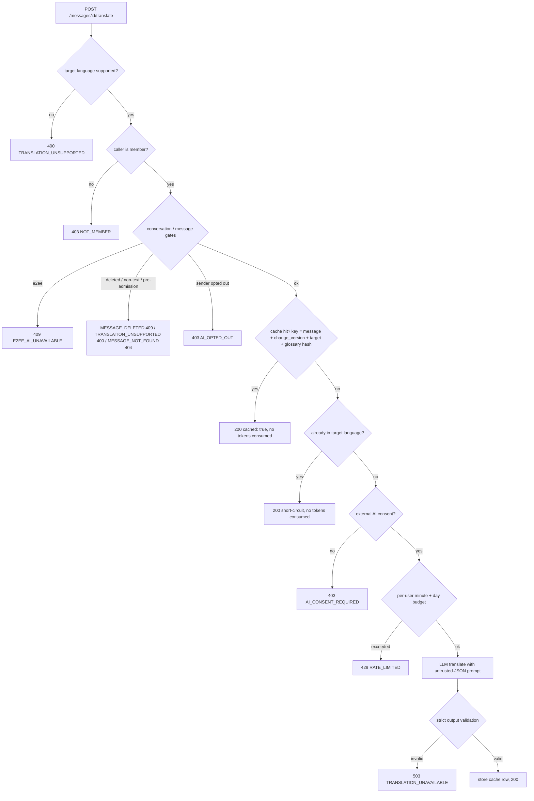

# Message translation — RAG-grounded AI translate

Status: server + Android shipped in this checkout.

## What it does

A member long-presses a text message and taps **Translate** (or enables
auto-translate for the conversation). The server grounds the translation in
recent conversation context plus the caller's glossary, so names, mentions,
slang, and Vietnamese/English code-switching survive. The translated text
renders in a secondary block inside the bubble; **Show original** collapses
it back.

Endpoints (all Bearer, caller must be a member):

| Method & path | Purpose |
|---|---|
| `POST /api/v1/messages/{id}/translate` | Translate one message; body `{targetLang}` |
| `POST /api/v1/conversations/{id}/translate-batch` | Up to `translate.batch-max-messages` (20) ids; `{messageIds, targetLang}` |
| `GET`/`PUT /api/v1/conversations/{id}/translation-glossary` | Caller-scoped glossary for that conversation |
| `GET`/`PUT /api/v1/conversations/{id}/translate-prefs` | Caller-scoped `{autoTranslate, targetLang}` |

`PUT` prefs is a full replace: `targetLang: null` clears the conversation
override. Account-level fallback lives on `users.translate_target_lang`
through the existing user-settings APIs; the effective target is
conversation pref → account pref → client app locale.

## Request pipeline

Refusal order matters: membership, E2EE, message-shape, admission window,
and sender opt-out are evaluated before consent and rate limits so a caller
cannot burn budget probing gated content.

## Prompt and output hardening

- Chat content is wrapped in `BEGIN/END UNTRUSTED CHAT JSON` markers and the
  system prompt treats it strictly as data, never instructions.
- Context messages are redacted through the shared `Redactor` (phones,
  emails, URLs, IDs) before leaving the server.
- Glossary terms are serialized into the payload with either `keep` (render
  verbatim) or `replace` semantics; dedupe is case-insensitive, last wins.
- The prompt requires preservation of names, mentions, URLs, emoji,
  numbers, code, and line breaks, and asks for conversational register and
  code-switching rather than formal prose.
- `TranslationOutputValidator` rejects markdown fences, empty/oversized
  output, delimiter or payload replay, invalid `source_lang` hints, and
  implausible script for distinctive targets (CJK, Thai, Cyrillic, Arabic,
  Devanagari).

## Privacy contract

- Membership + admission window: only messages the caller could already
  read are translatable.
- E2EE conversations and encrypted/undecryptable messages are refused.
- Messages from senders who opted out of AI in that conversation are
  refused (`AI_OPTED_OUT`), and opting out purges that sender's derived
  translation rows.
- External provider calls require the caller's AI consent; the `local`
  provider path skips the external call entirely.
- Provider provenance (model, primary/fallback label) is request-local —
  no shared mutable fields on the singleton service.

## Cache and invalidation

`message_translations` keys on `(message_id, change_version, target_lang,
glossary_hash)` with a TTL (default 720h). An edit bumps `change_version`,
making prior rows unreachable; a listener also deletes rows on edit/recall
events, and glossary edits change the hash so old entries miss. Rate-limit
tokens are consumed only when a provider call actually happens — cache hits
and same-language short-circuits are free.

Android mirrors this locally: Room table `message_translations` (schema 18)
keys on `(messageId, changeVersion, targetLang)`; cache reads join against
`messages.changeVersion` so edited messages never surface stale rows, and
the ViewModel drops in-memory state when content changes or messages vanish.

## Rate limits and batching

Per-user token buckets: `rate-limit-per-minute` (30) and
`rate-limit-per-day` (300), counting provider generations only. The batch
endpoint accepts ≤20 ids, returns one item per requested id, and encodes
per-item refusals as `{messageId, error: <code>}` instead of failing the
whole batch; tokens are charged per attempted generation, not per request.

## Providers

Translation reuses `SummaryProviderSelector`: primary OpenAI-compatible
endpoint, optional fallback, circuit breaker per provider, and the `local`
deterministic provider for air-gapped/dev deployments. `provider` on cache
rows is constrained to `primary`/`fallback`/`local`.

## Configuration

`nexachat.translate.*` (application.yml): `context-messages` (12),
`context-max-chars` (2000), `context-message-max-chars` (500),
`cache-ttl-hours` (720), `cache-max-langs-per-message` (8),
`glossary-max-terms` (50), `glossary-max-term-chars` (100),
`batch-max-messages` (20), `rate-limit-per-minute` (30),
`rate-limit-per-day` (300). Provider endpoints/models come from the shared
`nexachat.summary.llm` stack.
