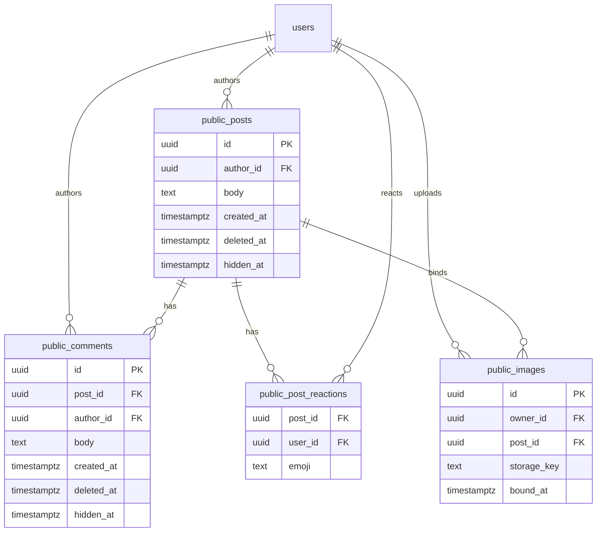
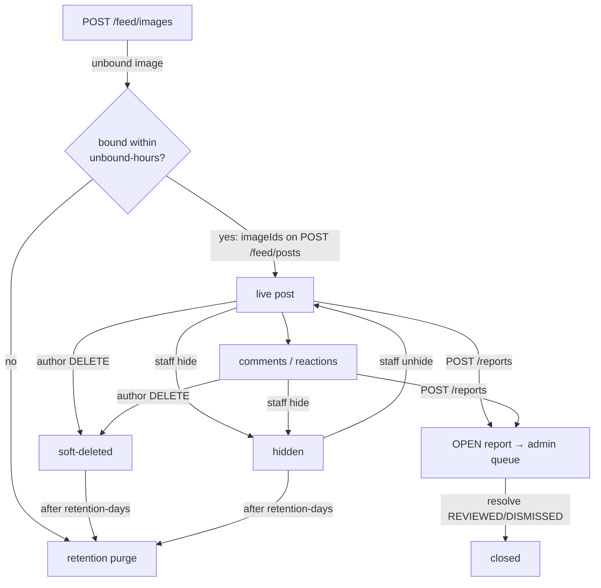

# Public feed

A plaintext, account-wide feed: any authenticated user can read every
non-hidden, non-deleted post and comment — the feed is **public and
unencrypted by design**, the opposite of the E2EE direct-chat surface.
It supports text posts with optional images, comments, and per-user emoji
reactions. `docs/architecture/api-contract.md` lists the routes; the staff
moderation page lives at `admin-web/` `/feed`.

## Data model (V43)

`reports.target_type` gained `POST` and `COMMENT` so feed content flows
through the existing abuse-report path (`POST /api/v1/reports`).

## Visibility predicate

Every read/list applies the same predicate: a post or comment is visible when
`deleted_at IS NULL AND hidden_at IS NULL`. Soft-deleted (author removed it)
and hidden (staff moderated it) rows are excluded from listings and single
reads alike and answer `POST_NOT_FOUND`/`COMMENT_NOT_FOUND`. Deleted parents
cascade visibility: comments on a deleted or hidden post are not listed even
when the comment rows themselves are clean.

## Lifecycle

- **Upload-first images** mirror message attachments: `POST /feed/images`
  stores an unbound image owned by the uploader; `imageIds` on
  `POST /feed/posts` bind them. Images never bound are purged after
  `nexachat.retention.jobs.public-feed.unbound-hours` (default `24`).
- **Soft delete** stamps `deleted_at`; **hide** stamps `hidden_at` (staff
  only, with a mandatory `reason` ≤500 chars, audit-logged).
- **Hard purge** is the opt-in `nexachat.retention.jobs.public-feed` retention
  job (default `enabled=false`): rows soft-deleted or hidden longer than
  `retention-days` (default `30`) are removed.

## Rate limits and abuse

Post and comment creation and image upload are per-user rate limited
(`RATE_LIMITED` 429 with `Retry-After`). Reporting feeds the shared abuse
pipeline (20/hour per user) with OPEN-report dedupe — a second report on the
same target returns `200` with the existing row.

## Privacy

Everything on the feed is server-readable plaintext reachable by every
account: author display name, body, and images are public surfaces. Author
deletion is a soft delete — content persists for the retention window so
staff can act on reports. Report handling stores the target body (≤500 chars)
as the evidence `messageSnapshot`; the admin queue returns reporter/author
names and the target body but no phone or email.
