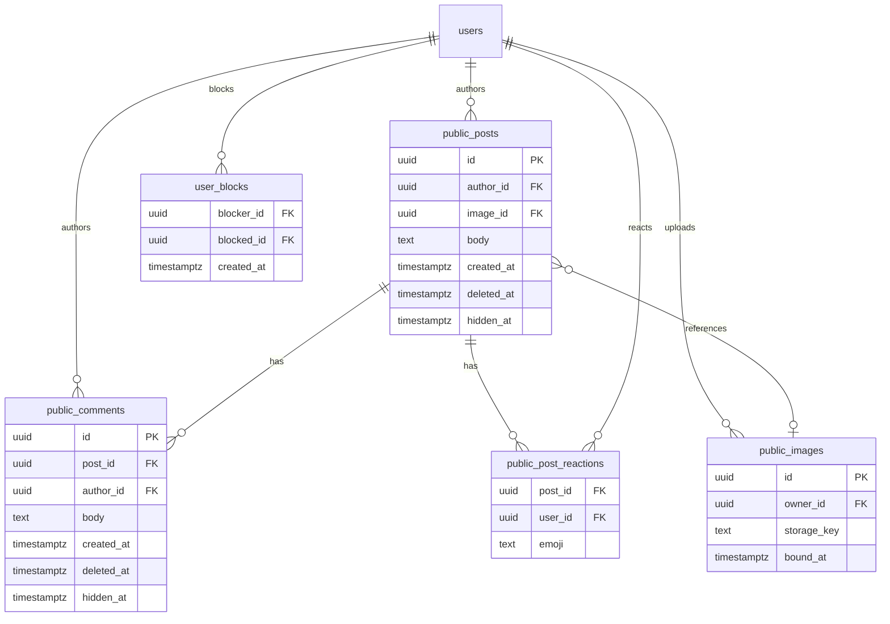
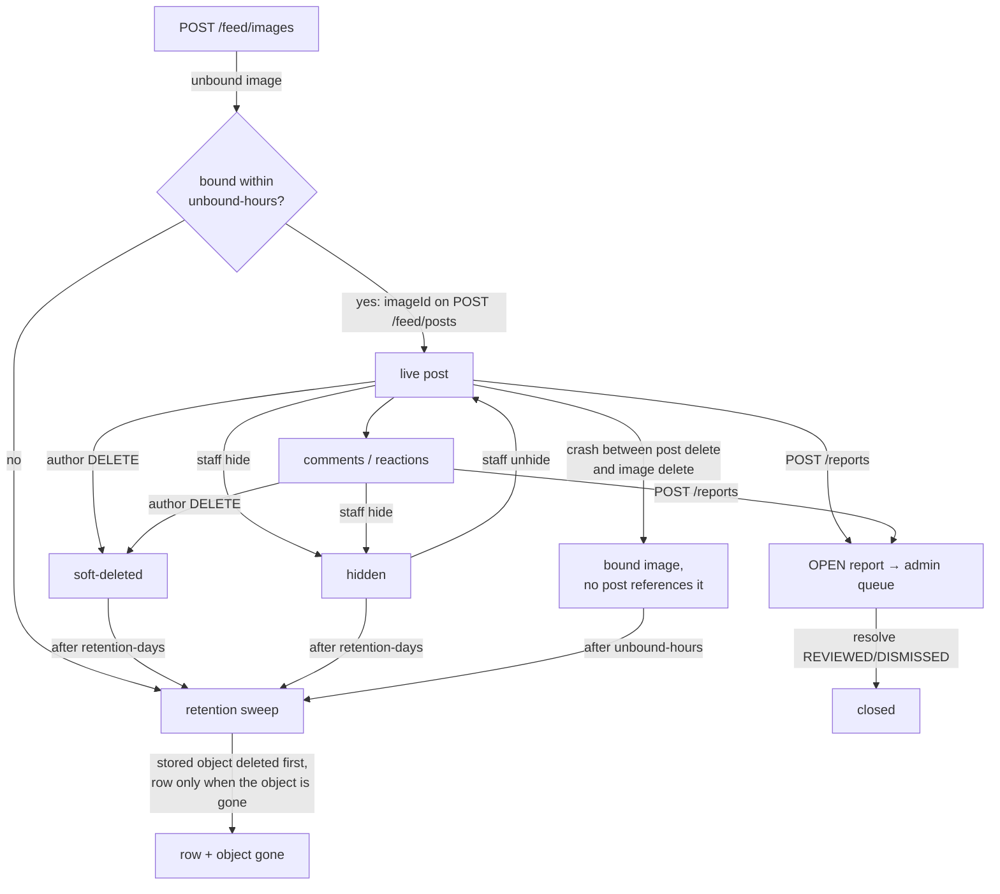

# Public feed

A plaintext, account-wide feed: any authenticated user can read every
non-hidden, non-deleted post and comment, except rows whose author is
soft-deleted or where the viewer and that author have a block in either
direction — the feed is **public and unencrypted by design**, the opposite of
the E2EE direct-chat surface.
It supports text posts with optional images, comments, and per-user emoji
reactions. `docs/architecture/api-contract.md` lists the routes; the staff
moderation page lives at `admin-web/` `/feed`.

## Data model (V43)

`reports.target_type` gained `POST` and `COMMENT` so feed content flows
through the existing abuse-report path (`POST /api/v1/reports`).

## Visibility predicate

Every read/list applies the same predicate, evaluated per viewer:

- the row itself is live — `deleted_at IS NULL AND hidden_at IS NULL`;
- its author is not soft-deleted — `users.deleted_at IS NULL` on the joined
  author row;
- no block edge exists in either direction between the viewer and the author —
  `NOT EXISTS (SELECT 1 FROM user_blocks b WHERE (b.blocker_id = :viewer AND
  b.blocked_id = author_id) OR (b.blocker_id = author_id AND b.blocked_id =
  :viewer))`. `user_blocks` is a directed pair, so both directions are checked:
  a row disappears from the viewer whether the viewer blocked the author or the
  author blocked the viewer.

Posts and comments each carry that predicate (`POST_VISIBLE` and
`COMMENT_VISIBLE` in `FeedStore`). Comments add one more condition: the parent
post must itself be visible to the viewer, so a comment on a deleted, hidden or
blocked post is not listed and cannot be reported even when the comment row is
clean. Failing the predicate answers `POST_NOT_FOUND` /
`COMMENT_NOT_FOUND` rather than `403`, so a moderated, deleted or blocked row is
indistinguishable from a missing one.

## Lifecycle

- **Upload-first images** mirror message attachments: `POST /feed/images`
  stores an unbound image owned by the uploader; `imageId` on
  `POST /feed/posts` binds it (one image per post). An uploader may keep at
  most 20 unbound images; beyond that, uploads answer `RATE_LIMITED`.
  Images that no post references — never bound, or left bound by a crash
  between the post delete and the image delete — are swept after
  `nexachat.retention.jobs.public-feed.unbound-hours` (default `24`) once
  the retention sweep is enabled. The stored object is deleted before its
  row, and a row whose object delete failed is kept so the next run retries;
  an already-missing object still lets the row go.
- **Soft delete** stamps `deleted_at`; **hide** stamps `hidden_at` (staff
  only, with a mandatory `reason` ≤500 chars, audit-logged).
- **Hard purge** is the opt-in `nexachat.retention.jobs.public-feed` retention
  job, **off by default** (`enabled=false`): rows soft-deleted or hidden
  longer than `retention-days` (default `30`) are removed. Enable it with
  `nexachat.retention.jobs.public-feed.enabled=true` (requires the global
  `nexachat.retention.enabled` as well); until then nothing is swept.
- **`commentCount`** on a post counts its visible comments (not deleted, not
  hidden): creating a comment raises it, the author's delete lowers it, and
  staff hide/unhide moves it — a comment that is both deleted and hidden is
  never counted twice.

## Rate limits and abuse

Per-user rate limits (`RATE_LIMITED` 429 with `Retry-After`): posts 3 per
minute and 30 per day, comments 10 per minute and 200 per day, image uploads
10 per minute and 100 per day (plus the 20-unbound cap above), reactions
60 per minute. A user may place at most 8 distinct emojis on one post;
re-adding one already placed is a no-op. Reporting feeds the shared abuse
pipeline (20/hour per user) with OPEN-report dedupe — a second report on the
same target returns `200` with the existing row.

## Privacy

Everything on the feed is server-readable plaintext reachable by every
account: author display name, body, and images are public surfaces. Author
deletion is a soft delete — content persists for the retention window so
staff can act on reports. Report handling stores the target body (≤500 chars)
as the evidence `messageSnapshot`; the admin queue returns reporter/author
names and the target body but no phone or email.
