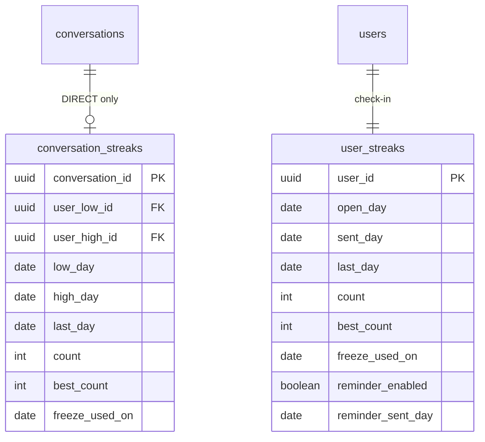

# Chat streaks

A streak counts consecutive days on which both members of a DIRECT
conversation sent at least one message (a *chat streak*), or on which one user
both opened the app and sent a message (the per-user *check-in streak*).
The Android app shows the count on inbox entries and in the conversation;
`docs/architecture/api-contract.md` lists the routes.

## Data model (V42)



`conversation_streaks` holds one row per DIRECT pair; `user_low_id`/
`user_high_id` are the two members ordered by canonical lowercase uuid text
(the same ordering as `conversations.direct_key`), so a pair maps to one row
whichever side writes first. `low_day`/`high_day` are the last streak day each
side sent on; `last_day` is the last day *both* had sent, which is what `count`
is measured against. `user_streaks` is the app-wide check-in streak:
`open_day`/`sent_day` feed the same engine.

## Day boundary and grace rules

Days are measured in `nexachat.streaks.zone` (default `UTC`), a single
server-wide zone — NexaChat has no per-user time zone, so both members share
one day boundary regardless of where they are.

- A send records the sender's side for the streak day it lands in.
- When both sides of a pair have sent on the same day and that day is
  `last_day + 1`, `count` increments; same-day repeats are no-ops.
- Missing one day consumes the chain's single grace day
  (`freeze_used_on`) once per rolling week — the streak stays alive and
  `atRisk` stays true until the second missed day.
- Missing two consecutive days lapses the streak: `count` resets on the next
  completed day and `best_count` keeps the historical maximum.
- `milestone` surfaces the highest crossed threshold (e.g. 7/30/100) for
  celebration UI.

`nexachat.streaks.enabled` (default `true`) gates recording; reads still
return the last stored state while it is off.

## Reminder push

`StreakReminderJob` runs when `nexachat.streaks.reminders-enabled` is `true`
(default) and sends a `STREAK_REMINDER` push once per day at
`nexachat.streaks.reminder-hour` (default `20`, local to the streak zone) to
accounts whose chain is at least `nexachat.streaks.reminder-min-count`
(default `3`) and who opted in via the `streakReminders` user setting
(`PATCH /users/me/settings`, default `false`). `reminder_sent_day` on
`user_streaks` dedupes the send. A user whose every device token now belongs
to a newer registrant on another account keeps the day unclaimed: the
reminder is skipped, not consumed, and goes out on a later day once the user
owns a token again.

```mermaid
flowchart LR
    A[Send or check-in] -->|recordSend / recordOpen| B(StreakStore)
    B --> C{Both sides sent<br/>on streak day?}
    C -->|yes, day+1| D[count++ / update last_day]
    C -->|no| E[wait for peer]
    F[missed day] -->|freeze unused this week| G[consume grace day]
    F -->|already used| H[streak lapses, count resets]
    I[StreakReminderJob<br/>@ reminder-hour] -->|count ≥ min & opted in| J[STREAK_REMINDER push]
```

## Privacy

Streak state is derived from send timestamps only — no message content is
read or stored in the streak tables. A chat streak is visible only to the two
members (`GET /api/v1/conversations/{id}/streak` enforces membership); the
check-in streak is visible only to its owner (`GET /api/v1/streaks/me`).
Inbox `streakCount`/`streakAtRisk` leak nothing beyond what the member already
sees in the conversation.

The `STREAK_REMINDER` push is data-only and carries exactly `type`,
`recipientId`, `conversationId`, `peerName` and `count`. `peerName` is the
peer's display name, the same way a new-message push carries the sender's
display name as `senderName`; the client builds the visible text. The payload
contains no message content.
