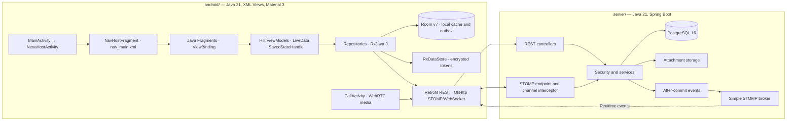

# BÁO CÁO KỸ THUẬT — NexaChat
## Real-time Android Messaging Platform

| Trường | Nội dung |
|---|---|
| Dự án | NexaChat — Real-time Messaging Platform |
| Nền tảng | Android native client và Spring Boot server |
| Ngôn ngữ triển khai | Java 21 ở `android/` và `server/` |
| Cơ sở dữ liệu | PostgreSQL 16 · Room schema v7 |
| Nhóm | `{{GROUP_NAME}}` |
| Thành viên | `{{MEMBER_1}}` · `{{MEMBER_2}}` · `{{MEMBER_3}}` · `{{MEMBER_4}}` |

> Báo cáo được dựng từ nguồn Markdown này bằng `python tools/build-report.py`.
> Đối chiếu mã nguồn tại đúng commit khi kiểm tra số liệu thực thi.

---

## Mục lục / Table of Contents

1. Giới thiệu và phạm vi
2. Yêu cầu và tiêu chí nghiệm thu
3. Kiến trúc tổng thể
4. Android client thuần Java
5. Server và cơ sở dữ liệu
6. REST và realtime contract
7. Bảo mật và dữ liệu riêng tư
8. Offline-first, đa ngôn ngữ và xoay màn hình
9. Tính năng và trải nghiệm người dùng
10. Kiểm thử và bằng chứng
11. Cài đặt và trình diễn
12. Hạn chế và hướng phát triển
13. Phân công thành viên
14. Kết luận

## 1. Giới thiệu và phạm vi

**NexaChat** là ứng dụng nhắn tin realtime trên Android. Người dùng đăng ký
bằng số điện thoại, tìm và kết nối với người dùng khác, trò chuyện trực tiếp
hoặc theo nhóm, gửi tệp đa phương tiện, và sử dụng các thao tác trả lời,
reaction, ghim, chuyển tiếp tin nhắn. Client hỗ trợ tiếng Việt và tiếng Anh,
chủ đề sáng/tối, lưu tin nhắn gửi khi ngoại tuyến, và cuộc gọi thoại 1-1.

Client Android và server đều được triển khai bằng **Java 21**. Android dùng
Android XML Views, Material 3, Java Fragments, AndroidX ViewModel, Room,
RxJava 3 và Retrofit. Server dùng Spring Boot, PostgreSQL và giao thức STOMP
trên WebSocket cho cập nhật realtime. Kho mã nguồn Android hiện có 385 tệp
Java trong cây mã ứng dụng và kiểm thử.

**Phạm vi chính:** xác thực và hồ sơ; tìm kiếm người dùng, danh bạ; chat trực
tiếp và nhóm; tin nhắn văn bản, ảnh, video, âm thanh và tệp; tìm kiếm lịch sử;
đọc tin, trạng thái online; reaction, trả lời, ghim và chuyển tiếp; bản địa hóa;
trạng thái ngoại tuyến; cuộc gọi thoại; tóm tắt hội thoại có kiểm soát đồng ý.

**Ngoài phạm vi:** mã hóa đầu cuối, đồng bộ danh bạ thiết bị, thông báo đẩy
FCM, cuộc gọi video, triển khai nhiều vùng và cam kết tải hàng triệu người
dùng. Những mục này không được xem là tính năng đã giao.

## 2. Yêu cầu và tiêu chí nghiệm thu

| Nhóm | Kết quả cần có | Bằng chứng chính |
|---|---|---|
| Tài khoản | Đăng ký, đăng nhập, làm mới phiên, đăng xuất và hồ sơ | `server/` auth APIs; Android auth screens và `TokenStore.java` |
| Liên hệ | Tìm theo số điện thoại, thêm/xóa liên hệ, mở chat trực tiếp | `ContactsFragment.java`, `UserSearchFragment.java`, REST API |
| Chat | Nhắn tin trực tiếp và nhóm, lịch sử có phân trang, trạng thái đọc | `ChatFragment.java`, `MessageRepository.java`, STOMP contract |
| Tệp | Chọn, tải lên, tải xuống và xem nội dung được hỗ trợ | `MediaPickerSheetFragment.java`, `MediaViewerFragment.java`, attachment API |
| Trạng thái | Giao diện Việt/Anh, chủ đề, xoay màn hình, lưu nháp | Android resources, ViewModel, `SavedStateHandle`, layout variants |
| Tương tác | Trả lời, reaction, ghim và chuyển tiếp | Chat UI, repository, message interaction APIs |
| Tính năng thêm | Cuộc gọi thoại 1-1 và tóm tắt hội thoại | `CallActivity.java`, `SummaryBottomSheetFragment.java` |
| Chất lượng | Hành vi trọng yếu có kiểm thử tự động và migration được kiểm tra | Android unit tests, `RoomMigrationTest.java`, server tests |

Tiêu chí đánh giá theo rubric và bản đồ bằng chứng chi tiết nằm trong
[`docs/rtm.md`](rtm.md). Trạng thái kiểm thử thay đổi theo revision; chỉ dùng
kết quả của lần chạy tương ứng với commit được đánh giá.

## 3. Kiến trúc tổng thể

Client và server cùng nằm trong một repository nhưng có thể build riêng. REST
phục vụ thao tác request/response, dữ liệu hồ sơ, tìm kiếm, lịch sử và tệp.
STOMP trên WebSocket gửi sự kiện chat và trạng thái. Phía server dùng lại
service nghiệp vụ cho các đường vào tương ứng; sự kiện tin nhắn được phát sau
khi giao dịch ghi dữ liệu đã commit. Phía Android lưu dữ liệu nhận được vào
Room rồi để luồng truy vấn cập nhật giao diện.

| Thành phần | Công nghệ và trách nhiệm |
|---|---|
| Android | Java 21; XML Views; Material 3; Java Fragments; Jetpack Navigation |
| Trình bày | AndroidX ViewModel, `LiveData`, `MutableLiveData`, `SavedStateHandle` |
| Bất đồng bộ | RxJava 3, RxAndroid; `Single`, `Maybe`, `Completable`, `Flowable` |
| HTTP và realtime | Retrofit/OkHttp; client STOMP riêng trên WebSocket |
| Lưu cục bộ | Room RxJava 3 integration, schema version 7; RxDataStore Preferences |
| Dependency injection | Hilt, xử lý annotation Java |
| Ảnh và media | Glide; AndroidX Media3 ExoPlayer |
| Server | Java 21, Spring Boot 3.4.1, REST, STOMP, PostgreSQL 16 |
| Build | Android Gradle; Maven cho server; Docker Compose cho dịch vụ demo |

## 4. Android client thuần Java

### 4.1. Activity, Navigation và giao diện

`MainActivity.java` là Activity khởi động và kế thừa `NexaHostActivity.java`.
Host chứa `NavHostFragment`, dùng đồ thị điều hướng
`android/app/src/main/res/navigation/nav_main.xml`. Các màn nghiệp vụ là Java
Fragments với XML layout và ViewBinding. Các thành phần Material 3 được dùng
trực tiếp trong giao diện native.

| Khu vực | Java class tiêu biểu |
|---|---|
| Khởi động và xác thực | `feature/splash/SplashFragment.java`, `feature/auth/LoginFragment.java`, `feature/auth/RegisterFragment.java` |
| Hộp thư và trò chuyện | `feature/inbox/InboxFragment.java`, `feature/chat/ChatFragment.java` |
| Liên hệ và tìm kiếm | `feature/contacts/ContactsFragment.java`, `feature/contacts/UserSearchFragment.java` |
| Nhóm | `feature/group/CreateGroupFragment.java`, `feature/group/GroupDetailFragment.java` |
| Tệp và hồ sơ | `feature/media/MediaViewerFragment.java`, `feature/media/MediaPickerSheetFragment.java`, `feature/profile/ProfileFragment.java` |
| Tóm tắt và ngôn ngữ | `feature/summary/SummaryBottomSheetFragment.java`, `feature/profile/LanguageSettingsFragment.java` |
| Cuộc gọi | `call/ui/CallActivity.java` |

Danh sách dùng `RecyclerView` với các adapter dựa trên `ListAdapter` và
`DiffUtil.ItemCallback`, ví dụ `feature/chat/adapter/MessageListAdapter.java`
và `feature/inbox/adapter/ConversationListAdapter.java`. Cách này tính phần tử
thay đổi theo danh tính và nội dung, thay vì dựng lại toàn bộ danh sách mỗi lần
trạng thái mới đến.

### 4.2. ViewModel và trạng thái

Các màn hình gắn với AndroidX `ViewModel`, một số ViewModel được Hilt tạo qua
`@HiltViewModel`. `LiveData`/`MutableLiveData` đưa trạng thái giao diện đến
Fragment; `SavedStateHandle` giữ các giá trị ngắn hạn cần phục hồi, chẳng hạn
định danh hội thoại và bản nháp. Sự kiện điều hướng hoặc thao tác một lần dùng
các wrapper có đánh dấu đã tiêu thụ, như `ChatSingleLiveEvent` và
`GroupSingleLiveEvent`.

ViewModel giữ các RxJava subscription cần thiết trong `CompositeDisposable`
và giải phóng chúng tại `onCleared()`. Khi đổi cấu hình, Android giữ ViewModel
trong vòng đời cấu hình và khôi phục state đã lưu; Fragment tạo lại View nhưng
quan sát lại cùng state. Màn chat có layout dọc
`res/layout/fragment_chat.xml` và ngang
`res/layout-land/fragment_chat.xml`.

### 4.3. RxJava 3 và ranh giới luồng

Các thao tác một lần dùng `Single<T>`, `Maybe<T>` hoặc `Completable`. Luồng dữ
liệu và sự kiện dùng `Flowable<T>` cùng `BehaviorProcessor<T>` hoặc
`PublishProcessor<T>`. Repository đăng ký công việc I/O trên `Schedulers.io()`;
RxAndroid đưa cập nhật quan sát của giao diện về main thread. `CompositeDisposable`
được sở hữu bởi component có vòng đời subscription.

`ApiResult.safeApiCall(Call<T>)` bọc Retrofit call và chạy network I/O trên
I/O scheduler. Kết quả phân biệt thành công, lỗi HTTP và lỗi kết nối để tầng
repository ánh xạ sang trạng thái nghiệp vụ. Với STOMP, `RealtimeSession` đưa
frame vào event stream; repository cập nhật Room trước khi giao diện quan sát
dữ liệu mới.

### 4.4. Room và lưu thông tin xác thực

`AppDatabase.java` khai báo Room schema version 7. Các DAO chính là
`MessageDao.java`, `ConversationDao.java`, `OutboxDao.java`,
`ReactionDao.java` và `PinDao.java`. Room hỗ trợ RxJava 3; compiler được chạy
bằng Java annotation processor. Migration được khai báo tường minh để dữ liệu
người dùng còn tương thích khi nâng phiên bản.

`TokenStore.java` lưu Preferences bằng `RxDataStore<Preferences>` từ
`datastore-preferences-rxjava3`. `AesGcmTokenCipher.java` mã hóa token bằng
AES-256-GCM với khóa trong Android Keystore. Token chỉ được giải mã tại client
khi cần gọi API; server vẫn kiểm tra token và quyền truy cập độc lập.

### 4.5. Dependency injection, media và kiểm thử

Hilt cung cấp đối tượng qua `dagger.hilt.android`; compiler dùng
`annotationProcessor`. Glide nạp ảnh, còn Media3 ExoPlayer phát video và âm
thanh được hỗ trợ. `CallActivity.java` là Activity riêng cho giao diện cuộc
gọi thoại; phần gọi không thay thế xác thực và signaling phía server.

Android unit tests dùng JUnit 4, Mockito, RxJava `TestObserver`/
`TestSubscriber`, `TestScheduler` và `InstantTaskExecutorRule`. Tại revision
được khảo sát, cây `android/app/src/test/java` có 542 test case. Kiểm thử
migration dùng `MigrationTestHelper` trong
`android/app/src/androidTest/java/com/nexachat/core/database/RoomMigrationTest.java`.

## 5. Server và cơ sở dữ liệu

Server là ứng dụng Java 21/Spring Boot 3.4.1 dạng modular monolith. Package
phân theo miền như auth, user, contact, conversation, message, attachment,
presence, call, summary và WebSocket. PostgreSQL 16 lưu dữ liệu chính; Flyway
quản lý schema từ các migration tại
`server/src/main/resources/db/migration/`.

Các thực thể cốt lõi gồm người dùng, liên hệ, hội thoại, thành viên, tin nhắn,
tệp đính kèm, reaction, pin, phiên làm mới và lịch sử cuộc gọi. Ràng buộc
database cùng service kiểm soát quan hệ thành viên, tính duy nhất và trạng thái
nghiệp vụ. Không coi bộ nhớ cục bộ của broker hoặc client là bản ghi chuẩn
của server.

Server giữ một điểm xử lý nghiệp vụ cho gửi tin. Service kiểm tra quyền, xử lý
idempotency, ghi tin nhắn và cập nhật dữ liệu hội thoại trong giao dịch. Event
listener ở pha sau commit gửi sự kiện qua broker; client có thể lấy lại phần bị
thiếu bằng API lịch sử khi kết nối lại.

## 6. REST và realtime contract

| Kênh | Mục đích | Xác thực và dữ liệu |
|---|---|---|
| REST `/api/v1` | Tài khoản, profile, tìm kiếm, hội thoại, lịch sử, tệp, cấu hình | Bearer access token; response có cấu trúc |
| WebSocket `/ws` | Gửi tin realtime, subscribe và nhận event | STOMP CONNECT mang token; server kiểm tra SUBSCRIBE/SEND |
| Room | Cache hiển thị, lịch sử cục bộ, outbox | Dữ liệu được cập nhật từ phản hồi REST và event realtime |

Client dùng cùng repository để chuyển các thao tác gửi tin và đồng bộ. Khi có
kết nối, STOMP cung cấp realtime; API REST hỗ trợ tải lịch sử và khôi phục
trạng thái sau khi mất kết nối. Room giữ thứ tự và dữ liệu được màn hình quan
sát. Frame nhận lặp được xử lý theo định danh để không tạo bản sao hiển thị.

Các contract và event chi tiết được mô tả trong
[`docs/api-contract.md`](api-contract.md) và
[`docs/websocket-protocol.md`](websocket-protocol.md). Khi contract thay đổi,
client và server cần được cập nhật cùng nhau vì đây là một repository chung.

## 7. Bảo mật và dữ liệu riêng tư

- Mật khẩu được xử lý ở server; client không tự quyết định quyền truy cập.
- Access token được gửi qua HTTPS trong môi trường triển khai phù hợp; cấu
  hình demo LAN có giới hạn riêng và không đại diện cấu hình production.
- Refresh token được quản lý phía server; client lưu token đã mã hóa trong
  Android Keystore thông qua `TokenStore`.
- Server kiểm tra danh tính và tư cách thành viên khi truy cập hội thoại,
  gửi sự kiện và tải tệp. Việc ẩn nút trên giao diện không phải kiểm soát quyền.
- Upload được giới hạn loại và kích thước; server kiểm tra nội dung tệp trước
  khi chấp nhận. Quyền tải xuống được xác định ở server.
- Tóm tắt hội thoại có cài đặt đồng ý riêng cho việc gửi dữ liệu tới dịch vụ
  mô hình bên ngoài. Tóm tắt cục bộ và lời gọi bên ngoài được phân biệt.

Ứng dụng không cung cấp mã hóa đầu cuối. Dữ liệu hội thoại được bảo vệ bởi xác
thực, phân quyền và kiểm soát truy cập của server, không phải bởi khóa riêng
chỉ người gửi và người nhận nắm giữ.

## 8. Offline-first, đa ngôn ngữ và xoay màn hình

### 8.1. Gửi tin khi ngoại tuyến

Tin đang gửi được biểu diễn trong outbox cục bộ với trạng thái chờ, gửi lỗi
hoặc đã đồng bộ. Khi gửi lại, client giữ định danh yêu cầu để server có thể
nhận diện thao tác lặp. Khi mạng trở lại, repository đồng bộ dữ liệu và cập
nhật Room; UI tiếp tục quan sát một danh sách đã hợp nhất từ dữ liệu local.
Offline mode không đồng nghĩa server đã nhận tin.

### 8.2. Ngôn ngữ và chủ đề

Chuỗi giao diện được tổ chức trong Android resources cho tiếng Việt và tiếng
Anh. `LanguageSettingsFragment.java` cho phép đổi ngôn ngữ; cấu hình locale
được lưu để khôi phục ở lần mở tiếp theo. Các chế độ giao diện gồm theo hệ
thống, sáng và tối.

### 8.3. Xoay màn hình

ViewModel giữ trạng thái màn trong thay đổi cấu hình; `SavedStateHandle` giữ
các giá trị nhỏ cần phục hồi sau khi process bị tạo lại. Fragment view state
khôi phục các trường giao diện do Android quản lý. Bố cục chat ngang được định
nghĩa riêng trong `layout-land/fragment_chat.xml`. Các trạng thái không được
lưu bền không được xem là còn nguyên sau khi hệ điều hành kết thúc process.

## 9. Tính năng và trải nghiệm người dùng

| Tính năng | Hành vi |
|---|---|
| Chat trực tiếp và nhóm | Gửi tin văn bản realtime, xem lịch sử, báo trạng thái đọc và đang nhập |
| Tìm người và liên hệ | Tìm theo thông tin cho phép, thêm liên hệ và mở hội thoại |
| Quản lý tin nhắn | Chỉnh sửa hoặc xóa tin của chính người gửi theo quy tắc server |
| Tương tác | Trả lời, reaction emoji, ghim tin và chuyển tiếp văn bản |
| Tệp | Chọn ảnh, video, âm thanh hoặc tài liệu; xem nội dung được hỗ trợ |
| Cuộc gọi | Gọi thoại 1-1; server quản lý signaling và trạng thái phiên |
| Tóm tắt | Tạo bản tóm tắt có trích dẫn; gửi dữ liệu ra dịch vụ bên ngoài chỉ theo cấu hình đồng ý |
| Cá nhân hóa | Tiếng Việt/Anh, giao diện sáng/tối, trạng thái hiện diện |

## 10. Kiểm thử và bằng chứng

| Phạm vi | Công cụ hoặc lệnh | Giới hạn của bằng chứng |
|---|---|---|
| Android unit | JUnit 4, Mockito, RxJava test observers/subscribers, `TestScheduler`, `InstantTaskExecutorRule` | Kiểm tra logic JVM; không chứng minh hành vi mọi thiết bị |
| Room migration | `MigrationTestHelper` trong `RoomMigrationTest.java` | Kiểm tra schema được khai báo; cần chạy đúng build hiện tại |
| Android test | `cd android; ./gradlew testDebugUnitTest` | Kết quả chỉ áp dụng cho revision và môi trường chạy |
| Server | `cd server; mvn verify` | Integration test cần PostgreSQL theo cấu hình kiểm thử |
| Hợp đồng và demo | `docs/api-contract.md`, `docs/websocket-protocol.md`, `docs/demo-runbook.md` | Tài liệu không tự chứng minh một lần chạy live |

Trong source tree hiện tại, có 542 Android unit test case dưới
`android/app/src/test/java`. Đây là số lượng khai báo test tại thời điểm lập
báo cáo, không phải khẳng định rằng mọi test đã chạy thành công trên commit
nộp. Chỉ báo cáo `PASS` khi lưu được log của lệnh trên đúng revision.

## 11. Cài đặt và trình diễn

1. Cấu hình biến môi trường theo `.env.example` và
   [`docs/operations.md`](operations.md).
2. Khởi động PostgreSQL và server bằng `docker compose up -d db app`.
3. Mở thư mục `android/` trong Android Studio, cấu hình Android SDK và địa
   chỉ server phù hợp với emulator hoặc thiết bị LAN.
4. Build bằng `./gradlew assembleDebug`, cài APK và đăng nhập tài khoản demo.
5. Dùng checklist cùng kịch bản trong
   [`docs/demo-runbook.md`](demo-runbook.md); kiểm tra hai tài khoản để trình
   diễn tin realtime, trạng thái đọc và cuộc gọi.

Thông tin cài đặt đầy đủ và cấu hình demo nằm trong tài liệu vận hành. Không
đưa mật khẩu, token hoặc dữ liệu cá nhân thật vào ảnh chụp hay bản nộp.

## 12. Hạn chế và hướng phát triển

- Chưa có mã hóa đầu cuối; cần thiết kế quản lý khóa và phục hồi thiết bị trước
  khi có thể tuyên bố tính năng này.
- Server demo dùng broker đơn giản trong tiến trình; triển khai nhiều instance
  cần broker dùng chung cùng cơ chế đồng bộ giới hạn và trạng thái.
- Chất lượng cuộc gọi phụ thuộc quyền microphone, mạng và cấu hình ICE; cần
  kiểm tra trên nhiều loại mạng và thiết bị trước khi mở rộng phạm vi.
- Dịch vụ tóm tắt bên ngoài cần endpoint, chính sách lưu trữ và cài đặt đồng ý
  được cấu hình rõ; không bật mặc định khi chưa có lựa chọn của người dùng.
- Kiểm thử JVM không thay thế kiểm thử UI, thiết bị vật lý, mạng yếu và nâng
  cấp dữ liệu từ các bản đã phát hành.

Các giới hạn đã biết và quyết định thiết kế được theo dõi trong
[`docs/known-limitations.md`](known-limitations.md) và
[`docs/architecture.md`](architecture.md).

## 13. Phân công thành viên

| Thành viên | MSSV | Vai trò |
|---|---|---|
| `{{MEMBER_1}}` | `{{MSSV_1}}` | `{{ROLE_1}}` |
| `{{MEMBER_2}}` | `{{MSSV_2}}` | `{{ROLE_2}}` |
| `{{MEMBER_3}}` | `{{MSSV_3}}` | `{{ROLE_3}}` |
| `{{MEMBER_4}}` | `{{MSSV_4}}` | `{{ROLE_4}}` |

Nhóm cần thay placeholder bằng thông tin đã được các thành viên xác nhận trước
khi nộp và chịu trách nhiệm kiểm tra nội dung, mã nguồn, kiểm thử cùng mọi
phát biểu trong phần bảo vệ.

## 14. Kết luận

NexaChat kết hợp ứng dụng Android native viết bằng Java 21 với server Java 21,
REST, STOMP/WebSocket, Room và PostgreSQL. Giao diện dựa trên XML Views,
Material 3, Fragments và Navigation; ViewModel cùng RxJava 3 quản lý trạng thái
và công việc bất đồng bộ. Hệ thống hỗ trợ chat trực tiếp/nhóm, lưu gửi ngoại
tuyến, tệp, thao tác tin nhắn, cuộc gọi thoại và tóm tắt có kiểm soát đồng ý.

Báo cáo và Q&A cần được đối chiếu với mã nguồn, cấu hình build và kết quả kiểm
thử của commit được bảo vệ. Bản Word chính thức được tạo từ
`docs/report.md` bằng `tools/build-report.py`.
