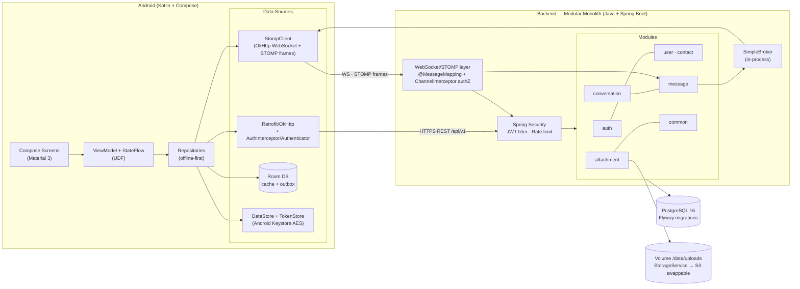

# BÁO CÁO ĐỒ ÁN — NexaChat
## Real-time Android Messaging Platform

| Trường thông tin | Giá trị |
|---|---|
| Nhóm / Group | `{{GROUP_NAME}}` |
| Môn học / Course | `{{COURSE_NAME}}` |
| Giảng viên / Instructor | `{{INSTRUCTOR}}` |
| Học kỳ / Semester | `{{SEMESTER}}` |
| Ngày nộp / Date | `{{DATE}}` |

| # | Thành viên / Member | MSSV | Vai trò / Role |
|---|---|---|---|
| 1 | `{{MEMBER_1}}` | `{{MSSV_1}}` | Backend Lead — auth & realtime |
| 2 | `{{MEMBER_2}}` | `{{MSSV_2}}` | Backend + DevOps — domain & infra |
| 3 | `{{MEMBER_3}}` | `{{MSSV_3}}` | Android Lead — chat core |
| 4 | `{{MEMBER_4}}` | `{{MSSV_4}}` | Android + QA/Docs — UX & quality |

> Báo cáo này được generate song song: `docs/report.md` (nguồn gốc markdown) →
> `tools/build-report.py` → `docs/report.docx` (bản nộp). Mọi số liệu kỹ thuật
> đều đối chiếu trực tiếp với mã nguồn trong repo tại commit nộp bài.

---

## Mục lục / Table of Contents

1. Giới thiệu & Phạm vi — Introduction & Scope
2. Tự đánh giá theo rubric — Rubric Self-Assessment (R1–R6)
3. Phân tích yêu cầu — Requirements Analysis
4. Kiến trúc hệ thống — System Architecture
5. Thiết kế cơ sở dữ liệu — Database Design (ERD)
6. REST API
7. WebSocket / STOMP Contract
8. Thiết kế bảo mật — Security Design
9. Offline-first Design (Android)
10. Đa ngôn ngữ & Xoay màn hình — i18n & Rotation
11. Tính năng sáng tạo — Creative Feature: Message Interactions
12. Ghi chú triển khai — Implementation Notes
13. Kiểm thử — Testing
14. Triển khai & Demo — Deployment & Demo
15. Hạn chế & hướng phát triển — Limitations & Future Work
16. Phân công công việc — Work Breakdown
17. Tuyên bố sử dụng AI — AI Usage Declaration
18. Kết luận — Conclusion

---

## 1. Giới thiệu & Phạm vi — Introduction & Scope

**NexaChat** là nền tảng nhắn tin thời gian thực trên Android: đăng ký bằng số
điện thoại (chuẩn hóa E.164), tìm và kết nối với người dùng khác qua SĐT, chat
cá nhân và chat nhóm realtime qua WebSocket/STOMP, gửi ảnh/video/audio/file,
giao diện Material 3 song ngữ Việt–Anh, chạy ổn định trong demo LAN nhiều
thiết bị không cần internet.

**Tech stack:** Android client — Kotlin + Jetpack Compose (MVVM + UDF, Hilt,
Room, OkHttp). Backend — Java 17 + Spring Boot 3.4.1 (modular monolith).
Database — PostgreSQL 16 (Flyway). Realtime — STOMP 1.2 over WebSocket.

**In-scope** (7 module theo đề + creative): Authentication & Account · User
Discovery & Phone Search · Private Chat · Group Chat · Multimedia & File ·
Multi-language · Rotation — cộng Creative Feature **Message Interactions**
(Reply/Quote + Emoji Reaction + Pin).

**Out-of-scope** (nói rõ để tránh overclaim): voice/video call (WebRTC),
end-to-end encryption, đồng bộ danh bạ máy, microservices/Kubernetes, admin
dashboard, FCM push notification. Mỗi mục loại đều có lý do và hướng phát
triển được ghi ở §15.

**Cấu trúc repo** (monorepo, một `.git` duy nhất):

```text
nexachat/
├─ android/   Kotlin + Jetpack Compose app (80 files, Hilt, Room, STOMP client)
├─ server/    Spring Boot modular monolith (134 files, REST /api/v1 + STOMP /ws)
├─ docs/      architecture, api-contract, websocket-protocol, security,
│             rtm, demo-runbook, known-limitations, packaging-checklist, report
└─ demo/      seed.sql + lan-up.sh / lan-up.ps1 + backup.sh
```

---

## 2. Tự đánh giá theo rubric — Rubric Self-Assessment (R1–R6)

| Mã | Tiêu chí | Điểm | Trạng thái | Bằng chứng trong repo |
|---|---|---:|---|---|
| R1 | Bài nộp đầy đủ, đúng cấu trúc | 5 | ✅ | `docs/packaging-checklist.md` (C1–C12), `.git` full history, `docs/report.docx`, APK release |
| R2 | Chat 1-1, chat nhóm, tìm kiếm, thêm bằng SĐT, quản lý tài khoản | 20 | ✅ | Module `auth`/`user`/`contact`/`conversation`/`message`; IT: `AuthFlowIT`, `ContactConversationIT`, `GroupFlowIT`, `MessageFlowIT` |
| R3 | Đa ngôn ngữ, multimedia/file, xoay màn hình | 15 | ✅ | `values/`+`values-vi/` 96 keys mỗi bên (`docs/i18n-audit.md`); `attachment` module + magic-byte sniff; `docs/rotation-audit.md` |
| R4 | Chức năng sáng tạo | 5 | ✅ | Message Interactions: reply/react/pin — migration `V3__interactions.sql`, `ReactionController`, `PinController`, `InteractionFlowIT` |
| R5 | Giao diện rõ ràng + toàn bộ unit test pass | 15 | ✅ | Server **310 tests green** (280 unit + 30 IT); Android **202 tests green** (20 classes) + `RoomMigrationTest` 3/3 on API 35; CI workflow `.github/workflows/ci.yml` configured |
| R6 | Thuyết trình, demo, vấn đáp | 40 | ✅ | `docs/demo-runbook.md` (kịch bản 8 phút + fallback), 18 câu vấn đáp trong thiết kế, mỗi quyết định kèm "vì sao" |

**Nguyên tắc xuyên suốt:** mọi claim trong bảng này trace được về file/test
cụ thể — không ghi "end-to-end encryption", không ghi "scalable triệu user".

---

## 3. Phân tích yêu cầu — Requirements Analysis

### 3.1. Functional requirements (FR theo module)

**Module A — Authentication & Account:** đăng ký bằng SĐT E.164 + mật khẩu +
tên hiển thị (trùng SĐT → 409 `PHONE_EXISTS`); login nhận access JWT 15' +
refresh token 14 ngày có rotation; refresh single-flight phía client; logout /
logout-all thu hồi refresh token; xem/sửa profile + avatar; đổi mật khẩu
(revoke mọi phiên khác).

**Module B — Discovery & Contacts:** tìm user chính xác theo SĐT hoặc theo
tên (prefix, ≤20 kết quả, rate-limited); thêm/xóa/sửa alias/xem contact
(idempotent); từ contact mở/tạo direct conversation không trùng
(`direct_key` unique).

**Module C — Private Chat:** gửi/nhận text realtime qua WebSocket; history
cursor pagination (mặc định 30/page, `beforeSeq`/`afterSeq`); inbox +
lastMessage + unreadCount; watermark `last_read_seq` → unread badge + read
receipt "Đã xem" 1-1; idempotent send bằng `clientMessageId`; offline send
queue (optimistic SENDING → SENT/FAILED, tap-to-retry); reconnect backoff
1→2→4→8→16s + jitter, tối đa 5 lần, resync bằng REST; typing indicator.

**Module D — Group Chat:** tạo nhóm ≥2 member (creator = ADMIN); thêm/xóa/xem
member, rời nhóm; chat nhóm realtime có tên người gửi; đổi tên/avatar nhóm
(ADMIN → broadcast `CONVERSATION_UPDATED`); system message
("A đã thêm B", `type=SYSTEM`).

**Module E — Multimedia & File:** Photo Picker (không cần permission) + SAF;
whitelist jpg/png/webp/mp4/mp3/m4a/ogg/pdf/doc/docx/txt; cap 25MB
(`spring.servlet.multipart.max-file-size`); upload multipart có progress;
server sniff magic bytes; download qua endpoint có authZ.

**Module F/G — i18n & Rotation:** Vi + En toàn bộ qua string resources, đổi
ngôn ngữ trong Settings và persist; format thời gian theo locale; rotation
không mất history/draft/scroll, không gọi lại API.

**Module H — Creative (Message Interactions):** reply/quote kể cả cross-type;
reaction emoji toggle (PK composite = idempotent); pin ≤3/conversation
(DIRECT: member nào cũng pin; GROUP: chỉ ADMIN).

### 3.2. Non-functional requirements (NFR)

| ID | Nhóm | Yêu cầu | Đạt bằng |
|---|---|---|---|
| NFR-1 | Performance | Tin nhắn tới đối phương <500ms LAN; inbox <1s; paginate 30 tin | `idx_msg_conv_seq`, denormalized `last_message_*`, inbox projection 1 query |
| NFR-2 | Reliability | Reconnect ≤5 lần backoff + jitter; send idempotent 100% | `clientMessageId` + `UNIQUE(sender_id, client_message_id)`; resync REST |
| NFR-3 | Security | bcrypt; JWT HS256 secret ≥256-bit từ env; mọi endpoint cần Bearer trừ whitelist; WSS ở prod | `SecurityConfig`, `JwtAuthFilter`, `application-prod.yml` fail-fast khi thiếu `JWT_SECRET` |
| NFR-4 | Usability | Material 3; mọi màn có Loading/Empty/Error/Retry; touch target ≥48dp | `core/ui/components` shared states; đợt a11y đã sửa vi phạm 48dp thật |
| NFR-5 | Maintainability | Package-by-feature; không trả JPA entity ra API; không business logic trong Controller/Composable | module `com.nexachat.<feature>` server; `feature/*` + `data/` + `core/` Android |
| NFR-6 | Testability | Unit tests pass locally; CI enforces the suites after push; mỗi service authZ có negative test | 310 + 202 tests; 21 negative tests ở quality phase |
| NFR-7 | Portability | minSdk 26, targetSdk 35; emulator + máy thật qua LAN | `build.gradle.kts`; `BuildConfig.API_BASE_URL` |
| NFR-8 | Observability | Log không chứa password/token/file body; `/actuator/health` | log scan sạch (chỉ id/event name) |
| NFR-9 | Constraints | 1 backend + 1 PostgreSQL; media ≤25MB; demo LAN offline | `docker-compose.yml` |

### 3.3. Use case đặc trưng — UC gửi tin 1-1 (main flow)

1. A nhập nội dung → app tạo `clientMessageId`, hiển thị tin SENDING (optimistic).
2. STOMP `SEND /app/conversations/{id}/messages` mang `{clientMessageId, type, content, replyToId?, attachmentIds[]}`.
3. Server xác thực JWT (CONNECT) + kiểm member (SEND interceptor) + validate.
4. Một transaction: `INSERT messages` (`seq` BIGSERIAL, `ON CONFLICT (sender_id, client_message_id)` trả row cũ) + `UPDATE conversations.last_message_*`.
5. Broadcast `MESSAGE_CREATED` tới `/topic/conversations.{id}` **sau commit**.
6. Máy A match `clientMessageId` → SENT; máy B render + unread++ (watermark).

*Alternate:* A offline → tin giữ SENDING trong outbox Room; WS sống lại → flush
theo thứ tự. *Exception:* không còn là member → `/user/queue/errors` → tin
chuyển FAILED + snackbar.

---

## 4. Kiến trúc hệ thống — System Architecture

### 4.1. Sơ đồ tổng (mermaid — xem bản render trong `docs/architecture.md`)



### 4.2. Vì sao modular monolith, không phải microservices

Module phân tách bằng package + boundary rõ ràng (mỗi module có
Controller/Service/Repository riêng: `auth`, `user`, `contact`, `conversation`,
`message`, `attachment`, `common`, `ws`, `config`), deploy 1 đơn vị. Ở quy mô
đồ án, microservices chỉ thêm phức tạp mạng/transaction phân tán mà không tăng
điểm; SimpleBroker in-process đủ cho 1 instance (hướng nâng cấp: broker relay
RabbitMQ — §15).

### 4.3. Luồng gửi tin — persist-before-broadcast

```text
Máy A                Spring Backend              PostgreSQL          Máy B
  │  optimistic insert Room (SENDING, clientMessageId)                     
  │── STOMP SEND /app/conversations/{id}/messages ──▶                      
  │                       │ authN JWT + authZ member + validate            
  │                       │── TX: INSERT messages (seq BIGSERIAL;          
  │                       │    ON CONFLICT sender+clientMessageId → old)   
  │                       │    UPDATE conversations.last_message_* ──▶     
  │                       │◀─ message{seq, createdAt}                      
  │◀── MESSAGE /topic/conversations.{id} MESSAGE_CREATED ──▶               
  │  match clientMessageId → SENT                    render + unread++     
  │                       (khi B mở chat: POST …/read {upToSeq}            
  │                        → A nhận MESSAGE_READ "Đã xem")                 
```

Điểm then chốt: server **commit DB xong mới fan-out** → tin nhận được luôn đã
bền vững; reconnect chỉ cần `GET messages?afterSeq=` để resync.

### 4.4. Quyết định công nghệ chính (decision log rút gọn)

| # | Quyết định | Chọn | Vì sao |
|---|---|---|---|
| T1 | UI | Jetpack Compose + Material 3 | Theo đề; declarative khớp UDF |
| T2 | App arch | MVVM + UDF + Repository, offline-first | "Clean ở mức phù hợp" — 3 layer rõ ràng |
| T3 | DI | Hilt | Chuẩn Google, compile-time safety |
| T4 | HTTP | Retrofit + OkHttp + Moshi | Authenticator/Interceptor chuẩn cho JWT refresh |
| T5 | Local DB | Room | Query phức tạp (inbox, pagination, outbox) + Flow |
| T6 | Token | TokenStore tự viết: AES/GCM key trong Android Keystore + DataStore | ~100 dòng, không phụ thuộc lib deprecating |
| T8 | Picker | Photo Picker + SAF | Không cần runtime permission |
| T9 | Backend | Spring Boot 3.4.1 MVC, Java 17 | Blocking model đơn giản, khớp JPA |
| T10 | DB access | Spring Data JPA + Flyway | Migration versioned V1→V3 |
| T11 | DB | PostgreSQL 16 | JSONB/constraint mạnh; BIGSERIAL ordering |
| T12 | Realtime | **STOMP over WebSocket + SimpleBroker**, không SockJS | Frame semantics + authZ theo destination có sẵn; client native không cần browser fallback |
| T13 | Auth | **SĐT + password + JWT access/refresh rotation** | OTP cần SMS gateway trả phí, khó test LAN; rubric không đòi verify ownership |
| T14 | JWT | HS256, secret env ≥32 bytes | Một service vừa ký vừa verify |
| T15 | Rate limit | Bucket4j in-memory | Đủ 1 instance; giới hạn per-node ghi thành thật |
| T16 | Media | StorageService interface → LocalFileStorage (volume) | Không phình DB; đổi S3 không sửa caller |
| T17 | MIME | Magic-byte sniffing tự implement (`common/MagicBytes.java`) | Content-type client khai là không tin được |
| T18 | SĐT | libphonenumber E.164 cả client lẫn server | Server normalize lại vì client không đáng tin |

---

## 5. Thiết kế cơ sở dữ liệu — Database Design (ERD)

### 5.1. Quan hệ tổng quan

```text
users ──1:N── refresh_tokens          (phiên đăng nhập, rotation chain)
users ──1:N── contacts                (owner_id → contact_user_id)
users ──N:M── conversations           qua conversation_members (role, last_read_seq)
conversations ──1:N── messages        (seq BIGSERIAL toàn cục)
messages ──1:N── message_attachments  (upload-first, bind khi send — V2)
messages ──1:N── message_reactions    (V3, PK composite = toggle idempotent)
conversations ──1:N── pinned_messages qua message (V3, ≤3/conv enforce ở service)
messages ──1:N── messages             (reply_to_id — self FK, V1)
```

### 5.2. Bảng thực tế (theo migration V1/V2/V3 — `server/src/main/resources/db/migration/`)

**V1__init.sql** — 7 bảng lõi + extensions `pgcrypto`, `pg_trgm`:

| Bảng | Cột chính | Ràng buộc & index đáng chú ý |
|---|---|---|
| `users` | `id` UUID PK, `phone` VARCHAR(16), `password_hash` CHAR(60), `display_name` VARCHAR(60), `avatar_url`, `created_at` | `UNIQUE(phone)`; `CHECK phone ~ '^\+[1-9]\d{7,14}$'` (E.164 ở DB); trigram GIN index cho search theo tên |
| `refresh_tokens` | `id` UUID PK, `user_id` FK→users CASCADE, `token_hash` CHAR(64) UNIQUE, `device_label`, `created_at`, `expires_at`, `revoked_at`, `replaced_by` | Chỉ lưu **SHA-256** của token; partial index `(user_id) WHERE revoked_at IS NULL`; `replaced_by` = rotation chain |
| `contacts` | `owner_id`+`contact_user_id` **composite PK** FK→users CASCADE, `alias_name`, `created_at` | `CHECK owner_id <> contact_user_id` |
| `conversations` | `id` UUID PK, `type` CHECK(DIRECT/GROUP), `direct_key` VARCHAR(80) UNIQUE, `title`, `avatar_url`, `created_by` FK, `last_message_id`, `last_message_seq`, `created_at` | `CHECK ((type='DIRECT') = (direct_key IS NOT NULL))`; `direct_key = LEAST(u1,u2):GREATEST(u1,u2)` chống tạo trùng direct; index inbox `last_message_seq DESC NULLS LAST` |
| `conversation_members` | `conversation_id`+`user_id` **composite PK**, `role` CHECK(ADMIN/MEMBER), `joined_at`, `last_read_seq` | `last_read_seq` = watermark đã đọc → unread count + read receipt |
| `messages` | `id` UUID PK, `seq` **BIGSERIAL UNIQUE**, `conversation_id` FK CASCADE, `sender_id` FK, `client_message_id` UUID, `type` CHECK(TEXT/IMAGE/VIDEO/AUDIO/FILE/SYSTEM), `content`, `reply_to_id` FK→messages, `created_at`, `edited_at`, `deleted_at` | `UNIQUE(sender_id, client_message_id)` = idempotency ở tầng DB; index `(conversation_id, seq DESC)` cho cursor pagination |
| `message_attachments` | `id` UUID PK, `message_id` FK CASCADE, `storage_key` VARCHAR(120) UNIQUE, `original_name`, `mime_type`, `size_bytes`, `width`, `height`, `duration_ms`, `created_at` | `storage_key` do server sinh (uuid) — chống path traversal; `mime_type` là mime đã sniff |

**V2__attachments.sql** — chuyển attachment sang lifecycle
*upload-first, bind-at-send*: thêm `owner_id` (FK→users, NOT NULL, backfill
từ sender của message đã bind), `message_id` → nullable, index `idx_att_owner`.
Upload chèn row với `message_id=NULL`; `MessageService.send()` validate
attachmentId (tồn tại + thuộc sender + chưa bind) rồi set `message_id` trong
cùng transaction.

**V3__interactions.sql** — creative feature:

| Bảng | Cột | Thiết kế |
|---|---|---|
| `message_reactions` | `message_id`+`user_id`+`emoji` **composite PK**, `created_at` | PK composite chính là toggle-idempotency: react lại = DELETE row, insert trùng = `ON CONFLICT DO NOTHING`; CASCADE theo message & user |
| `pinned_messages` | `conversation_id`+`message_id` **composite PK**, `pinned_by` FK, `pinned_at` | "Pin 2 lần" là no-op by construction; trần ≤3/conv enforce ở `PinService` dưới row-lock của conversation; index `idx_pins_message` |

### 5.3. Các quyết định schema phải giải thích được

1. **`seq BIGSERIAL` thay timestamp ordering**: tăng đơn điệu toàn cục, độc lập
   clock; cursor pagination = `seq < ?` / `afterSeq` resync.
2. **`UNIQUE(sender_id, client_message_id)`**: chốt chặn cuối chống duplicate
   khi retry/reconnect — `INSERT … ON CONFLICT` race-safe, không
   check-then-insert.
3. **`direct_key` unique**: hai người bấm "chat" đồng thời chỉ tạo 1 DIRECT —
   constraint DB giải quyết race thay vì code phòng thủ.
4. **Watermark `last_read_seq`** thay bảng read-per-message: nhóm N người × M
   tin = N×M rows; watermark 1 bigint cho unread (`count(seq > last_read_seq)`)
   + "Đã xem" (`partner.last_read_seq >= msg.seq`). Trade-off: không biết
   chính xác từng member nhóm đọc tới đâu — chấp nhận, ghi hướng phát triển.
5. **Denormalized `last_message_*`**: inbox không cần `MAX(seq)` per
   conversation; cập nhật trong cùng transaction insert message.
6. **Soft delete `deleted_at`**: tin xóa vẫn giữ FK integrity (reply_to,
   reactions); `edited_at` đã plumb sẵn (endpoint chưa ship — §15).
7. **JPA**: mọi `@ManyToOne` LAZY (bẫy N+1 kinh điển); transaction boundary ở
   Service `@Transactional`; `ddl-auto=validate` — schema chỉ đổi qua Flyway.

---

## 6. REST API

**Quy ước:** base `/api/v1`; `Authorization: Bearer <accessToken>` cho mọi
endpoint trừ `auth/register`, `auth/login`, `auth/refresh`, `/actuator/health`
và upgrade `/ws`. Error envelope thống nhất
`{"error":{"code","message","details"}}` — client switch theo `code`.
Pagination cursor (`beforeSeq`/`afterSeq`/`limit`), không offset. Danh sách
dưới liệt kê đúng các controller trong `server/src/main/java/com/nexachat/`.

### 6.1. Auth — `AuthController` (`/api/v1/auth`)

| Method & path | Auth | Success | Errors chính |
|---|---|---|---|
| `POST /auth/register` | Public | 201 `AuthResponse` | 400 VALIDATION_FAILED · 409 PHONE_EXISTS · 429 |
| `POST /auth/login` | Public | 200 `AuthResponse` | 401 INVALID_CREDENTIALS · 429 |
| `POST /auth/refresh` | Public | 200 (cặp token mới, rotation) | 401 TOKEN_INVALID / TOKEN_EXPIRED / TOKEN_REUSED |
| `POST /auth/logout` | Bearer | 204 | 401 |
| `POST /auth/logout-all` | Bearer | 204 | 401 |
| `PATCH /auth/password` | Bearer | 204 (revoke các phiên khác) | 401 WRONG_PASSWORD |

`AuthResponse` = `{user, accessToken, accessTokenExpiresIn:900, refreshToken}`.
Rate limit: login/register 10 req/5 phút, refresh 30 req/5 phút (Bucket4j,
`RateLimitInterceptor`).

### 6.2. Users & Contacts — `UserController`, `AvatarController`, `ContactController`

| Method & path | Auth | Success | Errors chính |
|---|---|---|---|
| `GET /users/me` | Bearer | 200 `UserResponse` | 401 |
| `PATCH /users/me` | Bearer | 200 `UserResponse` | 400 |
| `GET /users/search?phone=` hoặc `?q=` | Bearer | 200 `UserResponse[]` (phone→0–1, q→≤20) | 400 · 429 (30/min/user) |
| `POST /users/me/avatar` (multipart) | Bearer | 200 `{avatarUrl}` | 413 · 415 MIME_NOT_ALLOWED |
| `GET /contacts` | Bearer | 200 `ContactResponse[]` | 401 |
| `POST /contacts {phone}` | Bearer | 201 | 404 USER_NOT_FOUND · 409 ALREADY_CONTACT · 429 (30/min) |
| `PATCH /contacts/{userId} {aliasName?}` | Bearer | 200 | 400 · 404 |
| `DELETE /contacts/{userId}` | Bearer | 204 (idempotent) | 401 |

### 6.3. Conversations & Messages — `ConversationController`, `ConversationInboxController`, `GroupController`, `MessageController`

| Method & path | Auth | Success | Errors chính |
|---|---|---|---|
| `POST /conversations/direct` `{phone}` hoặc `{userId}` | Bearer | 201 created / 200 existing (idempotent qua `direct_key`) | 400 · 404 |
| `GET /conversations` | Bearer | 200 `InboxEntry[]` sort `lastMessageSeq DESC`; optional `limit` (1–100) + `cursor` (keyset, `X-Next-Cursor`) | 401 |
| `POST /conversations/group {title, memberIds[]}` | Bearer | 201 | 400 |
| `PATCH /conversations/{id}` | member ADMIN | 200 → broadcast CONVERSATION_UPDATED | 403 NOT_ADMIN |
| `POST /conversations/{id}/members {userIds[]}` | ADMIN | 200 | 403 · 404 |
| `DELETE /conversations/{id}/members/{userId}` | ADMIN | 204 | 403 |
| `POST /conversations/{id}/leave` | member | 204 | 403 |
| `POST /conversations/{id}/avatar` (multipart) | ADMIN | 200 `{avatarUrl}` → broadcast CONVERSATION_UPDATED | 403 · 413 · 415 MIME_NOT_ALLOWED |
| `GET /conversations/{id}/messages?beforeSeq=&afterSeq=&limit=` | member | 200 `MessagePageResponse{items,nextBeforeSeq,hasMore}` | 403 NOT_MEMBER · 404 |
| `POST /conversations/{id}/messages` | member | 201 / 200 dedup hit — REST fallback của đường WS | 403 · 404 · 400 |
| `POST /conversations/{id}/read {upToSeq}` | member | 204 → broadcast MESSAGE_READ | 403 · 400 |

### 6.4. Interactions — `ReactionController`, `PinController`

| Method & path | Auth | Success | Errors chính |
|---|---|---|---|
| `POST /messages/{id}/reactions {emoji}` | member | 204 (toggle: thêm/xóa) | 403 · 404 |
| `GET /conversations/{id}/pins` | member | 200 `PinnedMessageView[]` newest-first, batch-hydrated | 403 |
| `POST /conversations/{id}/pins {messageId}` | DIRECT: member; GROUP: ADMIN | 204 | 403 · 409 PIN_LIMIT (>3) |
| `DELETE /conversations/{id}/pins/{messageId}` | như trên | 204 | 403 |

### 6.5. Attachments & Files — `AttachmentController`, `FileController`

| Method & path | Auth | Success | Errors chính |
|---|---|---|---|
| `POST /attachments` (multipart `file`) | Bearer | 201 `AttachmentResponse` (upload-first, bind khi send) | 413 FILE_TOO_LARGE · 415 MIME_NOT_ALLOWED |
| `GET /attachments/{id}/content` | member của conv chứa file | 200 bytes | 403 · 404 |
| `GET /files/**` (storage_key path) | Bearer | 200 bytes + sniffed Content-Type | 404 FILE_NOT_FOUND |

**Tổng: 30 REST endpoint + `/actuator/health`.** Gửi tin có hai đường — WS
(chính) và REST POST (fallback) — cùng đi qua `MessageService.send()` → một nơi
enforce authZ + idempotency.

---

## 7. WebSocket / STOMP Contract

**Kết nối:** `ws://host/ws` (prod `wss://`); raw WebSocket nói STOMP 1.2, **không
SockJS** (client native, không cần browser fallback). JWT nằm trong
`Authorization` header của frame `CONNECT` — không query param (token trong URL
lọt vào access log). `heart-beat:10000,10000` → phát hiện kết nối chết ~30s.

### 7.1. Destinations

| Hướng | Destination | Body | Ghi chú |
|---|---|---|---|
| C→S SEND | `/app/conversations/{id}/messages` | `{clientMessageId,type,content,replyToId?,attachmentIds[]}` | `WsMessageController` → `MessageService.send()` |
| C→S SEND | `/app/conversations/{id}/typing` | `{}` | debounce client-side |
| C→S SEND | `/app/conversations/{id}/read` | `{upToSeq}` | watermark → MESSAGE_READ |
| S→C | `/topic/conversations.{id}` | event envelope | SUBSCRIBE bị chặn nếu không phải member |
| S→C | `/user/queue/inbox` | event envelope | inbox badge khi chưa subscribe conv |
| S→C | `/user/queue/errors` | `{code,clientMessageId?}` | lỗi SEND bị từ chối |

### 7.2. Event envelope & catalog

Mọi event cùng format — client parse một lần:

```json
{"eventType":"MESSAGE_CREATED","conversationId":"…","serverTs":"2026-11-04T10:31:05.123Z","payload":{…}}
```

| eventType | Payload | Phát khi |
|---|---|---|
| `MESSAGE_CREATED` | MessageResponse (seq, sender, content, attachments, replyTo, reactions) | tin mới persist xong |
| `MESSAGE_UPDATED` | message id + content/editedAt | (contract sẵn; endpoint edit chưa ship) |
| `MESSAGE_DELETED` | message id + deletedAt | (contract sẵn; endpoint delete chưa ship) |
| `MESSAGE_READ` | conversationId, readerId, upToSeq | member cập nhật watermark |
| `REACTION_UPDATED` | `{messageId, reactions:[{emoji,count,userIds[]}]}` | toggle reaction |
| `PIN_UPDATED` | `{conversationId, messageId, pinned}` | pin/unpin |
| `USER_TYPING` | conversationId, senderId | typing frame |
| `CONVERSATION_UPDATED` | title/avatar/members thay đổi | tạo nhóm, đổi nhóm, member add/remove |
| `USER_ONLINE` / `USER_OFFLINE` | (vocabulary tồn tại trong `WsEventType`, chưa emit — §15) | presence — future |

### 7.3. Điểm thiết kế then chốt

1. **Persist-before-broadcast** — commit xong mới fan-out (§4.3).
2. **AuthZ hai lớp** — CONNECT = authN (JWT); SUBSCRIBE/SEND = authZ qua
   `StompAuthChannelInterceptor` kiểm `conversation_members`; client không tự
   chọn được destination nhạy cảm.
3. **Dedup** — sender match `clientMessageId` → SENT; receiver insert theo
   message id (`OnConflictStrategy.IGNORE` trong Room).
4. **Ordering theo `seq`** — tin đến lệch chèn đúng vị trí, không append.
5. **Reconnect** — backoff 1·2·4·8·16s + jitter, tối đa 5 lần; sau reconnect
   resync REST (`GET …/messages?afterSeq=lastSeen`) → "WS là push, REST là
   source of truth".
6. **Giới hạn thành thật** — SimpleBroker in-process không fan-out xuyên node;
   STOMP SEND giới hạn 30/10 s (messages) và 60/10 s (typing) per user, bucket
   in-memory LRU 10.000 key / 15 phút idle.

---

## 8. Thiết kế bảo mật — Security Design

### 8.1. Credential & token model

- **Password:** bcrypt (hash CHAR(60)); register chuẩn hóa SĐT E.164 bằng
  libphonenumber ở server (client cũng normalize cho UX, server không tin
  client).
- **Access token:** JWT HS256, `sub`=userId, TTL 900s; `type=access` claim
  chặn replay; secret ≥32 bytes từ env — `application-prod.yml` fail-fast nếu
  thiếu `JWT_SECRET`. HS256 vì một service vừa ký vừa verify.
- **Refresh token:** opaque 48 bytes SecureRandom → 64 ký tự base64url; DB chỉ
  lưu `SHA-256(token)` (`token_hash CHAR(64) UNIQUE`) → lộ DB ≠ lộ token dùng
  được. TTL 14 ngày, single-use.
- **Rotation:** mỗi `/refresh` trả token mới, revoke token cũ, link
  `replaced_by` (chuỗi audit RT1→RT2→…). Rotation đọc row dưới
  `SELECT … FOR UPDATE` (PESSIMISTIC_WRITE) → 2 refresh song song không mint
  được 2 successor.
- **Reuse detection:** token đã rotate mà bị present → `401 TOKEN_REUSED` +
  revoke toàn bộ family của user (dấu hiệu theft). Logout idempotent + check
  ownership; đổi password revoke mọi phiên khác.

### 8.2. Transport & authorization

- REST stateless (CSRF off, không session). Chỉ `auth/register|login|refresh`,
  `/actuator/health`, `/error`, `/ws` là permitAll; mọi route còn lại bắt
  buộc Bearer (`SecurityConfig` + `JwtAuthFilter` + `AuthSecurityErrorHandler`
  → 401/403 theo envelope chuẩn).
- STOMP: `/ws` permitAll ở HTTP, JWT kiểm ở CONNECT; SUBSCRIBE/SEND kiểm member
  — authZ server-side, không tin client.
- Dev LAN chạy cleartext `http://`/`ws://` (nói rõ chỉ dev; debug build cho
  cleartext qua `network_security_config` debug-source-set); prod = TLS/WSS,
  `cleartextTraffic=false`.

### 8.3. Upload hardening

- Whitelist mime (jpg/png/webp/mp4/mp3/m4a/ogg/pdf/doc/docx/txt) kiểm bằng
  **magic bytes** tự implement (`common/MagicBytes.java`, 18 unit test) —
  đổi `.exe`→`.png` bị 415 `MIME_NOT_ALLOWED`.
- Cap 25MB cả client lẫn `spring.servlet.multipart` (413 `FILE_TOO_LARGE`).
- `storage_key` uuid server sinh — `original_name` chỉ để hiển thị → chống
  path traversal; download qua endpoint có authZ (member của conversation chứa
  file), không serve static trực tiếp.

### 8.4. Rate limiting & enumeration

| Endpoint | Bucket (Bucket4j in-memory, greedy refill) |
|---|---|
| `POST /auth/login`, `/register` | 10 req / 5 phút |
| `POST /auth/refresh` | 30 req / 5 phút |
| `GET /users/search` | 30 req / phút / user |
| `POST /contacts` | 30 adds / phút / user |

Login sai trả `INVALID_CREDENTIALS` thống nhất (không lộ user tồn tại). Search
chỉ trả public profile tối thiểu. Thừa nhận: contact-add theo SĐT cố hữu
200/404 — giảm rủi ro bằng rate limit, không giấu được hoàn toàn (§15).
Bucket là per-node (in-memory) — ghi thành thật, không claim distributed.

### 8.5. Không claim

Báo cáo **không** tuyên bố E2E encryption: mã hóa đường truyền TLS/WSS ở prod,
server thấy plaintext — E2E là hướng phát triển.

---

## 9. Offline-first Design (Android)

**Source of truth: Room.** WS event → ghi Room → UI recompose. Kill app mở
lại vẫn có history; rotation chỉ là recomposition, không re-fetch.

- **Entities:** `MessageEntity`, `ConversationEntity`, `OutboxEntity`,
  `MessageReactionEntity`, `PinnedMessageEntity` (`core/database/Entities.kt`).
- **Send pipeline (idempotent + queue):** `ChatViewModel.send()` →
  `OutboxDao.insert(SENDING, clientMessageId)` → flush STOMP SEND → ack bằng
  `MESSAGE_CREATED` khớp `clientMessageId` → SENT. WS down → REST fallback
  (`POST /conversations/{id}/messages` cùng `MessageService.send()`). Cả hai
  down → giữ SENDING; tap-to-retry / flush khi reconnect.
- **Token refresh single-flight:** OkHttp `Authenticator` bắt 401 →
  `TokenRepository.refresh()` bọc Mutex (n request 401 vẫn chỉ 1 call
  refresh) → retry request. Refresh fail → logout → navigate Login.
- **UDF:** `ChatUiState = combine(roomMessages, outbox, typingFlow, wsStatus)`
  → `stateIn(WhileSubscribed)`; one-shot event qua Channel + receiveAsFlow.
- **Permissions tối thiểu:** Photo Picker/SAF không cần runtime permission.

---

## 10. Đa ngôn ngữ & Xoay màn hình — i18n & Rotation

### 10.1. i18n

- `values/strings.xml` (EN mặc định) + `values-vi/strings.xml`: **96 keys mỗi
  bên, parity 100%** — kiểm chứng `docs/i18n-audit.md` (0 missing, 0 leak).
- Đổi ngôn ngữ trong Settings, persist: không có `androidx.appcompat` trong
  dependency graph → dùng **framework `android.app.LocaleManager` (API 33+,
  system-persisted)** và `SharedPreferences` + `wrapContext` cho API <33 —
  thoả ý đồ "setApplicationLocales + persist" (ghi chú lệch thiết kế trong
  ledger, có chủ đích).
- Timestamp format theo locale (`DateTimeFormatter` localized).

### 10.2. Rotation — audit từng màn (`docs/rotation-audit.md`)

Nguyên tắc: UI state trong ViewModel (survives config change); draft/scroll
trong `SavedStateHandle`/`rememberSaveable` (survives process death); history
trong Room. Kết quả audit + fix thật:

| Màn | Xử lý |
|---|---|
| Chat | `input` → `SavedStateHandle["chat_input"]`; `listState` = `rememberLazyListState` giữ scroll; messages/outbox từ Room → không mất gì |
| UserSearch | `query` → SavedStateHandle; results refetch (server data, rẻ) |
| MediaViewer | zoom `scale`/`offset` → `rememberSaveable` floats; download lỗi có Retry |
| Contacts/Group/Profile | draft trong UiState/rememberSaveable; dialog sống qua rotation |
| Chấp nhận (documented) | Process-death reset create-group form, contact sheet, rename dialog — transient flow, mở lại sạch từ Room/network |

**Rotation không gọi lại API** — Room Flows phát lại state, verify bằng log.

---

## 11. Tính năng sáng tạo — Creative Feature: Message Interactions

**Chọn: Reply/Quote + Emoji Reaction + Pin** (R4). Vì sao không chọn khác:
WebRTC = rủi ro ổn định cao nhất (signaling, STUN/TURN — demo fail mất R6);
voice message trùng phạm vi "gửi audio" bắt buộc của R3; smart search mơ hồ
khó demo trong 8 phút. Interactions tái dùng toàn bộ pipeline message sẵn có:
+2 bảng (V3), +1 cột dùng sẵn (`reply_to_id` đã có từ V1), +4 endpoint.

### 11.1. Server

- `POST /api/v1/messages/{id}/reactions {emoji}` → 204 toggle. PK composite
  `(message_id, user_id, emoji)` là idempotency: react lại = DELETE, insert
  trùng = `ON CONFLICT DO NOTHING` (`ReactionService`, 8 unit test; emoji
  normalize NFC).
- `GET|POST|DELETE /api/v1/conversations/{id}/pins` → DIRECT: member nào cũng
  pin; GROUP: chỉ ADMIN; trần **≤3/conv** enforce ở `PinService` dưới row-lock
  conversation (16 unit test). Vi phạm → 409 `PIN_LIMIT`.
- Reply: `SendMessageRequest.replyToId` validate cùng conversation;
  `MessageResponse.replyTo` = embedded preview `{senderDisplayName, content,
  deleted}` — reply ảnh bằng text (cross-type) hoạt động.
- Broadcast `REACTION_UPDATED` / `PIN_UPDATED` qua `/topic/conversations.{id}`.

### 11.2. Android

- `feature/interactions/`: ReplyPreview (swipe/long-press → quote strip),
  ReactionBar (emoji chips `count`/`byMe`), PinnedBanner (≤3 pin, tap →
  jumpToMessage có phân trang ngược giới hạn ~20 trang ≈ 600 tin).
- Data: DTO + Retrofit + Room (`MessageReactionEntity`, `PinnedMessageEntity`)
  + typed WS events; optimistic với **revert-on-failure** (compare-and-restore
  snapshot — sửa từ review MED-1); pin ngoài window decode từ
  `PinnedMessageView.message` nhúng sẵn (sửa MED-2).
- Tích hợp `ChatViewModel.toggleReaction/togglePin` — reaction bar chỉ hiện
  trên tin đã SENT (không react tin pending).

---

## 12. Ghi chú triển khai — Implementation Notes (khó khăn & cách giải)

Những vấn đề thật gặp phải trong build (từ execution ledger), không phải
lý thuyết:

1. **Testcontainers vỡ trên Docker Desktop 29** — docker-java 1.20.4 không
   negotiate được named pipe. *Giải:* viết lại ITs chạy Postgres thật qua
   env-JDBC (`IT_DB_URL`/`IT_DB_USER`/`IT_DB_PASSWORD`; local mặc định compose
   `jdbc:postgresql://localhost:5433/nexachat`, CI dùng postgres service
   `:5432`). Coverage giữ nguyên — vẫn Postgres thật, chỉ không quản lý
   container lifecycle.
2. **Cổng 5432 bị chiếm trên máy dev** → compose map `5433:5432`; app container
   vẫn nói `db:5432` nội bộ, host mapping chỉ cho tools/ITs.
3. **i18n không có appcompat** — dependency graph thiếu `androidx.appcompat`
   nên `AppCompatDelegate.setApplicationLocales` không khả dụng. *Giải:*
   framework `android.app.LocaleManager` (33+, system-persisted) +
   SharedPreferences/`wrapContext` phía dưới — giữ đúng intent "đổi ngôn ngữ
   persist".
4. **Wire mismatch server↔android** — server emit `byMe`, client mong
   `reactedByMe` → thêm field `byMe` + resolution 3 chiều; `POST /reactions`
   trả 204 → `Unit`-cast CCE khi đọc `.reactions` → guard `runCatching`.
5. **LAN demo phải đổi IP mà không sửa source** — `BuildConfig.API_BASE_URL`
   đọc từ `local.properties`/`-PapiBaseUrl`; debug-source-set
   `network_security_config` cho cleartext LAN (release giữ config chặt).
6. **Accessibility thật, không phải checkbox** — audit tìm ra vi phạm 48dp:
   nút remove-X 22dp, row quá nhỏ, nút "!" retry không label → sửa thành
   whole-bubble retry (additive UX change).
7. **Attachment lifecycle** — V1 buộc `message_id NOT NULL` nên không upload
   trước khi gửi được; V2 chuyển sang upload-first (`owner_id` +
   `message_id` nullable), `MessageService.send()` bind trong cùng
   transaction — đúng UC-09 (upload → nhận attachmentId → gửi kèm
   `attachmentIds`).
8. **Pin ≤3 không cần counter column** — serialize trên row-lock của
   conversation; race pin/unpin giải quyết bằng khoá, không bằng check-count.
9. **Upload MIME precedence** — `AttachmentRepository.resolveMime` ưu tiên MIME
   thật của resolver/parser hơn hint chung (`application/octet-stream`), nên
   picker không còn làm mất ảnh thành FILE (`AttachmentRepositoryTest`).
10. **Picker grant + truncated download** — `SecurityException` khi grant
    đã thu hồi được bắt thành `ATTACHMENT_UNREADABLE` (không crash scope);
    file tải dở do mất mạng bị xóa thay vì giữ lại thành file hỏng.
11. **Group-update debounce** — `CONVERSATION_UPDATED` burst (đổi tên + add/remove
    member) chỉ gọi `refreshMembers()` một lần sau 200 ms
    (`GroupDetailViewModel.PUSH_REFRESH_DEBOUNCE_MS`).
12. **Minimal UI copy** — `splash_tagline` ("Connecting…") bị bỏ khỏi cả EN/VI
    (96/96 keys); splash chỉ giữ logo, tên app và progress indicator.

---

## 13. Kiểm thử — Testing

### 13.1. Kết quả kiểm thử local (đếm từ XML report và Maven output)

| Tầng | Công cụ | Số test | Trạng thái |
|---|---|---|---:|---|
| Server unit | JUnit5 + Mockito (`mvn test`, surefire) | **280** | ✅ green |
| Server integration | `@SpringBootTest` + Postgres thật qua env-JDBC (failsafe, `*IT`) | **30** | ✅ green |
| **Server tổng** | `mvn -B verify` | **310** | ✅ green |
| Android unit | JUnit + MockK + coroutines-test + Turbine (`testDebugUnitTest`) | **202** (20 classes) | ✅ green |
| Android instrumented | `MigrationTestHelper` (`connectedDebugAndroidTest`, API 35) | **3** (`RoomMigrationTest`) | ✅ green |
| **Live E2E (prod Docker)** | REST + STOMP smoke script | 12 bước | ✅ green |
| **On-device (emulator API 35)** | adb-driven manual flow + screenshot set | 22 screenshots (Vi/En) + 21 design screens | ✅ captured |

CI (`.github/workflows/ci.yml`) defines job `server-test` (postgres:16 service +
`mvn -B verify` với `IT_DB_*` env) + `android-test` + secret-scan — chạy trên
mọi PR và push `main`/`develop`; đỏ là không merge ("suite luôn xanh"). CI
chưa được chạy lại cho các thay đổi working tree chưa commit trong phiên này.

### 13.2. Integration test classes (26 test, Postgres thật)

| IT class | Tests | Cover |
|---|---:|---|
| `auth/AuthFlowIT` | 6 | register→login→refresh rotation→reuse→logout flow |
| `attachment/AttachmentFlowIT` | 5 | upload→bind→download authZ, mime/size reject |
| `contact/ContactConversationIT` | 4 | add contact → open direct, `direct_key` dedup |
| `conversation/GroupFlowIT` | 3 | tạo nhóm → member mgmt → non-member bị chặn |
| `message/MessageFlowIT` | 8 | send WS/REST, idempotency + re-broadcast, history cursor, inbox paging, read watermark |
| `message/InteractionFlowIT` | 4 | react toggle, pin limit/policy, reply (TC-INT-01..04) |

### 13.3. Unit test highlight

Server: `MessageServiceTest` (32 — authZ, idempotency + re-broadcast, content
cap, watermark), `GroupServiceTest` (37), `MagicBytesTest` (18 — mime sniff),
`StompAuthChannelInterceptorTest` (20 — WS authN/Z + message/typing rate
limit), `AuthServiceTest` (17), `AttachmentServiceTest` (16),
`PinServiceTest` (16), `LocalStorageServiceTest` (15), `ContactServiceTest`
(12), `PhoneNormalizerTest` (11 — E.164), `UserServiceTest` (11),
`TokenServiceTest` (10 — rotation/reuse), `ConversationServiceTest` (10),
`ReactionServiceTest` (8 — NFC normalize), `ProductionConfigurationTest` (3),
`ConversationInboxControllerTest` (2), `AvatarControllerTest` (1)…

Android (202 test, 20 lớp): `ChatViewModelTest` (optimistic send, dedup theo
`clientMessageId`, retry), `ChatUiLogicTest` (jump index mapping),
`StringParityTest` (EN/VI key parity), `TokenAuthenticatorTest` (single-flight
401→refresh), `StompCodecTest` (frame parse/build), `TokenStoreTest`,
`InboxViewModelTest`, `MessageRepositoryTest`, `AttachmentRepositoryTest`,
`ConversationRepositoryTest`, `AuthViewModelTest`, `SplashViewModelTest`,
`ContactsViewModelTest`, `CreateGroupViewModelTest`, `GroupDetailViewModelTest`,
`MediaViewerViewModelTest`, `ProfileViewModelTest`, `AppLocaleManagerTest`,
`WsEndpointUrlTest` (wsUrl derivation + constructor crash guard),
`RealtimeSessionReArmTest` (expired-access refresh before CONNECT, parked-loop
re-arm: network-regain, `ensureConnected` + foreground wake, logged-out
no-ops, concurrent single-loop).

### 13.4. Live E2E & on-device verification

Unit/IT coverage không đủ để chứng minh hệ thống chạy thật — phần này kiểm
chứng artifact đã đóng gói trên stack production-profile.

**(a) Live stack (Docker compose, profile `prod`):** register → tạo direct
conversation → gửi message → **idempotency** (gửi lại cùng `clientMessageId`
→ server trả đúng message id cũ, không nhân đôi, và re-broadcast
`MESSAGE_CREATED` để sender thấy SENT) → đọc history → reaction
toggle on/off (204 + summary) → pin → `GET /pins` → reply kèm embedded
preview → mark-read → inbox unread count → non-member bị **403**. STOMP raw
WebSocket: `CONNECT` + Bearer → `CONNECTED` → REST gửi tin → nhận broadcast
`MESSAGE_CREATED` → stranger `CONNECTED` nhưng `SUBSCRIBE` bị drop
(authZ deny-by-default, đúng contract §7.3).

**(b) On-device (emulator Android 15 / API 35, signed debug + release APK; 22
feature screenshots + 21 design-system screens in `docs/design/screens/`):**
cài đặt → launch → login tài khoản seed `+84900000001` → inbox render từ
Room → mở direct chat (history đầy đủ) → gửi tin (REST → persist → bubble
hiện) → **nhận tin realtime qua WS push** (không cần refresh) → Contacts →
Profile → đổi ngôn ngữ EN→VI **ngay lập tức** (framework `LocaleManager`
API 33+, không restart) → group chat với sender labels → **xoay ngang màn
hình state giữ nguyên** → logout → session restore sau reinstall.

Các luồng tương tác cũng được lái qua **chính UI của release APK** (không
chỉ REST): long-press bubble → sheet 6 emoji + Reply + Pin → react 👍
(server trả `{emoji:"👍", count:1, byMe:true}`, pill hiển thị) → reply
(`replyToId` + preview hydrated) → pin (banner "Pinned" + toggle Unpin)
→ attach ảnh qua Photo Picker hệ thống (message `IMAGE`, attachment
`image/png` byte-identical) → tạo group 3 người qua FAB (SYSTEM event
"created the group" render) → search theo SĐT + add contact (sheet
chuyển "Remove contact"/alias) → message user mới tạo direct conv.

**(c) Hai lỗi thật chỉ phát hiện được trên device** (đã fix tại `dd83442`):

| Lỗi | Nguyên nhân gốc | Vì sao 418 test không bắt được |
|---|---|---|
| Crash `unexpected scheme: ws` ~2s sau cold start | `HttpUrl.Builder.scheme("ws")` — OkHttp chỉ chấp nhận http/https; WebSocket upgrade dùng request http(s) thường | Không unit test nào khởi tạo `StompClient` (nó wrap socket thật) — đã thêm `WsEndpointUrlTest` cover đúng code path |
| Login nền xanh đậm, chữ gần như vô hình | Không có root `Surface` → `windowBackground` (màu splash) lộ ra các màn không có `Scaffold` | Lỗi render-time, JVM test không thấy; fix bằng `Surface(colorScheme.background)` |

Bài học ghi vào release checklist: gate "install + launch signed APK trên
device" là bắt buộc trước khi tag release.

**(d) Offline outbox + auto-reconnect (airplane-mode E2E, fix tại `cb2c5ee`):**
bật airplane mode → gửi tin → bubble hiện SENDING (pending) ngay → tắt
airplane mode → **~15s sau WS tự reconnect và outbox tự flush**, tin chuyển
SENT đúng thứ tự seq, không nhân đôi (Room `outbox` rỗng, message có seq
server). Các lỗi thật tiếp theo chỉ lộ trên device / trong spec-gap review
(gồm cả hai lỗi tìm ra bằng adversarial review + probe on-device, không qua
UI bug trực tiếp):

| Lỗi | Nguyên nhân gốc | Fix |
|---|---|---|
| Tin pending mãi không gửi sau khi có mạng lại | `runConnectionLoop` thoát vĩnh viễn sau `MAX_ATTEMPTS`; chỉ `openConversation` gọi `ensureConnected()` → không ai re-arm khi mạng về | `NetworkMonitor` (ConnectivityManager, `NET_CAPABILITY_VALIDATED` lọc captive portal) → `observeNetworkRegain` trong `RealtimeSession` re-arm loop khi socket chết và còn refresh token; Open → `resyncRequests` → `flushOutbox` |
| Tin mới (send/push/flush) không hiện khi user rời đáy danh sách | `reverseLayout` neo viewport vào item đang thấy; mở bàn phím (`imePadding`) làm mất neo cạnh đáy → item index-0 rơi xuống dưới | `ChatScreen` auto-scroll về 0 khi `firstVisibleItemIndex ≤ 1`, luôn scroll cho tin mình gửi; đang đọc history thì không giật |
| Contact vừa add (qua search) không hiện trong danh bạ tới khi re-open | Mỗi nav destination có `ContactsViewModel` riêng; list là snapshot REST một lần — add từ màn search chỉ cập nhật instance của search | `ContactsRepository.contactsFlow` — cache `StateFlow` dùng chung, mọi fetch/add/alias/remove cập nhật; VM overlay lên state → mọi màn cùng thấy ngay (a066e56) |
| Socket chết lặng khi app ở background → app "Offline" vĩnh viễn | Retry loop **thoát hẳn** sau `MAX_ATTEMPTS`; regain listener chỉ bắn khi network *toggle* — socket chết giữa chừng (server restart, idle TCP, doze) khi mạng vẫn tốt thì không ai re-arm | Reconnect loop **park chứ không exit**: sau hết budget nó chờ `merge(networkMonitor.regained, rearmRequests)`; `ensureConnected()` (user action + send path) và `ProcessLifecycleOwner.onStart` → `onAppForeground()` (gate `!isOpen && hasValidRefresh`) đánh thức. Verify on-device: background → `docker restart` server (WS chết, network không đổi) → foreground → tự reconnect → push + typing indicator sống lại |
| Loop "park" nhưng thực ra **spin** khi park trong lúc mạng vẫn tốt | `networkMonitor.regained` là **cold** callbackFlow — mỗi collector `registerNetworkCallback` riêng và Android bắn `onAvailable` NGAY cho network đã kết nối → parked-merge subscribe = nhận "regain" giả ngay → wake → fail → park → lặp vô hạn (mỗi ~25s một chu kỳ retry vô nghĩa; đã quan trắc trên device: nhiều collector hash khác nhau emit liên tiếp khi server down) | `regained` → `SharedFlow` qua `shareIn(scope, Lazily, replay=0)` — đúng 1 registration cả đời app; collector đến sau chỉ thấy regain THẬT. Verify: `docker stop` → park → `docker start` → 60s+ server healthy nhưng app vẫn Offline (không spin-reconnect) → mở chat → `ensureConnected` wake → resync → tin về đúng. Kèm `ensureConnected` trong send path (user gửi tin = tín hiệu muốn online mạnh nhất) |
| Read receipt "Đã xem" (FR-C4, P0) đã có watermark + wire nhưng **không render** trên bubble của người gửi | `MessageRepository._readEvents` route MESSAGE_READ vào một SharedFlow **không ai collect** — UI không có consumer nào; `DeliveryStatus.SENT -> Unit` | Room v4: `conversations.peerReadSeq` (client-only, bump đơn điệu bằng MESSAGE_READ, bỏ qua echo của chính mình; refresh REST merge-preserve để không xóa) → `ChatViewModel.peerReadSeq` → bubble mình gửi hiển thị "Đã xem"/"Seen" khi `seq <= peerReadSeq`, chỉ DIRECT. Verify 2-device: A gửi → B đọc → "Seen" hiện trên A; force-stop + reopen vẫn còn; chiều ngược lại trên B cũng "Seen" |
| Admin không thấy nút Remove/Add member/Rename trong group info — chức năng quản lý member không thể dùng từ UI | Server `InboxEntry.Member` không trả `role` (DTO "chưa cần"); client `ConversationMemberDto.role` nullable chấp nhận thiếu field → `iAmAdmin` luôn false → mọi affordance admin ẩn vĩnh viễn | Server thêm `role` vào `InboxMemberView` + `InboxEntry.Member` (client không cần đổi — DTO đã tolerate). Verify release APK: sheet hiện badge "Admin", nút Remove trên từng member, Add member, Rename — remove Chi qua dialog confirm → server mất row member + SYSTEM "An removed Chi" hiện sau resync; add lại qua picker |
| "Change password" (FR-A6, P0) chỉ là text mờ không bấm được — tính năng không tồn tại trên UI | `ProfileScreen` render row stub `alpha(0.5f)` với comment "no change-password screen exists yet" dù server `PATCH /auth/password` + `AuthRepository.changePassword` + DTO đã đủ | Profile thêm dialog 3 field (current/new/confirm — tái dùng `PasswordField` + error flags chuẩn auth); `ProfileViewModel` validate từng field, gọi repo kèm refresh token hiện tại để giữ session thiết bị này (FR-A6: revoke các thiết bị khác). Verify release APK 2 lượt đổi thật: password123→np456789→password123, login xác nhận cả hai chiều; wrong-old hiện "Wrong phone number or password"; dialog snackbar "Password changed — other devices were signed out"; +4 VM tests |
| Avatar (FR-A5) chỉ có nửa server — client không có flow upload nào, và ngay cả khi upload xong thì **3 điểm nối render đều gãy**: (a) `ContactResponse` bỏ sót `avatarUrl` (cùng lớp lỗi silent-degradation với `role` ở lỗi #9); (b) peer avatar ở inbox nằm trong `members[]` nhưng `resolvedOtherAvatar()` chỉ đọc `otherUser*`; (c) không chỗ nào render `AsyncImage` cho avatar | `ProfileScreen` chỉ có letter-circle (comment "until avatar upload lands"); server `POST /users/me/avatar` + sniff image + serve qua `/api/v1/files/**` đã hoàn chỉnh nhưng phía client `UserApi` thiếu hẳn method | End-to-end client: `UserApi.uploadAvatar` multipart → `ContactsRepository.uploadAvatar` (đọc Uri, cap 25MB, re-fetch `getMe` cho record thật) → `ProfileViewModel.uploadAvatar` → picker `PickVisualMedia.ImageOnly` + `InitialAvatar(name, avatarUrl)` render bằng authed Coil cho **mọi** row (profile, inbox DIRECT, member, contacts, search, group-create); `resolvedOtherAvatar(myId)` nhận fallback `members[≠self]` — gate DIRECT-only (verify on-device bắt được bug group mượn avatar member trước khi commit); server thêm `avatarUrl` vào `ContactResponse` + JPQL. Verify release APK: pick ảnh → `users.avatar_url` persist → GET authed 200 image/png đúng byte, unauthed 401 → B thấy avatar ở inbox row + member row, group rows vẫn letter-fallback; +3 VM tests |
| Group avatar (FR-D4) gãy toàn chuỗi: client không có DTO field/Room column/upload UI nào, và ngay cả khi upload được thì **`InboxEntry` bỏ sót `avatarUrl` conversation-level** — silent-degradation lần thứ 4 cùng lớp với `role`/contacts (projection `InboxConversationRow` đã SELECT nhưng service không forward vào DTO) | Server `conversations.avatar_url` + PATCH + `CONVERSATION_UPDATED` đã đủ nhưng không có endpoint upload; client `ConversationInboxDto`/`ConversationEntity`/`ConversationSummary` thiếu hẳn field | Server: `POST /conversations/{id}/avatar` multipart ADMIN-gated trong `GroupService.setGroupAvatar` — sniff `MagicBytes` + `StorageService` như user avatar, broadcast `CONVERSATION_UPDATED`; `InboxEntry` thêm `avatarUrl` forward từ `InboxConversationRow`. Client: Room v5 (`MIGRATION_4_5` + đăng ký trong `DatabaseModule`), `GroupApi.uploadAvatar`, `ConversationRepository.setGroupAvatar` (patch Room ngay cho inbox re-emit), `ConversationSummary.displayAvatar = group ?: peer`, `GroupDetailScreen` header 72dp + picker `GetContent` chỉ render khi `iAmAdmin`. Verify release APK: REST upload → `avatar_url` persist + inbox trả field → B render ảnh ở group row, group chưa style vẫn letter-fallback; GET authed 200/1903B, anon 401; +3 `GroupServiceTest` |
| Tin push bị miss khi topic chưa watch (hoặc Room bị wipe sau logout) **không bao giờ được backfill** — inbox preview có tin mới nhưng mở chat chỉ thấy history cũ, hole tồn tại vĩnh viễn | `openConversation` chỉ `ensureConnected` + `watchConversation` + `sendRead`; `resyncForward` chỉ chạy trong `resyncOnReconnect` (sau reconnect). Socket đã sống sẵn thì không có resyncRequest nào → không ai forward-fill | `openConversation` gọi `resyncForward` trước `sendRead` (đúng thứ tự watermark đọc cả row vừa fetch). Verify release APK: device B mất seq 671-679 (push tới khi topic unwatched + wipe sau relogin) → build mới mở chat → `GET ?afterSeq` backfill đủ tới seq 679, reaction 👍 render chéo máy |
| "Sign out all devices" (FR-A4: logout-all thu hồi refresh token) không có UI — endpoint `POST /auth/logout-all` + `AuthApi.logoutAll` tồn tại nhưng không ai gọi | Profile chỉ render một nút "Sign out" đơn phiên; cùng lớp lỗi missing-UI với change-password | `AuthRepository.logoutAll` (Bearer, revoke mọi token → clear local → `LoggedOut` global nav); VM `logoutAll()`; Profile thêm row + confirm dialog (copy "every session including this one"). Verify release APK: tap → confirm → về Login; DB `refresh_tokens.revoked_at IS NULL` count = 0; +1 VM test |
| Member (không phải ADMIN) vẫn thấy menu "Pin" trong group — bấm vào mới bị server 403 với lỗi chung chung | Server enforce đúng (group pin = ADMIN-only) nhưng client không biết role của chính mình: `ConversationSummary` chỉ có cột Room, không ai persist `members[].role` của caller → long-press menu luôn render "Pin" | Room v6: `conversations.myRole` (`MIGRATION_5_6`) map từ `members[myId].role` trong inbox payload; upsert merge-preserve khi payload thiếu members[]; `ChatViewModel.canPin = !isGroup || myRole == "ADMIN"`; `ChatScreen` chỉ render item Pin khi `canPin`. Verify release APK 2 máy: B (Binh=MEMBER) long-press → menu chỉ còn reaction + Reply; A (An=ADMIN) → Pin vẫn hiện; +1 `ChatViewModelTest` (member ẩn, admin/direct hiện, role null → ẩn) |
| Member bị admin kick nhưng group **vẫn nằm trong inbox** của họ mãi mãi — mở được chat cache, chỉ fail khi send | `refreshInbox` chỉ `upsert` các row server trả về mà không xóa row vắng mặt trong set authoritative — MEMBER_REMOVED (kèm push `CONVERSATION_UPDATED` tới `/queue/inbox` của chính nạn nhân) trigger refresh đúng nhưng row cũ không ai delete | `ConversationDao.deleteAllExcept(ids)` + `refreshInbox` reconcile: set trả về là authoritative full → row không có trong set bị xóa (`clear()` khi list rỗng vì `NOT IN ()` invalid SQLite). Verify release APK: REST remove Binh khỏi "Nhom Do An" → row biến mất ngay trên inbox của B (trước fix: preview "An Nguyen removed Binh" cập nhật mà row vẫn ở lại); +4 `ConversationRepositoryTest` (drop stale, empty→clear, role map, merge-preserve) |

Regression test mới: `RealtimeSessionReArmTest` (9 case — expired-access
refresh before CONNECT, regain re-arm parked loop, `ensureConnected` wake
không cần network, `onAppForeground` wake khi login / no-op khi logout,
regain khi logout không spin, regain khi socket sống là no-op, 50 luồng
`ensureConnected` đồng thời chỉ mở đúng 1 loop, probe init) +
`MessageRepositoryTest.send re-arms the
connection loop` (send khi socket chết phải kick parked loop) + 4 case
`ProfileViewModelTest` đổi mật khẩu (success đóng dialog + flag changed,
mismatch/short/empty chặn local trước repository, lỗi server giữ dialog
mở kèm ApiError) + `ChatViewModelTest` canPin gating (GROUP MEMBER/role
null ẩn Pin; ADMIN và DIRECT hiện). Review
pass sau fix còn phát hiện check-then-launch của `launchConnectionLoop`
không atomic → bọc `synchronized` cho cả launch lẫn logout-cancel.
Cùng kịch bản airplane-mode được chạy lại trên **release APK đã ký** —
`relproof` flush → SENT — chứng minh path re-arm sống qua R8/minify.

**(e) Multi-device E2E (2 emulator, cả hai chạy signed release APK):**
`campuscore-p07-native` login **An** ↔ `campuscore-demo` login **Binh**, cùng
mở direct chat. A→B gửi tin → hiện trên B qua WS push; B→A reply → hiện trên
A; B gõ phím → A hiện `typing…` (chuỗi đầy đủ: STOMP SEND → broker fan-out
USER_TYPING → conv topic → Room/VM → indicator). Server-side xác nhận frame
typing của B tới topic; A nhận cả REACTION_UPDATED/PIN_UPDATED (topic-only)
— chứng minh subscription đầy đủ, không chỉ inbox queue. **Read receipt
hai chiều verified trên artifact đã ký:** B mở chat → client B POST
watermark → MESSAGE_READ → A bump `peerReadSeq` → bubble của A hiển thị
"Seen" ngay; force-stop + mở lại vẫn còn (Room persist, không chỉ flow);
chiều ngược lại bubble của B cũng "Seen" (watermark hai phía đồng loạt
679). Unread badge lifecycle: tin mới tới inbox B tăng badge, mở chat
badge về 0 và watermark server tiến 677→678. **History paging verified**
trên chính conversation này: scroll qua toàn bộ ~680 messages tới seq 1
("Bình ơi, họp lúc 3 giờ chiều đúng không?") mượt, không lỗi.
**Rotation** giữ draft + conversation state qua portrait↔landscape.
**Group admin qua UI**: remove Chi (dialog confirm) + re-add qua member
picker; SYSTEM message "An removed Chi" render sau resync.
**Media matrix đủ 4 loại, hai chiều trên release APK**: attach qua system
pickers — VIDEO `video/mp4` (seq 751), FILE `text/plain` (752), AUDIO
`audio/mpeg` (753) từ "File or audio" SAF picker, cộng IMAGE `image/png`
(670) từ Photo Picker — cả 4 hiện trong DB server qua
`message_attachments`. Inbox B tăng badge live trên push attachment; B
mở group → resync render cả 3 bubble attachment; bấm "Open attachment"
trên video → player in-app phát `1000000078.mp4` trên **máy nhận**
(download path `GET /attachments/{id}/content` qua auth hoạt động
end-to-end; gọi thẳng không token trả 401 đúng spec).
**Vòng đời tài khoản lái qua UI release**: đổi display name thành
"An Nguyen" (nhãn cập nhật ngay trên inbox B); đổi tên nhóm thành
"NexaChat Group" (SYSTEM "An renamed the group…" + title bar trên B đổi
live qua `CONVERSATION_UPDATED`); register tài khoản mới `+84900000077`
qua form → auto-login inbox rỗng → search SĐT + add contact từ tài khoản
mới (FR-B1/B3 trên account fresh); đổi mật khẩu **2 lượt trên dialog**
(password123→np456789→password123 — dialog 3 field, wrong-old hiện
INVALID_CREDENTIALS, success giữ session thiết bị hiện tại nhờ keepToken,
login xác nhận cả hai chiều; demo state khôi phục nguyên).
**Interactions + danh bạ + group lifecycle lái qua UI release**: reaction
👍 qua long-press bubble → persist `message_reactions` → render trên B
sau resync; pin qua long-press → banner "Pinned 1/2" + row
`pinned_messages`; search theo tên "Chi" (prefix `?q=`) → user detail →
"Message" mở direct conv (reuse đúng `direct_key`); alias contact
set→clear đều persist; remove + re-add contact full cycle; member
leave→re-add full cycle (Binh rời "Nhom Do An" → row biến khỏi inbox →
An add lại → SYSTEM "An Nguyen added Binh" + badge live trên B); group
avatar pick qua UI (picker → POST /conversations/{id}/avatar → render
header + inbox row); logout-all qua UI → Login + 0 refresh token sống
trong DB.

**(f) Realtime reconnect after access-token expiry (two API 35 emulators, debug and signed release APKs):** access JWT TTL is 900 seconds. Wi-Fi and mobile data were disabled past that TTL, then restored on both devices. The existing An/Binh sessions stayed logged in; Binh sent `JWT_AFTER_EXPIRY_20261104`, which appeared in An's open chat through STOMP, and Binh received `Seen`. `/actuator/health` stayed `UP`, and server logs after network restoration showed no new expired-JWT CONNECT rejection. This covers the server's dropped-CONNECT behavior: the client now checks local token expiry and refreshes through the shared `TokenRefresher` before each STOMP attempt. The signed release APK was also rebuilt from this source with `tools/sign-release.sh`; `apksigner verify` passed, `adb install -r` succeeded on both API 35 emulators, both processes were running, and neither logcat had `FATAL EXCEPTION`. The 900-second expiry test was then repeated with the current signed release on both emulators: An (5556) stayed offline more than 15 minutes after fresh login while Binh (5554) stayed online; after network restoration, Binh sent `ok`, An received it over STOMP, and Binh saw `Đã xem`. Backend stayed UP, and the post-restore server log sample contained no expired-JWT CONNECT rejection.

### 13.5. Tái hiện / Reproduce

```bash
# Server: Postgres thật rồi verify (unit + IT)
docker compose up -d db          # postgres:16 @ localhost:5433
cd server && mvn -B verify       # 310 tests (280 unit + 30 IT)

# Android unit tests
cd android && ./gradlew testDebugUnitTest   # 202 tests (20 classes)
```

Manual E2E: `docs/demo-runbook.md` §5 — 10 bước demo ~8 phút (2 máy chat 1-1,
3 máy nhóm, offline send, media, interactions, i18n+rotation, CI xanh).

---

## 14. Triển khai & Demo — Deployment & Demo

### 14.1. Docker — một lệnh

```bash
docker compose up -d db app      # lần đầu build image ~3–5 phút
curl http://localhost:8080/actuator/health    # {"status":"UP"}
```

`docker-compose.yml`: `db` = postgres:16-alpine (healthcheck `pg_isready`,
volume `pgdata`, host `5433→5432`); `app` = multi-stage `server/Dockerfile`
(Maven build JDK17 → `eclipse-temurin:17-jre`, non-root user, curl cho
HEALTHCHECK), profile `prod`, Flyway migrate khi boot, volume `app-uploads`
cho `STORAGE_ROOT`, `JWT_SECRET` passthrough env (fallback dev để fresh clone
vẫn boot). Healthcheck `GET /actuator/health` (permitAll), `start_period: 60s`.

### 14.2. LAN demo (`demo/`)

- `./demo/lan-up.sh` (Git Bash) / `lan-up.ps1` (PowerShell): detect LAN IP →
  compose up → chờ health → seed → in URL + accounts.
- `./demo/backup.sh`: `pg_dump` → `demo/backups/nexachat-<timestamp>.sql`
  (gitignored); restore bằng psql.
- `demo/seed.sql`: 4 tài khoản demo — `+84900000001` **An**,
  `+84900000002` **Binh**, `+84900000003` **Chi**, `+84900000004` **Dung**;
  password `password123` (seed hash bcrypt cost 10; the app encodes new
  passwords at cost 12 — Spring verifies either). **Chỉ dùng cho demo.**
- App trỏ backend qua `BuildConfig.API_BASE_URL` — đặt
  `API_BASE_URL=http://<LAN-IP>:8080` trong `android/local.properties` rồi
  rebuild, không sửa source. Fallback: `adb reverse tcp:8080 tcp:8080` +
  `127.0.0.1`; hotspot dự phòng; emulator mặc định `10.0.2.2`.

### 14.3. Kịch bản demo ~8 phút (map rubric — `docs/demo-runbook.md` §5)

Splash → session restore (30s) → tìm theo SĐT + add contact + mở chat (60s) →
chat 1-1 realtime + **tắt wifi → tin xám → bật lại → tin tới** (90s) → read
receipt + unread badge (30s) → nhóm 3 người + member mgmt (90s) → media ảnh/
video/PDF + progress (60s) → creative reply/react/pin (45s) → đổi En→Vi + xoay
màn giữ draft (45s) → test suites xanh (60s) → kiến trúc + ERD + log (60s).

---

## 15. Hạn chế & hướng phát triển — Limitations & Future Work

Đầy đủ ở `docs/known-limitations.md`; tóm tắt trung thực:

### 15.1. Ngoài phạm vi theo thiết kế

| Hạn chế | Vì sao | Hướng phát triển |
|---|---|---|
| Không E2E encryption | Threat model chọn = JWT + TLS; E2EE không nằm trong MVP | Key exchange per-conversation + client crypto |
| Không WebRTC voice/video | Rủi ro ổn định cao nhất; đề tự khuyên loại nếu ảnh hưởng cốt lõi | Signaling + STUN/TURN đã thiết kế sẵn |
| Không FCM push | Optional tier; demo foreground đủ | Integration point đã vẽ sẵn |
| SimpleBroker 1 instance | Đúng cho demo/deploy 1 node | Broker relay RabbitMQ + rate-limit bucket ra Redis/JDBC |

### 15.2. Deferred findings (ghi thành thật)

- Inbox `GET /conversations` hỗ trợ `limit`/`cursor` tuỳ chọn nhưng client
  Android vẫn gọi full list (`limit=null`) và prune chỉ khi payload là tập
  đầy đủ; presence `USER_ONLINE/OFFLINE` chưa emit (online dot đã bỏ);
  reactions/pins chưa vào offline outbox (optimistic + revert); **message
  edit/delete** đã plumb `editedAt`/`deletedAt` nhưng endpoint chưa ship; đã
  có `androidTest` migration test (3/3 trên API 35) nhưng chưa có UI
  instrumentation; lint 0 error / 73 warning.
- Env: Testcontainers không chạy được trên Docker Desktop 29 → IT qua
  env-JDBC; LAN demo cleartext (dev-only, prod WSS/TLS); dev JWT secret là
  placeholder (prod fail-fast khi thiếu `JWT_SECRET` và credentials datasource).
- UX: jump-to-quote/pin giới hạn ~20 trang ≈ 600 tin; reaction bar ẩn trên tin
  pending; access JWT sống 15 phút sau logout-all/đổi mật khẩu (chỉ thu hồi
  refresh token).

---

## 16. Phân công công việc — Work Breakdown

> Template — điền tên thật khi nộp. Nguyên tắc: mỗi thành viên sở hữu
> **vertical slice** (màn hình + API + test) → commit/PR mang tên thật, là
> bằng chứng cho hệ số đóng góp 0.9–1.1. `git shortlog -sn` phải cân đối.

| Thành viên | MSSV | Sở hữu backend | Sở hữu Android | Test & tài liệu | Tỉ lệ đóng góp |
|---|---|---|---|---|---|
| `{{MEMBER_1}}` | `{{MSSV_1}}` | auth/*, token rotation, rate limit, WS/STOMP layer, MessageService | — (pair review Auth UI) | Auth/message tests; báo cáo phần security | `{{PCT_1}}%` |
| `{{MEMBER_2}}` | `{{MSSV_2}}` | user, contact, conversation, attachment + storage, Flyway | — | Docker/compose/CI; báo cáo phần DB+API | `{{PCT_2}}%` |
| `{{MEMBER_3}}` | `{{MSSV_3}}` | — | Scaffold, auth UI, session, StompClient, Room, Chat/Inbox, offline outbox | Android unit tests chat; báo cáo Android arch | `{{PCT_3}}%` |
| `{{MEMBER_4}}` | `{{MSSV_4}}` | — (pair attachment API client) | Contacts/search/group UI, media UI, i18n, rotation, Settings, interactions UI | Test matrix, manual E2E, screenshots, báo cáo + RTM + slide | `{{PCT_4}}%` |

Review chéo: {{MEMBER_1}}↔{{MEMBER_2}}, {{MEMBER_3}}↔{{MEMBER_4}}; cross-pair
attachment ({{MEMBER_2}}↔{{MEMBER_4}}) và auth ({{MEMBER_1}}↔{{MEMBER_3}}).
WS layer + TokenAuthenticator pair-program — hai điểm khó nhất, ≥2 người hiểu.

---

## 17. Tuyên bố sử dụng AI — AI Usage Declaration

AI tools được dùng để brainstorm thiết kế, sinh boilerplate và gợi ý test
case. **Mọi dòng merge — AI hỗ trợ hay không — đều đã qua review và owner
giải thích được** (quy tắc "explain-back": không merge đoạn nào mà người merge
không giải thích được khi vấn đáp).

| Thành viên | Vai trò | Phần AI hỗ trợ | Xác nhận explain-back |
|---|---|---|---|
| `{{MEMBER_1}}` | Backend Lead (auth, realtime) | `{{AI_AREA_1}}` | ☐ |
| `{{MEMBER_2}}` | Backend + DevOps | `{{AI_AREA_2}}` | ☐ |
| `{{MEMBER_3}}` | Android Lead (chat core) | `{{AI_AREA_3}}` | ☐ |
| `{{MEMBER_4}}` | Android + QA/Docs | `{{AI_AREA_4}}` | ☐ |

Mỗi PR khai báo AI involvement trong description (`.github/pull_request_template.md`).

---

## 18. Kết luận — Conclusion

NexaChat ship đầy đủ phạm vi rubric: chat 1-1/nhóm realtime qua STOMP-over-
WebSocket, tìm & thêm bằng SĐT E.164, quản lý tài khoản với JWT refresh
rotation + reuse detection, media/file upload-first với magic-byte hardening,
i18n Vi/En 100% parity, rotation an toàn, và creative feature Message
Interactions trên nền schema V1→V3 có kiểm soát bằng Flyway.

Chất lượng được chứng minh bằng số liệu thật: **310 test server** (280 unit +
30 integration trên Postgres thật) và **202 test Android** (20 lớp) đã pass
local, cộng `RoomMigrationTest` 3/3 trên emulator API 35; CI workflow được
cấu hình làm gate cho PR/push nhưng chưa chạy lại trên working tree chưa commit
này; deploy một lệnh `docker compose up`; demo LAN có runbook + fallback.
Các hạn chế được khai báo trung thực (không E2E, SimpleBroker 1 node, presence
chưa emit, edit/delete plumb sẵn chưa ship) — mỗi hạn chế kèm hướng phát triển
rõ ràng, đúng nguyên tắc "không overclaim" của đồ án.
